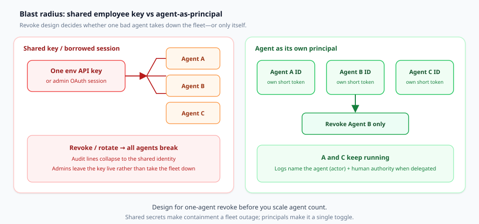
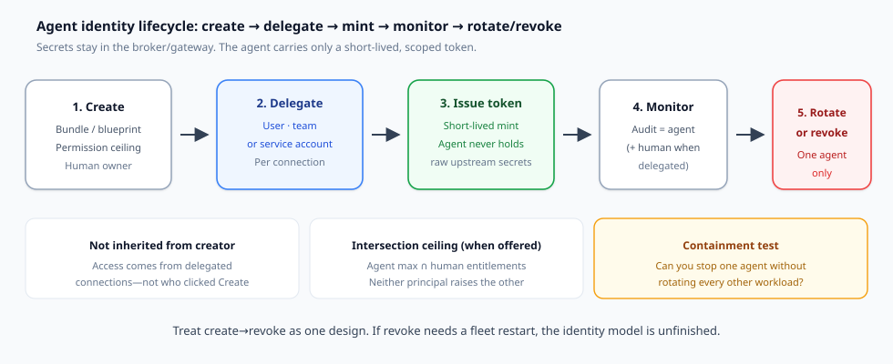

An agent misbehaves. You need it off *now*. If that agent was running on a shared env API key or a borrowed admin OAuth session, “off” means rotating a secret every other agent still needs—or restarting a fleet you cannot afford to restart. Admins learn that lesson once and then leave the shared credential live.

That is the revocation problem. It shows up wherever coding agents, SaaS copilots, and MCP-connected workers share credentials with humans or with each other. Practitioners already ask the IAM question in plain language: can you revoke **one** agent, and can you reconstruct what **that** agent did afterward? (See a typical framing in [r/AI_Agents](https://www.reddit.com/r/AI_Agents/comments/1ut2ulw/how_are_teams_actually_revoking_an_ai_agents/).)

This article is a decision document for security and platform engineers. It argues for one design choice before you scale agent count: give every agent its **own principal**—not a copy of an employee’s key.

## What you are actually deciding

Write the decision as one sentence before you ship another agent into production:

> Will this agent authenticate as its own first-class identity (with delegated, scoped authority and one-agent revoke), or will it borrow a human session / shared service key that every peer also depends on?

If the answer collapses to “just put the token in `.env`,” you are choosing all-or-nothing revocation and muddy audit lines—whether or not you call it temporary.

## Shared keys explode blast radius

Shared credentials fail in two places at once.

**Containment.** Revoking the secret stops every agent that held it. Teams therefore avoid revocation. Standing access becomes the quiet default. Okta’s Agent Gateway write-up names the same pattern for MCP gateways that hang a single shared credential behind many agents: revoke breaks everyone, so nobody revokes ([Okta Agent Gateway runtime security](https://www.okta.com/blog/product-innovation/okta-agent-gateway-runtime-security/)).

**Attribution.** When every tool call presents the same bearer identity, logs cannot name the actor. You see “the service account” or “the admin session,” not which agent branched, which human delegated, or which blueprint ceiling applied. Incident response then reconstructs intent from chat transcripts instead of from auth events.

Borrowed employee sessions add a third failure: the agent inherits the human’s full permission set. WorkOS summarized the old tradeoff cleanly—user-scoped keys give attribution but cannot cut the agent *below* the user; org-scoped keys give a tight scope but lose the person ([scoping AI agent permissions](https://workos.com/blog/scoping-ai-agent-permissions)). For a delegated agent you want both bounds at once.

*Figure 1. Left: one env key or borrowed admin session fans out to many agents—revoke/rotate is a fleet event, and audit lines collapse to the shared identity. Right: each agent is a principal with its own short-lived token—revoke stops one agent; peers keep running.*

## What “agent as principal” means

An agent principal is not a nickname in a dashboard. Operationally it means:

1. **Own identity.** The agent has an ID that is not the engineer who clicked Create and not the human who happens to be logged in.
2. **Secrets stay out of the agent.** Upstream API keys, OAuth refresh tokens, and vault material live in a broker or gateway. The agent receives a short-lived token minted for *it*.
3. **Delegated authority, not inherited creator rights.** Connections run as the triggering user, a team credential, or a provisioned service account—explicitly chosen per connection.
4. **Tool and permission scope.** The agent sees only the tools/permissions its job requires. Prefer a ceiling ∩ human entitlements model when the product offers it.
5. **Audit names the agent.** Tool calls, auth events, and credential changes attribute to the agent (actor). When delegated, the human authority travels with the call as a distinct claim—not as a free-text `user_id` parameter the caller invents.

Mintive’s product language matches that checklist almost line for line: first-class agent IDs, delegated permissions, secrets kept in the gateway, short-lived tokens, tool toggles per agent, and audit lines under the agent’s name ([Agent Identities](https://www.mintive.com/agent-identities)). Treat Mintive here as a **worked case** of the principal model—not as a soft launch post.

## The lifecycle that makes revoke real

Identity without a lifecycle is a directory row. The useful loop is create → delegate → mint → monitor → rotate or revoke.

*Figure 2. Create a bundle/blueprint with a permission ceiling and owner; delegate connections (user, team, or service); issue a short-lived token while secrets stay in the broker; monitor with agent-attributed audit; rotate or revoke **one** agent when needed.*

**Create.** Define the agent’s role: name, owner, permission ceiling, who may invoke it, token lifetimes. WorkOS calls this a *blueprint*—a reusable definition that caps what any session minted from it may do ([Agent Auth / Agent Blueprints](https://workos.com/docs/authkit/agent-blueprints)). Mintive calls the equivalent an *agent bundle* with a four-step path: create → delegate → issue token → monitor ([Agent Identities](https://www.mintive.com/agent-identities)). Okta registers agents as first-class identities in Universal Directory with human owners and lifecycle workflows ([Okta for AI Agents GA](https://www.okta.com/blog/ai/okta-for-ai-agents-general-availability/); [Govern AI Agent Identity](https://www.okta.com/products/govern-ai-agent-identity/)).

**Delegate.** Bind each connection to a source of authority. Mintive’s docs are explicit: a connection can run as the user who triggered the agent, as a team credential, or as a service account—and nothing is inherited from whoever created the agent. WorkOS splits instances into *delegated* (acting for a signed-in user; effective permissions = user ∩ blueprint ceiling) and *autonomous* (acting as itself in an org; effective permissions = ceiling). Okta’s Agent Gateway goes further at runtime: it refuses calls unless the credential names both the end user (`sub`) and the registered agent (`act`) via RFC 8693-style delegation ([Agent Gateway](https://www.okta.com/blog/product-innovation/okta-agent-gateway-runtime-security/)).

**Mint.** Hand the agent a short-lived access token. Mintive: the agent authenticates with short-lived tokens; raw credentials never reach it. WorkOS: minting is a server-side call with your API key; the agent never holds that key—only the scoped JWT, which carries `sub_profile: "ai_agent"`, optional `act` for the delegating user, and already-intersected `permissions`. Okta: replace standing secrets with ephemeral, vaulted credentials issued for what the agent needs, for as long as it needs it.

**Monitor.** Every useful identity system puts the agent’s name on the log line. Mintive attributes tool calls, auth events, and credential changes to the agent. Okta streams tool calls, access attempts, and authorization decisions for SIEM and certification campaigns. WorkOS emits blueprint/instance/session lifecycle events over webhooks and the Events API, and JWT claims keep actor and authority distinct in your own API logs.

**Rotate or revoke one.** This is the containment test. Mintive: revoke the agent’s token—that agent stops and nothing else does; or toggle one tool off without redeploying. WorkOS: revoke a session and invalidate its refresh token, every access token under it, and chained descendants. Okta: deactivation / kill-switch language across Govern AI Agent Identity and Agent Gateway—containment that does not require waiting for every connected app to revoke independently (Gateway kill switch described as forthcoming in the October 2026 runtime post; treat roadmap items as non-commitments).

If your current stack fails that last step, you do not yet have agent identity—you have shared secrets with better branding.

## Comparison: Mintive vs Okta vs WorkOS Agent Auth

These three products sit on the same principal idea and serve different buyers. Use the table to pick a fit—not to declare a universal winner.

| Dimension | **Mintive** (Agent Identity + adjacent gateways) | **Okta** (Govern AI Agent Identity / Okta for AI Agents + Agent Gateway) | **WorkOS Agent Auth** (AuthKit Agent Blueprints) |
| --- | --- | --- | --- |
| **Who it’s for** | Teams deploying many MCP-speaking agents (managed frameworks or custom) that need identity, tool governance, and monitoring in one agent-side control plane | Enterprise workforce: discover/register agents across browsers, endpoints, SaaS; govern with existing Okta IAM / Universal Directory | First-party agents **you build inside your own app** on AuthKit—not third-party agents connecting from outside |
| **Principal model** | First-class agent ID in the gateway; own tools, status, and name on every log line | Agents as first-class identities in Universal Directory; cryptographic credentials; human owners | Blueprint → instance → session; agent access token JWT with `sub` = agent instance, `sub_profile: ai_agent` |
| **Delegation** | Per connection: triggering user, team credential, or service account; not inherited from creator | Runtime credential must name user (`sub`) + agent (`act`); effective access ≈ gateway allows ∩ user can already do; HITL for high-risk actions | Delegated = user ∩ blueprint ceiling; autonomous = ceiling only; `invocable_by` gates who may mint |
| **Where secrets live** | In the gateway; agent gets a client secret once at creation to mint short-lived tokens | Vaulted / issued on demand; Agent Gateway brokers credentials at tool-call time | WorkOS API key stays on your backend; agent holds only minted short-lived tokens + single-use refresh |
| **Revoke granularity** | Revoke one agent token; optional per-tool toggle without redeploy | Agent deactivation / kill switch; certification campaigns; Gateway path rejects deactivated agents when available | Revoke session (cascades to tokens + chained sessions); user session end refuses further delegated refreshes |
| **MCP / runtime path** | MCP Gateway as adjacent product (approved servers, role bundles, tool switches); Agent Identity is the principal layer | Agent Gateway: identity-native MCP/runtime enforcement; MCP servers as governed resources | Scopes permissions in *your* app’s AuthKit permission model; resource-level bounds still checked at your tool boundary |
| **Notable limits** | Full stack (identity + MCP/LLM gateways + monitor) is a platform choice; evaluate lock-in and residency needs for your org | Heaviest enterprise surface; some Gateway features called out as coming soon—verify GA status for your tenant | Early access / enablement may be required; first-party only; permission slugs ≠ tenant/record scope |

Sources for the rows above: [Mintive Agent Identities](https://www.mintive.com/agent-identities), [Mintive launch product surface](https://www.mintive.com/blog/mintive-launch) (identity, MCP gateway, monitor—ignore fundraising framing), [Okta Govern AI Agent Identity](https://www.okta.com/products/govern-ai-agent-identity/), [Okta for AI Agents GA](https://www.okta.com/blog/ai/okta-for-ai-agents-general-availability/), [Okta Agent Gateway](https://www.okta.com/blog/product-innovation/okta-agent-gateway-runtime-security/), [WorkOS Agent Blueprints](https://workos.com/docs/authkit/agent-blueprints), [WorkOS scoping post](https://workos.com/blog/scoping-ai-agent-permissions).

**Selection shortcuts**

- Building agents **inside** a SaaS product you already run on WorkOS/AuthKit → start with Agent Auth blueprints and intersection ceilings.
- Need **workforce** discovery, shadow-AI OAuth detection, certifications, and a kill switch next to human IAM → Okta for AI Agents is the natural control plane.
- Need an **agent-side** identity + MCP tool door for mixed frameworks (Claude / ChatGPT workspace agents / custom MCP clients) with per-agent bundles → Mintive’s identity model is the case study shape; evaluate the adjacent gateways only if you want that whole path.

Do not pick from a funding headline. Pick from revoke granularity, where secrets live, and whether your agents are first-party app workers or enterprise workforce agents.

## Boundary: agent identity ≠ MCP gateway selection

An **MCP gateway** is a tool door: which servers are approved, which tools are exposed, how calls are routed and logged at the protocol edge. An **agent identity** answers a different question: *who* is calling, on whose authority, and how you revoke that caller.

You need both eventually. You should not confuse buying one for finishing the other.

- Gateways without verified user+agent credentials still route calls; Okta’s critique of “platform API key + `user_id` in the JSON body” is exactly that failure mode—anyone holding the key can claim any user ([Agent Gateway](https://www.okta.com/blog/product-innovation/okta-agent-gateway-runtime-security/)).
- Identity without a runtime enforcement point still leaves standing tool credentials in agent memory or env files.
- Mintive ships both layers as adjacent products (Agent Identity and MCP Gateway). Okta separates Govern / Okta for AI Agents (principal + lifecycle) from Agent Gateway (runtime door). WorkOS Agent Auth scopes first-party app permissions; your MCP or tool servers remain your resource boundary.

Gateway shopping—feature matrices, protocol quirks, multi-tenant routing—is a **separate article axis**. This piece stops at the boundary: pick a principal design first, then hang the tool door on credentials that already name the agent.

## Practical checklist for coding and SaaS agents

Use this before the next agent reaches production credentials.

1. **Inventory credentials.** List every env var, CI secret, and “personal access token” an agent process can read. Mark each shared vs per-agent.
2. **Name the principal.** Every production agent gets an ID, an owner, and a written job (the ceiling should read like a tool list, not a job title—WorkOS’s advice).
3. **Move secrets out of the agent.** Prefer broker/gateway vaulting. If you must mint locally, mint short TTLs (minutes, not days) and rotate refresh tokens as single-use.
4. **Delegate explicitly.** For user-triggered work, require a real user token at mint time—not a free-text user field. Prefer intersection ceilings so neither the human nor the agent raises the other.
5. **Prove one-agent revoke.** In staging, revoke agent B while A and C keep calling tools. If A/C die, you still have a shared secret.
6. **Prove attribution.** Trigger one tool call; confirm the audit or JWT shows agent actor and, when delegated, human authority as separate fields.
7. **Separate creator from runtime authority.** Disabling the engineer who created the agent must not be your only kill switch—and must not silently orphan (or mass-disable) unrelated agents without a transfer path.
8. **Keep MCP tool policy in the door, identity in the principal.** Do not paper over missing agent IDs by adding more prompt text (“never call payroll”). Prompt text is not revocation.
9. **Certify on a calendar.** Stale agent permissions rot like stale human roles. Use access reviews or a quarterly blueprint audit.
10. **Write the exception.** Any shared key that remains needs an owner, an expiry, and a compensating control (usually network isolation + mandatory per-call human approval).

## Closing: choose the principal before you scale the count

Agent count is about to outrun human headcount in many orgs. Shared employee keys and borrowed admin sessions scale the wrong way: every new agent widens a blast radius you are afraid to shrink.

Give each agent its own principal. Keep secrets in a broker. Delegate authority per connection. Mint short-lived tokens. Put the agent’s name on the audit line. Practice revoking one agent until it is boring.

Mintive, Okta’s agent identity stack, and WorkOS Agent Auth are three concrete ways to buy or build that shape for different buyers. The product names will change. The containment test will not: **can you stop one agent without rotating everyone else—and still know which actor did what?**

If you cannot answer yes, fix identity before you add the next agent.

## Sources (primary)

- Mintive — [Agent Identities](https://www.mintive.com/agent-identities); product surface (identity, MCP gateway, monitor) on [launch post](https://www.mintive.com/blog/mintive-launch)
- Okta — [Govern AI Agent Identity](https://www.okta.com/products/govern-ai-agent-identity/); [Okta for AI Agents GA](https://www.okta.com/blog/ai/okta-for-ai-agents-general-availability/); [Agent Gateway runtime security](https://www.okta.com/blog/product-innovation/okta-agent-gateway-runtime-security/)
- WorkOS — [AuthKit Agent Blueprints / Agent Auth](https://workos.com/docs/authkit/agent-blueprints); [Scoping AI agent permissions](https://workos.com/blog/scoping-ai-agent-permissions)
- Pain-point hook (revocation discussion, not proof) — [r/AI_Agents thread](https://www.reddit.com/r/AI_Agents/comments/1ut2ulw/how_are_teams_actually_revoking_an_ai_agents/)
