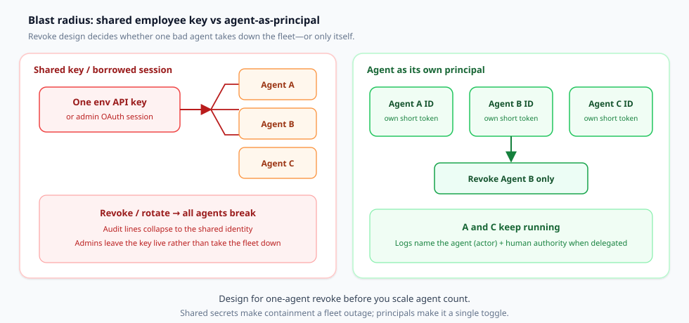
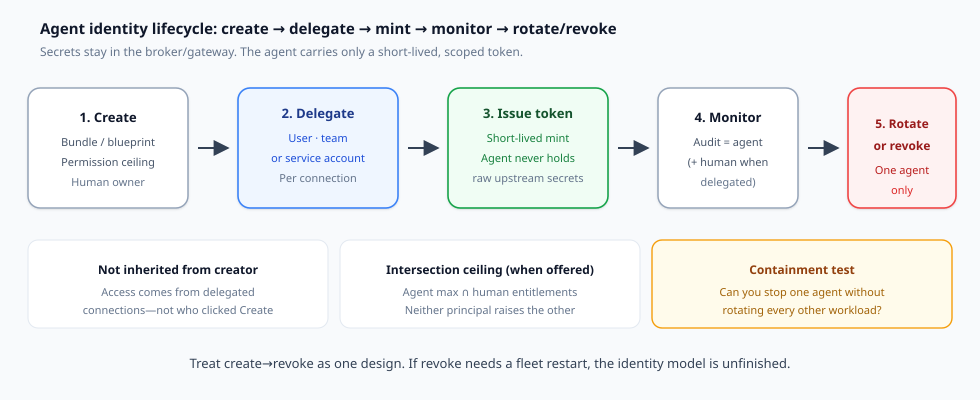

某个 agent 行为失常。你需要*立刻*把它停掉。如果这个 agent 跑在一把共享的环境 API 密钥上，或跑在借用的管理员 OAuth 会话上，所谓“停掉”就意味着轮换一把其他每一个 agent 仍然需要的密钥，或者重启一支你负担不起重启的集群。管理员把这个教训吃过一次之后，就会让共享凭证继续保持有效。

这就是吊销问题。只要编程 agent、SaaS Copilot，以及接入 MCP 的工作者与人类或彼此共享凭证，它就会出现。实践者已经在用直白的话提出这个 IAM 问题：你能不能吊销**一个** agent，又能不能在事后还原**那个** agent 做了什么？（一种典型问法见 [r/AI_Agents](https://www.reddit.com/r/AI_Agents/comments/1ut2ulw/how_are_teams_actually_revoking_an_ai_agents/)。）

本文是写给安全工程师与平台工程师的一份决策文档。它主张在扩大 agent 数量之前，先做一个设计选择：给每个 agent **它自己的主体**，而不是员工密钥的一份副本。

## 你真正在决定的是什么

在把下一个 agent 送进生产之前，先把这个决定写成一句话：

> 这个 agent 会作为它自己的一等身份进行认证（具备委托而来、范围受限的权限，以及单 agent 吊销），还是借用人类会话或共享服务密钥，而每一个同伴也都依赖这同一份凭证？

如果答案退化成“把令牌放进 `.env` 就行”，你选择的就是全有或全无的吊销，以及含混的审计行——无论你是否称之为临时方案。

## 共享密钥会放大爆炸半径

共享凭证会同时在两处失败。

**遏制。** 吊销这把密钥，会停掉每一个持有它的 agent。团队因此回避吊销。常设访问变成悄无声息的默认状态。Okta 关于 Agent Gateway 的文章为同一模式点了名：把一把共享凭证挂在许多 agent 后面的 MCP gateway，吊销会弄坏所有人，于是没有人吊销（[Okta Agent Gateway 运行时安全](https://www.okta.com/blog/product-innovation/okta-agent-gateway-runtime-security/)）。

**归因。** 当每一次工具调用都出示同一个 bearer 身份时，日志无法点出行动者。你看到的是“服务账号”或“管理员会话”，而不是哪个 agent 分支出去、哪个人类做了委托，或哪一个 blueprint 上限生效。事件响应于是从聊天记录里还原意图，而不是从认证事件里还原。

借用员工会话还会带来第三种失败：agent 继承该人类的全部权限集。WorkOS 把旧的取舍概括得很清楚——用户范围的密钥能够归因，但无法把 agent 的权限砍到该用户*之下*；组织范围的密钥能给出很紧的范围，却丢掉了那个人（[限定 AI agent 权限范围](https://workos.com/blog/scoping-ai-agent-permissions)）。对于受委托的 agent，你希望这两条边界同时成立。

*图 1. 左：一把环境密钥或借用的管理员会话扇出到许多 agent——吊销/轮换是一次集群事件，审计行塌缩成那个共享身份。右：每个 agent 都是一个主体，持有自己的短时令牌——吊销只停掉一个 agent；同伴继续运行。*

## “agent 作为主体”意味着什么

agent 主体不是仪表盘上的一个昵称。在操作上，它意味着：

1. **自有身份。** 该 agent 有一个 ID，它既不是点击 Create 的那位工程师，也不是恰好处于登录状态的那个人类。
2. **密钥留在 agent 之外。** 上游 API 密钥、OAuth 刷新令牌，以及保险库中的材料，都放在 broker 或 gateway 里。agent 收到的是为*它*签发的短时令牌。
3. **委托而来的权限，而不是继承的创建者权利。** 连接以触发用户、团队凭证或已预配的服务账号身份运行——按每个连接显式选定。
4. **工具与权限范围。** agent 只能看到其工作所需的工具与权限。当产品提供这种模型时，优先采用上限 ∩ 人类授权。
5. **审计点出 agent 的名字。** 工具调用、认证事件和凭证变更都归因到该 agent（行动者）。在委托场景下，人类权限作为一条独立的 claim 随这次调用一起传递——而不是调用方自行编造的自由文本 `user_id` 参数。

Mintive 的产品用语几乎与这份清单逐行对应：一等 agent ID、委托权限、密钥保存在 gateway 中、短时令牌、按 agent 开关工具，以及署在该 agent 名下的审计行（[Agent Identities](https://www.mintive.com/agent-identities)）。在这里把 Mintive 当作主体模型的一个**已完成的案例**，而不是一篇软启动发布文。

## 让吊销真正成立的生命周期

没有生命周期的身份，只是目录里的一行。有用的循环是：创建 → 委托 → 签发 → 监控 → 轮换或吊销。

*图 2. 创建一个带有权限上限和所有者的 bundle/blueprint；委托连接（用户、团队或服务）；在密钥留在 broker 中的同时签发短时令牌；用以 agent 为归因的审计进行监控；需要时轮换或吊销**一个** agent。*

**创建。** 定义该 agent 的角色：名称、所有者、权限上限、谁可以调用它、令牌有效期。WorkOS 称之为 *blueprint*——一份可复用的定义，用来封顶从它签发的任何会话可以做什么（[Agent Auth / Agent Blueprints](https://workos.com/docs/authkit/agent-blueprints)）。Mintive 把对应物称为 *agent bundle*，路径分四步：创建 → 委托 → 签发令牌 → 监控（[Agent Identities](https://www.mintive.com/agent-identities)）。Okta 把 agent 注册为 Universal Directory 中的一等身份，并配上人类所有者和生命周期工作流（[Okta for AI Agents GA](https://www.okta.com/blog/ai/okta-for-ai-agents-general-availability/)；[Govern AI Agent Identity](https://www.okta.com/products/govern-ai-agent-identity/)）。

**委托。** 把每个连接绑定到一个权限来源。Mintive 的文档写得很明确：连接可以以触发该 agent 的用户、团队凭证或服务账号身份运行——并且不会从创建该 agent 的任何人那里继承任何东西。WorkOS 把实例分成 *delegated*（代表已登录用户行事；有效权限 = 用户 ∩ blueprint 上限）和 *autonomous*（在组织中以自身身份行事；有效权限 = 上限）。Okta 的 Agent Gateway 在运行时更进一步：除非凭证经由 RFC 8693 风格的委托同时点名终端用户（`sub`）和已注册的 agent（`act`），否则拒绝调用（[Agent Gateway](https://www.okta.com/blog/product-innovation/okta-agent-gateway-runtime-security/)）。

**签发。** 交给 agent 一枚短时访问令牌。Mintive：agent 用短时令牌进行认证；原始凭证永远到不了它手里。WorkOS：签发是一次使用你的 API 密钥发起的服务端调用；agent 从不持有那把密钥——只持有范围受限的 JWT，其中携带 `sub_profile: "ai_agent"`、可选的表示委托用户的 `act`，以及已经取过交集的 `permissions`。Okta：用临时的、存入保险库的凭证替换常设密钥；这些凭证按该 agent 的需要签发，并且只在它需要的时长内有效。

**监控。** 每一个有用的身份系统都会把 agent 的名字写在日志行上。Mintive 把工具调用、认证事件和凭证变更归因到该 agent。Okta 将工具调用、访问尝试和授权决策流出，供 SIEM 和认证活动使用。WorkOS 通过 webhook 和 Events API 发出 blueprint、实例与会话的生命周期事件，并且 JWT 的 claim 在你自己的 API 日志里把行动者与权限来源保持为彼此区分的内容。

**轮换，或吊销一个。** 这就是遏制测试。Mintive：吊销该 agent 的令牌——那个 agent 停下，其他一概不停；或者关掉某一个工具，而无需重新部署。WorkOS：吊销一个会话，并使其刷新令牌、该会话下的每一个访问令牌，以及链式后代全部失效。Okta：在 Govern AI Agent Identity 与 Agent Gateway 中使用停用 / 终止开关这样的表述——这种遏制不需要等待每一个已连接应用各自独立完成吊销（Gateway 终止开关在 2026 年 10 月的运行时文章中被描述为即将推出；路线图事项应视为非承诺）。

如果你当前的技术栈通不过最后这一步，你还没有 agent 身份——你拥有的是品牌包装得更好的共享密钥。

## 对比：Mintive、Okta 与 WorkOS Agent Auth

这三款产品立于同一个主体想法之上，服务的买家各不相同。用这张表来挑选契合的一项，而不是宣布一个普遍适用的赢家。

| 维度 | **Mintive**（Agent Identity + 相邻 gateway） | **Okta**（Govern AI Agent Identity / Okta for AI Agents + Agent Gateway） | **WorkOS Agent Auth**（AuthKit Agent Blueprints） |
| --- | --- | --- | --- |
| **面向谁** | 部署大量以 MCP 通信的 agent（托管框架或自研）的团队；这些 agent 需要在同一个面向 agent 一侧的控制平面中获得身份、工具治理和监控 | 企业 workforce：跨浏览器、端点和 SaaS 发现并注册 agent；用现有的 Okta IAM / Universal Directory 进行治理 | 你在 AuthKit 上、于**自己的应用内部**构建的一方 agent——不是从外部连入的第三方 agent |
| **主体模型** | gateway 中的一等 agent ID；自有的工具、状态，以及每一行日志上的名字 | agent 作为 Universal Directory 中的一等身份；密码学凭证；人类所有者 | blueprint → 实例 → 会话；agent 访问令牌 JWT，其中 `sub` = agent 实例，`sub_profile: ai_agent` |
| **委托** | 按连接：触发用户、团队凭证或服务账号；不从创建者继承 | 运行时凭证必须点名用户（`sub`）+ agent（`act`）；有效访问 ≈ gateway 所允许的 ∩ 用户已经能做的；高风险动作采用 HITL | delegated = 用户 ∩ blueprint 上限；autonomous = 仅上限；`invocable_by` 约束谁可以签发 |
| **密钥放在哪里** | 在 gateway 中；agent 在创建时获得一次客户端密钥，用来签发短时令牌 | 存入保险库 / 按需签发；Agent Gateway 在工具调用时代理这些凭证 | WorkOS API 密钥留在你的后端；agent 只持有已签发的短时令牌 + 一次性刷新令牌 |
| **吊销粒度** | 吊销一个 agent 令牌；可选的按工具开关，无需重新部署 | agent 停用 / 终止开关；认证活动；Gateway 路径在该能力可用时拒绝已停用的 agent | 吊销会话（级联到令牌 + 链式会话）；用户会话结束会拒绝后续的委托刷新 |
| **MCP / 运行时路径** | MCP Gateway 作为相邻产品（已批准的服务器、角色 bundle、工具开关）；Agent Identity 是主体层 | Agent Gateway：以身份为原生方式的 MCP / 运行时强制；MCP 服务器作为受治理资源 | 在*你的*应用的 AuthKit 权限模型中限定权限范围；资源级边界仍在你的工具边界处检查 |
| **值得注意的限制** | 完整技术栈（身份 + MCP/LLM gateway + 监控）是一次平台选择；按你的组织评估锁定与数据驻留需求 | 企业覆盖面最重；部分 Gateway 功能被标明为即将推出——请针对你的租户核实 GA 状态 | 可能需要早期访问 / 开通；仅限一方；权限 slug ≠ 租户/记录范围 |

上表各行的来源：[Mintive Agent Identities](https://www.mintive.com/agent-identities)、[Mintive 发布时的产品表面](https://www.mintive.com/blog/mintive-launch)（身份、MCP gateway、监控——忽略融资叙事）、[Okta Govern AI Agent Identity](https://www.okta.com/products/govern-ai-agent-identity/)、[Okta for AI Agents GA](https://www.okta.com/blog/ai/okta-for-ai-agents-general-availability/)、[Okta Agent Gateway](https://www.okta.com/blog/product-innovation/okta-agent-gateway-runtime-security/)、[WorkOS Agent Blueprints](https://workos.com/docs/authkit/agent-blueprints)、[WorkOS 权限范围文章](https://workos.com/blog/scoping-ai-agent-permissions)。

**选型捷径**

- 在你已经运行于 WorkOS/AuthKit 之上的 SaaS 产品**内部**构建 agent → 从 Agent Auth 的 blueprint 与交集上限开始。
- 需要紧挨人类 IAM 的 **workforce** 发现、影子 AI 的 OAuth 检测、认证，以及终止开关 → Okta for AI Agents 是自然的控制平面。
- 需要面向混合框架（Claude / ChatGPT workspace agent / 自研 MCP 客户端）、按 agent 划分 bundle 的 **agent 侧**身份 + MCP 工具门 → Mintive 的身份模型就是这一案例研究的形态；只有当你想要整条路径时，才去评估相邻的 gateway。

不要根据融资标题来挑选。依据吊销粒度、密钥放在哪里，以及你的 agent 是一方应用中的工作者还是企业 workforce agent 来挑选。

## 边界：agent 身份 ≠ MCP gateway 选型

**MCP gateway** 是一扇工具门：哪些服务器已获批准、哪些工具被暴露、调用在协议边缘如何被路由和记录。**agent 身份**回答的是另一个问题：*谁*在调用、凭谁的权限，以及你如何吊销那个调用者。

你最终两者都需要。不应当把买下其中一个，误认为已经做完了另一个。

- 没有经过核验的用户+agent 凭证，gateway 仍然会路由调用；Okta 对“平台 API 密钥 + JSON 正文中的 `user_id`”的批评，正是这种失败模式——任何持有该密钥的人都可以声称自己是任意用户（[Agent Gateway](https://www.okta.com/blog/product-innovation/okta-agent-gateway-runtime-security/)）。
- 没有运行时强制点的身份，仍然会把常设的工具凭证留在 agent 内存或环境文件里。
- Mintive 把两层作为相邻产品一起交付（Agent Identity 与 MCP Gateway）。Okta 把 Govern / Okta for AI Agents（主体 + 生命周期）与 Agent Gateway（运行时的门）分开。WorkOS Agent Auth 限定一方应用的权限范围；你的 MCP 或工具服务器仍然是你的资源边界。

选购 gateway——功能矩阵、协议怪癖、多租户路由——是**另一条文章轴线**。本文停在这条边界上：先选定主体设计，再把工具门挂到已经点名该 agent 的凭证上。

## 面向编程 agent 与 SaaS agent 的实用清单

在下一个 agent 接触到生产凭证之前，使用这份清单。

1. **盘点凭证。** 列出 agent 进程能够读取的每一个环境变量、CI 密钥，以及“个人访问令牌”。把每一项标为共享或按 agent 划分。
2. **给主体命名。** 每一个生产 agent 都得到一个 ID、一位所有者，以及一份写下来的工作说明（上限读起来应该像一份工具清单，而不是一个职位名称——这是 WorkOS 的建议）。
3. **把密钥移出 agent。** 优先采用 broker/gateway 的保险库保管。如果必须在本地签发，就签发很短的 TTL（以分钟计，而不是以天计），并把刷新令牌按一次性方式轮换。
4. **显式委托。** 对于由用户触发的工作，在签发时要求一枚真实的用户令牌——而不是一个自由文本的用户字段。优先采用交集上限，使人类和 agent 都不能抬高对方。
5. **证明单 agent 吊销。** 在预发环境中吊销 agent B，同时让 A 和 C 继续调用工具。如果 A/C 也停掉，你手里的仍是一把共享密钥。
6. **证明归因。** 触发一次工具调用；确认审计记录或 JWT 显示出 agent 行动者，并且在委托场景下把人类权限显示为彼此分开的字段。
7. **把创建者与运行时权限分开。** 停用创建该 agent 的工程师，绝不能是你唯一的终止开关——而且在没有转移路径时，绝不能静默地使无关 agent 变成无主（或被批量停用）。
8. **把 MCP 工具策略放在门上，把身份放在主体上。** 不要靠增加提示词文本（“永远不要调用薪资”）来掩盖缺失的 agent ID。提示词文本不是吊销。
9. **按日历做认证。** 陈旧的 agent 权限会像陈旧的人类角色一样腐坏。使用访问评审，或每季度做一次 blueprint 审计。
10. **把例外写下来。** 任何仍然保留的共享密钥都需要一位所有者、一个到期时间，以及一项补偿控制（通常是网络隔离 + 每次调用强制的人类批准）。

## 收束：先选定主体，再扩大数量

在许多组织里，agent 数量即将超过人类人数。共享员工密钥和借用的管理员会话是在朝错误的方向扩展：每新增一个 agent，都会加宽一个你不敢缩小的爆炸半径。

给每个 agent 它自己的主体。把密钥留在 broker 里。按连接委托权限。签发短时令牌。把该 agent 的名字写在审计行上。练习吊销一个 agent，直到这件事变得乏味。

Mintive、Okta 的 agent 身份技术栈，以及 WorkOS Agent Auth，是面向不同买家购买或构建这一形态的三种具体方式。产品名称会变。遏制测试不会变：**你能不能停掉一个 agent，而不必轮换其他所有人——并且仍然知道是哪个行动者做了什么？**

如果你无法回答“能”，就在添加下一个 agent 之前先修好身份。

## 来源（主要）

- Mintive — [Agent Identities](https://www.mintive.com/agent-identities)；产品表面（身份、MCP gateway、监控）见[发布文](https://www.mintive.com/blog/mintive-launch)
- Okta — [Govern AI Agent Identity](https://www.okta.com/products/govern-ai-agent-identity/)；[Okta for AI Agents GA](https://www.okta.com/blog/ai/okta-for-ai-agents-general-availability/)；[Agent Gateway 运行时安全](https://www.okta.com/blog/product-innovation/okta-agent-gateway-runtime-security/)
- WorkOS — [AuthKit Agent Blueprints / Agent Auth](https://workos.com/docs/authkit/agent-blueprints)；[限定 AI agent 权限范围](https://workos.com/blog/scoping-ai-agent-permissions)
- 痛点钩子（吊销方面的讨论，并非证据）— [r/AI_Agents 帖子](https://www.reddit.com/r/AI_Agents/comments/1ut2ulw/how_are_teams_actually_revoking_an_ai_agents/)
