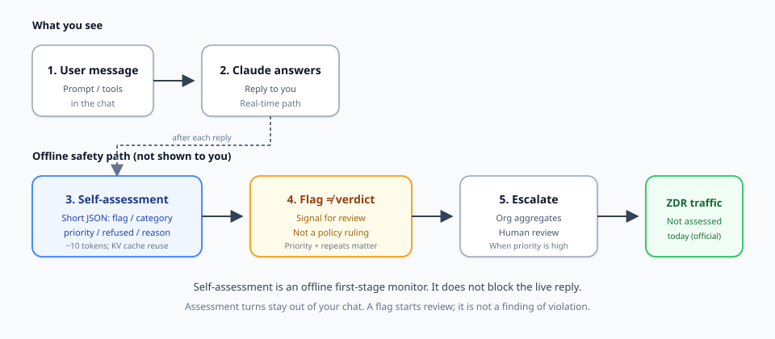
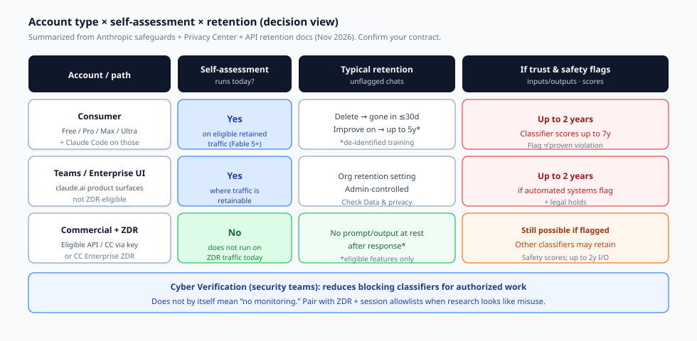

Viral posts call Claude a “digital snitch.” The phrase is sticky. It is also a bad decision tool.

Anthropic’s [self-assessment paper](https://safeguards.anthropic.com/2026/self-assessment/) describes an offline misuse monitor that runs after Claude replies, on traffic the company can already retain. It does not block the live answer. A flag is a review signal, not a finding that you violated policy. Zero-data-retention (ZDR) traffic is out of scope today. Those four facts change what you should do next—and the right next step depends on **which account path you use**.

This guide is for people who need a retention and monitoring decision, not a news recap. It maps consumer plans, Teams/Enterprise product surfaces, commercial API with ZDR, and security research under Cyber Verification. It also separates Claude Code’s optional operational telemetry from server-side self-assessment—two systems that viral threads often mash into one scare story.

## What you are actually deciding

Before you change plans or file a sales ticket, write down the decision in one sentence:

> Given my account type, does self-assessment run on my traffic, how long can unflagged and flagged content stay, and what do I do if legitimate security work looks like misuse?

Everything below answers that sentence. If your goal is only “understand the drama,” other write-ups already cover the launch narrative. This one is for operators, security leads, and privacy-conscious builders who need a clear matrix.

## How self-assessment works (mechanics, not mythology)

*Figure 1. Visible path vs offline safety path. Self-assessment is not shown in chat and does not block the live reply. ZDR traffic is not assessed today.*

After Claude finishes a response, the system appends a short instruction that asks for a safety reflection. Claude returns a compact structured assessment. Anthropic’s illustrative schema is simple: when nothing is wrong, `{"flagged": false}`. When something might be harmful, the assessment can include `flagged`, a short free-text `reason`, `category`, `subpolicy`, whether Claude `refused`, and a `priority` from 1–10.

Important properties from the [official safeguards write-up](https://safeguards.anthropic.com/2026/self-assessment/) (October 16, 2026):

1. **Offline, not live-blocking.** In production, self-assessment flags for review. Separate classifiers and safeguards handle real-time blocking. Their red-team experiment treating self-assessment as a blocker still left many attacks succeeding—Anthropic’s own numbers show it is a weak sole gate.
2. **Hidden from the chat.** The assessment turns are not available to the user and are not carried into the rest of the conversation.
3. **Cheap enough for wide coverage.** The conversation is already in the KV cache, so each assessment costs a short instruction plus roughly ten output tokens. Anthropic estimates under 2% added inference compute and does not bill that cost to customers.
4. **Coverage since Fable 5.** Self-assessment ships in Claude models released since Fable 5 and has run passively on a large share of global traffic since June 2026.
5. **Detection numbers are relative to a stronger teacher.** On Fable 5, at a 1% false-positive rate, it recalls 78% of conversations a prompted teacher classifier flags as potentially harmful, and 94% of high-priority ones (priority 7+). Those figures measure agreement with another model judge, not “78% of all human-defined crimes.”
6. **Flag ≠ violation.** Footnote 1 is unambiguous: an assessment is a signal for further review. It is not a determination that a user violated policy or that harm occurred. Enforcement uses priority scores and repeated high-priority flags, because a 1% false-positive rate still produces many benign flags.

Data handling matches that design. Self-assessment **collects no additional user data**. It reads the conversation already processed for the reply and runs only on traffic retainable under existing policies. The free-text `reason` can paraphrase user content, so it gets the same governance as prompts and completions. Structured fields (flag, category, subpolicy, priority, score) cannot carry user text and are treated like other classifier scores.

**Viral correction #1:** this is not a real-time tip line that interrupts your answer with a police call. Other systems may block or interrupt; self-assessment’s production role is offline monitoring and triage.

**Viral correction #2:** a flag is not a conviction. Treat social posts that collapse “flagged” into “banned for thoughtcrime” as noise unless they show an actual enforcement outcome.

## The matrix you need: account type × assessment × retention

*Figure 2. Decision matrix. Confirm your contract and Console privacy settings; Covered Models and feature eligibility can change the ZDR row.*

### Consumer (Free, Pro, Max, Ultra—and Claude Code on those plans)

**Does self-assessment run?** Expect yes on eligible retained consumer traffic for Fable 5 and later models. Consumer products are not ZDR-eligible, so the “ZDR traffic is not assessed” carve-out does not help you here.

**Unflagged retention (Privacy Center, consumer article, July 1, 2026):**

- You can delete a chat anytime. It leaves your history immediately and is deleted from Anthropic’s back-end storage within **30 days**.
- If you allow model improvement, Anthropic may retain de-identified chats or coding sessions for up to **5 years** in training pipelines. That clock applies to new or resumed chats after the setting is on. Turning the setting off stops future training use; in-flight runs and already-trained models are unaffected. Incognito chats are not used to improve Claude even when model improvement is on.
- Feedback you submit can be kept for **5 years**.

**If automated trust and safety systems flag a chat or session:** Anthropic may retain inputs and outputs for up to **2 years**, and trust and safety classification scores for up to **7 years**. Legal holds and dispute resolution can extend retention further. Source: [How long do you store my data?](https://privacy.claude.com/en/articles/10023548-how-long-do-you-store-my-data).

**Decision actions for consumers**

1. Turn **model improvement** off if you do not want long training retention—then rely on normal delete + 30-day backend deletion for unflagged chats.
2. Prefer **Incognito** for sensitive exploratory prompts that should stay out of training even if improvement is otherwise on.
3. Assume that **policy-adjacent work** (malware analysis samples, exploit walkthroughs, bio-adjacent research) can raise classifier attention. That is separate from “Anthropic is listening to your diary.”
4. Do not treat a refused answer as proof you were self-assessed into a permanent file. Refusal is a live safety behavior; retention extensions need a trust-and-safety flag path under the published policy.

### Teams / Enterprise product interfaces (claude.ai surfaces)

**Does self-assessment run?** Where traffic is retainable under commercial product policies, treat self-assessment as in play for Fable 5+ the same way Anthropic describes wide production coverage. These product interfaces are **not ZDR-eligible** under the Claude API ZDR arrangement (see [API and data retention](https://platform.claude.com/docs/en/manage-claude/api-and-data-retention)).

**Retention.** Organization admins set conversation retention in product privacy controls. Local Claude Code / Cowork session transcripts follow organization settings (docs also describe long default transcript retention unless a finite org period is set). Self-assessment still only runs on traffic that existing policies allow Anthropic to retain.

**Decision actions for Teams/Enterprise admins**

1. Set an explicit org retention period. Do not leave “we assumed ZDR” if you only bought seats on the product UI.
2. Separate **high-sensitivity workloads** onto a commercial API organization with a real ZDR arrangement (next section) if zero prompt retention at rest is a hard requirement.
3. Train staff that **flagged-content exceptions** still exist: even strong commercial arrangements can retain flagged inputs/outputs for up to 2 years.

### Commercial API / Claude Code with commercial API keys / Claude Code Enterprise ZDR

This is the row that viral posts usually skip.

**Does self-assessment run on ZDR traffic today?** Official answer: **no.** Footnote 8 of the self-assessment paper: *“Self-assessment does not run on traffic covered by zero-data-retention agreements today.”*

That is the sharpest privacy control in this whole story—and it is contract-gated, not a toggle in consumer settings.

**What ZDR covers (high level):** Under an approved arrangement, Anthropic does not store customer prompts or responses at rest after the API response returns, for eligible features. Per the [Privacy Center ZDR product article](https://privacy.claude.com/en/articles/8956058-i-have-a-zero-data-retention-agreement-with-anthropic-what-products-does-it-apply-to), ZDR applies to eligible Anthropic APIs, Anthropic products that use your Commercial organization API key (including Claude Code accessed via the API), and Claude Code for Enterprise plans (a separate enablement). Claude Platform users can confirm ZDR under Settings → Privacy Controls → Data retention period.

**What ZDR does not cover:** Consumer Free/Pro/Max/Ultra (including Claude Code on those plans), Claude Console playground usage, Claude Managed Agents session transcripts, Teams/Enterprise product interfaces (except the separate Claude Code Enterprise ZDR offering), many stateful features (Batches, Files, code execution containers, MCP connector, and others marked “No” in the eligibility table), and third-party integrations. Covered Models such as Fable 5 / Mythos 5 (and 5.1 variants) generally require **30-day retention** and are not available under ZDR unless Anthropic expressly authorizes otherwise—workspaces can sometimes enable 30-day retention to unlock those models while other workspaces stay ZDR.

**Even with ZDR:** Anthropic still retains User Safety classifier results to enforce the Usage Policy. Flagged content and legal holds can retain inputs and outputs for up to **2 years**, regardless of arrangement. Metrics logging in Claude Code, if enabled, is exempted from ZDR and may retain productivity statistics.

**Decision actions for commercial buyers**

1. If “no self-assessment on my prompts” is a hard requirement, you need a **qualified ZDR organization**, not a consumer Max plan and a hope.
2. Audit feature eligibility. Using Batches, Files, or code execution means that slice of data leaves the zero-retention path under documented feature policies.
3. Keep Covered Models and ZDR in the same planning conversation. Want Mythos-class models without 30-day retention? You need explicit Anthropic authorization or a different model choice.
4. Confirm enablement per organization. ZDR does not automatically spread to every org under the same account.

## Security research false positives and Cyber Verification

Legitimate vulnerability research, malware analysis, and authorized red-teaming look like misuse to classifiers that only see text. That is not a conspiracy; it is a context problem Anthropic itself documents.

### Two different mitigations (do not confuse them)

**1. Cyber Verification Program (CVP).** Anthropic’s [Cyber Verification Program](https://support.claude.com/en/articles/14604842-cyber-verification-program) gives qualifying security professionals access to advanced models with **reduced blocking classifiers**. Defense Access covers defensive work, malware analysis, and vulnerability validation. Red Team Access covers authorized offensive testing for qualifying orgs. Apply once per organization; admins assign seats. Individuals currently get Defense Access only. Security requirements are strict (phishing-resistant MFA, org-domain accounts, short-lived credentials, managed devices, egress allow-lists for agentic/offensive work, and more).

CVP is about **interruption and capability access** for authorized security work. It is not a magic “delete all monitoring” switch.

**2. Session-policy allowlists inside self-assessment.** The safeguards paper shows a deployment-time `<session_policy>` block that can name an authorized target (example: vulnerability research on OpenLDAP). In their test set, Fable 5 flagged 100% of non-allowlisted targets and 0% of allowlisted ones across a wide threshold range. That is a research/production adaptation for **assessment**, not the same product as CVP enrollment.

### Practical playbook for security teams

1. **If live classifiers keep blocking your work:** apply to CVP at the right tier. Do not try to “jailbreak around” the block and then act surprised when offline monitors notice.
2. **If you need minimum prompt retention:** put research on a commercial org with ZDR (and accept Covered Model limits). Remember self-assessment is off for ZDR traffic today, but other classifiers and flagged-content retention still exist.
3. **Scope the authorized target in prompts and tickets.** Ambiguous “scan everything on the internet” language is how false positives become true enforcement reviews.
4. **Separate personal consumer accounts from corporate research.** Mixing bug-bounty notes into a Free/Pro chat with model improvement on is the worst of both worlds: training retention risk plus no ZDR.

## Claude Code telemetry ≠ server-side self-assessment

This mix-up fuels a lot of “snitch” threads. Keep the streams straight.

| System | Where it runs | What it sees | Your control |
| --- | --- | --- | --- |
| **Self-assessment** | Anthropic inference path (server-side), on retainable traffic | Conversation Claude just answered; emits hidden JSON assessment | Account/arrangement (ZDR excludes it today); not a Claude Code CLI flag |
| **Claude Code operational telemetry** | Client → Anthropic / infra | Latency, reliability, usage patterns; docs say metrics never include code, prompts, or file paths | `DISABLE_TELEMETRY=1` (and related flags); see [Claude Code data usage](https://code.claude.com/docs/en/data-usage) |
| **Claude Code OpenTelemetry** | Client → **your** collector | Metrics/events you configure; prompt content only if you enable those log flags | Opt-in; never a substitute for understanding API retention |
| **The model request itself** | Client → model provider | Prompts and outputs for inference | Choosing consumer vs commercial+ZDR; Incognito; delete; org settings |

Turning off Claude Code metrics does **not** disable self-assessment on consumer or non-ZDR commercial traffic. Enabling your own OpenTelemetry collector does **not** mean Anthropic stopped server-side safety monitoring. And ZDR on an eligible API org does **not** mean Claude Code will refuse to send optional productivity metrics unless you also manage metrics logging.

If you need a one-line mental model: **telemetry settings govern client operational data; self-assessment governs how the model grades conversations Anthropic is allowed to retain.**

## Decision tree: pick your row, then act

**A. I am a consumer who wants less long-term training retention.**  
Turn off model improvement. Delete sensitive chats. Use Incognito for throwaway probes. Accept that Usage Policy flags can still extend retention to 2 years / scores to 7 years.

**B. I am a consumer who does security or bio-adjacent research “just to learn.”**  
Expect more classifier friction. Prefer official labs, CTF sandboxes, and documented educational framing. For professional research, move to commercial + CVP rather than arguing with Free-tier refusals on Twitter.

**C. My company needs “Anthropic does not keep our prompts.”**  
Buy/enable ZDR on the correct organization. Verify Console privacy controls. Map every feature you use against the eligibility table. Plan Covered Models separately. Do not confuse product UI seats with API ZDR.

**D. My company needs authorized cyber work without constant blocks.**  
Enroll in Cyber Verification at the right tier and meet the security requirements. Pair with ZDR if retention is also a hard requirement. Document authorized targets. Treat remaining flags as review signals, not proof of malice.

**E. I only turned off Claude Code telemetry and feel “safe.”**  
You reduced operational metrics/error reporting. You did not change server-side self-assessment or API retention. Re-read the table above.

## What “good” looks like in an internal privacy note

If you need to brief counsel or a security committee, a short accurate note beats a viral screenshot:

1. Self-assessment is an **offline** monitor shipping since Fable 5; production use is review triage, not live blocking.
2. Official docs state a flag is a **review signal**, not a policy determination.
3. Self-assessment **does not run on ZDR traffic today**.
4. Consumer retention is delete→≤30 days backend; model improvement→up to 5 years de-identified; flagged→up to 2 years I/O and up to 7 years scores ([Privacy Center](https://privacy.claude.com/en/articles/10023548-how-long-do-you-store-my-data)).
5. ZDR is commercial, feature-scoped, org-scoped, and still allows classifier scores plus flagged/legal retention exceptions ([API retention docs](https://platform.claude.com/docs/en/manage-claude/api-and-data-retention); [ZDR products FAQ](https://privacy.claude.com/en/articles/8956058-i-have-a-zero-data-retention-agreement-with-anthropic-what-products-does-it-apply-to)).
6. Cyber Verification reduces **blocking** for verified security work; it is complementary to—not identical with—assessment allowlists.
7. Claude Code telemetry controls are **orthogonal** to self-assessment.

## Limits of this guide (and of the system)

Anthropic is open about limits: self-assessment inherits teacher blind spots; it is not robust against attackers who target the assessor; it is not yet a reliable monitor of Claude’s own misaligned conduct; leave-one-out generalization tests covered harms Claude already “knows,” not every future unknown. Privacy policy pages also evolve—Covered Model lists, feature eligibility, and ZDR enablement paths change. Always re-check the safeguards page, Privacy Center, and your contract before you assert a compliance claim.

## Bottom line

Stop asking “is Claude a snitch?” Ask which **account row** you sit on.

- **Consumer:** assessment can run; control training with privacy settings; flagged chats can stick around for years under published policy.
- **Teams/Enterprise UI:** still retainable product traffic; configure org retention; ZDR is not automatic.
- **Commercial ZDR:** self-assessment off today on covered traffic; confirm feature eligibility and flagged-content exceptions.
- **Security research:** use Cyber Verification for blocks; use ZDR for retention; do not confuse either with Claude Code telemetry switches.

That is the decision. Everything else is commentary.

## Sources

- Anthropic Safeguards: [Scaling Misuse Detection with Self-Assessment](https://safeguards.anthropic.com/2026/self-assessment/) (Oct 16, 2026), including Data Handling and footnote 8 on ZDR.
- Anthropic Privacy Center: [How long do you store my data?](https://privacy.claude.com/en/articles/10023548-how-long-do-you-store-my-data) (consumer retention).
- Anthropic Privacy Center: [ZDR product applicability](https://privacy.claude.com/en/articles/8956058-i-have-a-zero-data-retention-agreement-with-anthropic-what-products-does-it-apply-to).
- Claude Platform docs: [API and data retention](https://platform.claude.com/docs/en/manage-claude/api-and-data-retention) (ZDR/HIPAA eligibility, flagged retention).
- Claude Help Center: [Cyber Verification Program](https://support.claude.com/en/articles/14604842-cyber-verification-program).
- Claude Code docs: [Data usage](https://code.claude.com/docs/en/data-usage) (operational telemetry vs prompts).
