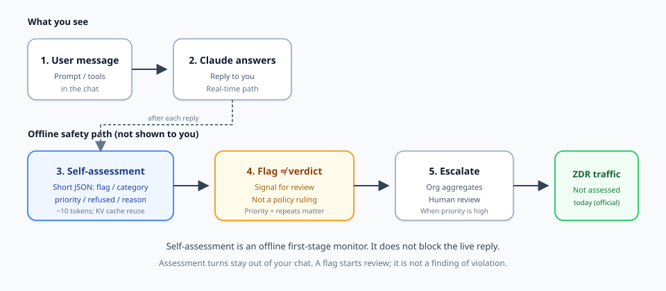
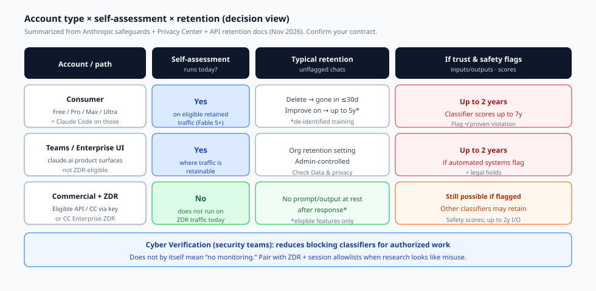

疯传的帖子把 Claude 称作「数字告密者」。这个说法很上口。它也是一个很糟糕的决策工具。

Anthropic 的 [self-assessment 论文](https://safeguards.anthropic.com/2026/self-assessment/) 描述的是一种离线滥用监测：它在 Claude 回复之后运行，对象是公司本就可以保留的流量。它不会拦截实时回答。一次标记是复核信号，并不是认定你违反了政策。零数据保留（ZDR）流量今天不在范围内。这四项事实会改变你下一步该做什么——而正确的下一步取决于**你使用的是哪一种账户路径**。

本指南面向需要做保留与监测决策的人，而不是新闻复述。它梳理消费者套餐、Teams/Enterprise 产品界面、带 ZDR 的商业 API，以及 Cyber Verification 之下的安全研究。它还把 Claude Code 可选的运维遥测与服务端 self-assessment 分开——疯传的讨论串常常把这两套系统揉成同一个吓人故事。

## 你实际在决定什么

在更换套餐或提交销售工单之前，用一句话把这个决策写下来：

> 就我的账户类型而言，self-assessment 是否会在我的流量上运行，未标记内容与已标记内容可以保留多久，以及当合法的安全工作看起来像滥用时我该怎么做？

下文都在回答这句话。如果你的目标只是「看懂这场热闹」，其他文章已经覆盖了发布叙事。这一篇是写给需要一张清楚矩阵的系统操作者、安全负责人，以及注重隐私的构建者的。

## self-assessment 如何工作（机制，而非神话）

*图 1. 可见路径对照离线安全路径。self-assessment 不会显示在聊天里，也不会拦截实时回复。ZDR 流量今天不会被评估。*

Claude 完成回复之后，系统会追加一条简短指令，要求做一次安全反思。Claude 返回一份紧凑的结构化评估。Anthropic 的示例 schema 很简单：没有问题时是 `{"flagged": false}`。当某件事可能有害时，评估可以包含 `flagged`、一段简短的自由文本 `reason`、`category`、`subpolicy`、Claude 是否 `refused`，以及从 1–10 的 `priority`。

来自[官方 Safeguards 文章](https://safeguards.anthropic.com/2026/self-assessment/)（2026 年 10 月 16 日）的重要属性：

1. **离线，而不是实时拦截。** 在生产环境中，self-assessment 把内容标记出来供复核。实时拦截由另外的分类器和安全防护处理。他们把 self-assessment 当作拦截器的红队实验，仍然让许多攻击得以成功——Anthropic 自己的数字表明，它作为唯一关卡是弱的。
2. **对聊天隐藏。** 这些评估轮次用户看不到，也不会被带入对话的其余部分。
3. **便宜到足以广泛覆盖。** 对话已经在 KV cache 中，因此每次评估的开销是一条短指令，加上大约十个输出 token。Anthropic 估计增加的推理计算不到 2%，并且不向客户计收这笔费用。
4. **自 Fable 5 起覆盖。** self-assessment 随自 Fable 5 起发布的 Claude 模型一同提供，并且自 2026 年 6 月起在全球流量的很大一部分上被动运行。
5. **检测数字是相对于一个更强的教师而言的。** 在 Fable 5 上，当假阳性率为 1% 时，它能召回经提示的教师分类器标记为潜在有害的对话中的 78%，以及高优先级对话（priority 7+）中的 94%。这些数字衡量的是与另一个模型评判者的一致程度，而不是「全部人类所定义犯罪中的 78%」。
6. **标记 ≠ 违规。** 脚注 1 写得很明确：一次评估是供进一步复核的信号。它并不是认定某位用户违反了政策，或已经发生了伤害。执行使用 priority 分数以及反复出现的高优先级标记，因为 1% 的假阳性率仍会产生许多良性标记。

数据处理与这一设计一致。self-assessment **不收集额外的用户数据**。它读取的是已经为生成回复而处理过的对话，并且只在现有政策允许保留的流量上运行。自由文本 `reason` 可以转述用户内容，因此它与 prompt 和 completion 接受相同的治理。结构化字段（flag、category、subpolicy、priority、score）不能携带用户文本，并且被当作其他分类器分数来对待。

**病毒式说法纠正 #1：** 这不是一条会用报警电话打断你回答的实时举报热线。其他系统可能会拦截或打断；self-assessment 在生产中的角色是离线监测与分诊。

**病毒式说法纠正 #2：** 一次标记不是定罪。把「flagged」直接等同于「因思想罪被封禁」的社交帖子当作噪音，除非它们展示了实际的执行结果。

## 你需要的矩阵：账户类型 × 评估 × 保留

*图 2. 决策矩阵。请确认你的合同和 Console 隐私设置；Covered Models 与功能资格可以改变 ZDR 那一行。*

### 消费者（Free、Pro、Max、Ultra——以及这些套餐上的 Claude Code）

**self-assessment 会运行吗？** 对于 Fable 5 及之后模型上符合条件且被保留的消费者流量，应预期会运行。消费者产品不具备 ZDR 资格，因此「ZDR 流量不会被评估」这一排除在这里帮不了你。

**未标记内容的保留（Privacy Center，消费者文章，2026 年 7 月 1 日）：**

- 你可以随时删除一次聊天。它会立即离开你的历史，并在 **30 天**内从 Anthropic 的后端存储中删除。
- 如果你允许模型改进，Anthropic 可以在训练流水线中把去标识化的聊天或编程会话保留最多 **5 年**。这个计时适用于该设置开启之后新建或被恢复的聊天。关闭该设置会停止此后的训练使用；进行中的运行以及已经训练完成的模型不受影响。即使模型改进处于开启状态，Incognito 聊天也不会被用来改进 Claude。
- 你提交的反馈可以保留 **5 年**。

**如果自动化信任与安全系统标记了某次聊天或会话：** Anthropic 可以将输入和输出保留最多 **2 年**，将信任与安全分类分数保留最多 **7 年**。法律保全和争议解决可以进一步延长保留。来源：[你们会存储我的数据多久？](https://privacy.claude.com/en/articles/10023548-how-long-do-you-store-my-data)。

**消费者的决策行动**

1. 如果你不想要长期的训练保留，请关闭**模型改进**——然后对未标记聊天依靠普通删除 + 30 天后端删除。
2. 对于应当留在训练之外的敏感探索性 prompt，即使改进功能在其他方面是开启的，也优先使用 **Incognito**。
3. 默认认为**贴近政策的工作**（恶意软件分析样本、漏洞利用的逐步讲解、生物邻近研究）会提高分类器的关注。这和「Anthropic 在听你的日记」是两回事。
4. 不要把遭到拒绝的回答当成你已被 self-assessment 记入永久档案的证据。拒绝是一种实时安全行为；延长保留需要已发布政策下的信任与安全标记路径。

### Teams / Enterprise 产品界面（claude.ai 界面）

**self-assessment 会运行吗？** 在商业产品政策允许保留流量的地方，把 Fable 5+ 上的 self-assessment 视为生效，方式与 Anthropic 所描述的广泛生产覆盖相同。根据 Claude API 的 ZDR 安排，这些产品界面**不具备 ZDR 资格**（见 [API 与数据保留](https://platform.claude.com/docs/en/manage-claude/api-and-data-retention)）。

**保留。** 组织管理员在产品隐私控制中设置对话保留。本地 Claude Code / Cowork 会话记录遵循组织设置（文档还说明，除非设置了有限的组织期限，默认的记录保留时间很长）。self-assessment 仍然只在现有政策允许 Anthropic 保留的流量上运行。

**Teams/Enterprise 管理员的决策行动**

1. 设置明确的组织保留期限。如果你只是在产品界面上购买了席位，不要停留在「我们以为已经有 ZDR」。
2. 如果静态状态下的零 prompt 保留是硬性要求，把**高敏感工作负载**单独放到具备真正 ZDR 安排的商业 API 组织上（下一节）。
3. 培训员工：**已标记内容例外**仍然存在：即使是严格的商业安排，也可以将已标记的输入/输出保留最多 2 年。

### 商业 API / 使用商业 API 密钥的 Claude Code / Claude Code Enterprise ZDR

这是疯传帖子通常会跳过的那一行。

**self-assessment 今天会在 ZDR 流量上运行吗？** 官方答案：**不会。** self-assessment 论文脚注 8：*「self-assessment 今天不会在零数据保留协议所覆盖的流量上运行。」*

这是整件事里最鲜明的隐私控制——而且它由合同把关，不是消费者设置里的一个开关。

**ZDR 覆盖什么（概要）：** 在已获批准的安排下，对于符合条件的功能，API 响应返回之后，Anthropic 不会静态存储客户的 prompt 或响应。根据 [Privacy Center 的 ZDR 产品文章](https://privacy.claude.com/en/articles/8956058-i-have-a-zero-data-retention-agreement-with-anthropic-what-products-does-it-apply-to)，ZDR 适用于符合条件的 Anthropic API、使用你的 Commercial 组织 API 密钥的 Anthropic 产品（包括经由 API 访问的 Claude Code），以及 Enterprise 计划的 Claude Code（需单独启用）。Claude Platform 用户可以在 Settings → Privacy Controls → Data retention period 下确认 ZDR。

**ZDR 不覆盖什么：** 消费者 Free/Pro/Max/Ultra（包括这些套餐上的 Claude Code）、Claude Console playground 的使用、Claude Managed Agents 会话记录、Teams/Enterprise 产品界面（单独的 Claude Code Enterprise ZDR 产品除外）、许多有状态功能（Batches、Files、代码执行容器、MCP connector，以及资格表中标为 “No” 的其他项），以及第三方集成。Covered Models 如 Fable 5 / Mythos 5（及 5.1 变体）通常要求 **30 天保留**，并且除非 Anthropic 明确另行授权，否则在 ZDR 下不可用——工作区有时可以启用 30 天保留来解锁这些模型，同时其他工作区保持 ZDR。

**即使有 ZDR：** Anthropic 仍会保留 User Safety 分类器结果，以执行 Usage Policy。无论何种安排，已标记内容和法律保全都可以将输入和输出保留最多 **2 年**。Claude Code 中的指标日志如果已启用，则不属于 ZDR 范围，并可能保留生产力统计。

**商业买家的决策行动**

1. 如果「我的 prompt 上不要有 self-assessment」是硬性要求，你需要一个**具备资格的 ZDR 组织**，而不是消费者 Max 套餐再加一份指望。
2. 审计功能资格。使用 Batches、Files 或代码执行，意味着那一部分数据会依照已写明的功能政策离开零保留路径。
3. 把 Covered Models 和 ZDR 放在同一次规划讨论中。想要 Mythos 级别的模型又不要 30 天保留？你需要 Anthropic 的明确授权，或者另选模型。
4. 按组织确认是否已启用。ZDR 不会自动扩展到同一账户下的每一个组织。

## 安全研究误报与 Cyber Verification

合法的漏洞研究、恶意软件分析，以及经授权的红队测试，在只看见文本的分类器看来像是滥用。这不是阴谋；这是 Anthropic 自己写进文档的上下文问题。

### 两种不同的缓解（不要混淆）

**1. Cyber Verification Program（CVP）。** Anthropic 的 [Cyber Verification Program](https://support.claude.com/en/articles/14604842-cyber-verification-program) 让符合条件的安全专业人员能够访问带有**减弱拦截分类器**的高级模型。Defense Access 覆盖防御性工作、恶意软件分析和漏洞验证。Red Team Access 覆盖符合条件组织的经授权进攻性测试。每个组织申请一次；由管理员分配席位。个人目前只能获得 Defense Access。安全要求很严格（抗钓鱼 MFA、组织域名账户、短时凭证、受管设备、面向 agentic/进攻性工作的出站允许列表，以及更多）。

CVP 关乎经授权安全工作的**中断与能力访问**。它不是一个神奇的「删掉全部监测」开关。

**2. self-assessment 内部的会话策略允许列表。** safeguards 论文展示了一个部署时的 `<session_policy>` 块，它可以写明一个授权目标（示例：针对 OpenLDAP 的漏洞研究）。在他们的测试集中，Fable 5 在很宽的阈值范围内标记了 100% 的非允许列表目标，以及 0% 的允许列表目标。那是面向**评估**的一种研究/生产适配，并不是与 CVP 注册相同的产品。

### 安全团队的实用做法

1. **如果实时分类器一直拦截你的工作：** 按正确层级申请 CVP。不要试图「用 jailbreak 绕过」拦截，然后在离线监测注意到时装作惊讶。
2. **如果你需要最小的 prompt 保留：** 把研究放到带有 ZDR 的商业组织上（并接受 Covered Model 的限制）。请记住，self-assessment 今天对 ZDR 流量是关闭的，但其他分类器以及已标记内容的保留仍然存在。
3. **在 prompt 和工单里限定授权目标。** 含糊的「把互联网上的一切都扫描一遍」这类说法，正是误报变成真正执行复核的途径。
4. **把个人消费者账户和公司研究分开。** 把漏洞赏金笔记混进开启了模型改进的 Free/Pro 聊天，是两头都最糟的做法：既有训练保留风险，又没有 ZDR。

## Claude Code 遥测 ≠ 服务端 self-assessment

这种混淆催生了大量「告密」讨论串。把这些数据流分清楚。

| 系统 | 运行位置 | 它看到什么 | 你的控制 |
| --- | --- | --- | --- |
| **self-assessment** | Anthropic 推理路径（服务端），针对可保留流量 | Claude 刚刚回答的对话；发出隐藏的 JSON 评估 | 账户/安排（ZDR 今天将其排除）；不是 Claude Code CLI flag |
| **Claude Code 运维遥测** | 客户端 → Anthropic / 基础设施 | 延迟、可靠性、使用模式；文档称指标从不包含代码、prompt 或文件路径 | `DISABLE_TELEMETRY=1`（及相关 flag）；见 [Claude Code 数据使用](https://code.claude.com/docs/en/data-usage) |
| **Claude Code OpenTelemetry** | 客户端 → **你的**收集器 | 你所配置的指标/事件；只有启用那些日志 flag 时才包含 prompt 内容 | 需主动开启；绝不能代替对 API 保留的理解 |
| **模型请求本身** | 客户端 → 模型提供方 | 用于推理的 prompt 与输出 | 选择消费者还是商业+ZDR；Incognito；删除；组织设置 |

关闭 Claude Code 指标**不会**停用消费者流量或非 ZDR 商业流量上的 self-assessment。启用你自己的 OpenTelemetry 收集器**并不**意味着 Anthropic 停止了服务端安全监测。符合条件的 API 组织上的 ZDR **并不**意味着 Claude Code 会拒绝发送可选的生产力指标，除非你同时也管理指标日志。

如果需要一行心智模型：**遥测设置管的是客户端运维数据；self-assessment 管的是模型如何给 Anthropic 被允许保留的对话打分。**

## 决策树：先选定你的那一行，再行动

**A. 我是想减少长期训练保留的消费者。**  
关闭模型改进。删除敏感聊天。对一次性探测使用 Incognito。接受 Usage Policy 标记仍可以把保留延长到 2 年 / 分数延长到 7 年。

**B. 我是「只是为了学习」而做安全或生物邻近研究的消费者。**  
预期会有更多分类器摩擦。优先使用官方实验室、CTF 沙箱，以及有文档记录的教育性表述。对于专业研究，转到商业 + CVP，而不是在 Twitter 上和 Free 层级的拒绝争论。

**C. 我的公司需要「Anthropic 不保留我们的 prompt」。**  
在正确的组织上购买/启用 ZDR。核实 Console 隐私控制。把你使用的每一项功能对照资格表。单独规划 Covered Models。不要把产品界面席位和 API ZDR 搞混。

**D. 我的公司需要经授权的网络安全工作，并且不要一直被拦截。**  
按正确层级注册 Cyber Verification，并满足安全要求。如果保留也是硬性要求，就与 ZDR 搭配。记录授权目标。把剩余的标记当作复核信号，而不是恶意的证明。

**E. 我只关闭了 Claude Code 遥测，就觉得「安全」了。**  
你减少了运维指标/错误报告。你没有改变服务端 self-assessment 或 API 保留。请重读上面的表格。

## 内部隐私说明里「好」是什么样

如果你需要向法律顾问或安全委员会做简报，一份简短而准确的说明胜过一张疯传的截图：

1. self-assessment 是自 Fable 5 起提供的**离线**监测；生产用途是复核分诊，不是实时拦截。
2. 官方文档写明，标记是**复核信号**，不是政策认定。
3. self-assessment **今天不会在 ZDR 流量上运行**。
4. 消费者保留是：删除→后端 ≤30 天；模型改进→去标识化最多 5 年；已标记→输入/输出最多 2 年，分数最多 7 年（[Privacy Center](https://privacy.claude.com/en/articles/10023548-how-long-do-you-store-my-data)）。
5. ZDR 属于商业安排，按功能限定范围，按组织限定范围，并且仍然允许分类器分数以及已标记/法律保留例外（[API 保留文档](https://platform.claude.com/docs/en/manage-claude/api-and-data-retention)；[ZDR 产品 FAQ](https://privacy.claude.com/en/articles/8956058-i-have-a-zero-data-retention-agreement-with-anthropic-what-products-does-it-apply-to)）。
6. Cyber Verification 为已验证的安全工作降低**拦截**；它与评估允许列表互补，但并不等同。
7. Claude Code 遥测控制与 self-assessment **相互正交**。

## 本指南的限度（以及该系统的限度）

Anthropic 对限度是公开说明的：self-assessment 继承教师的盲点；它对针对评估器的攻击者并不稳健；它还不是对 Claude 自身不对齐行为的可靠监测；留一法泛化测试覆盖的是 Claude 已经「知道」的危害，而不是每一个未来的未知。隐私政策页面也会演变——Covered Model 列表、功能资格和 ZDR 启用路径会变化。在你作出合规主张之前，务必重新核对 safeguards 页面、Privacy Center 和你的合同。

## 底线

别再问「Claude 是不是告密者？」去问你处在哪一个**账户行**。

- **消费者：** 评估可以运行；用隐私设置控制训练；已标记聊天可以按已发布政策留存多年。
- **Teams/Enterprise 界面：** 仍然是可保留的产品流量；配置组织保留；ZDR 不是自动具备的。
- **商业 ZDR：** self-assessment 今天在所覆盖流量上是关闭的；确认功能资格和已标记内容例外。
- **安全研究：** 用 Cyber Verification 应对拦截；用 ZDR 应对保留；不要把二者与 Claude Code 遥测开关混淆。

这就是那个决策。其余都是评论。

## 来源

- Anthropic Safeguards：[借助 Self-Assessment 扩展滥用检测](https://safeguards.anthropic.com/2026/self-assessment/)（2026 年 10 月 16 日），包括 Data Handling 以及关于 ZDR 的脚注 8。
- Anthropic Privacy Center：[你们会存储我的数据多久？](https://privacy.claude.com/en/articles/10023548-how-long-do-you-store-my-data)（消费者保留）。
- Anthropic Privacy Center：[ZDR 产品适用范围](https://privacy.claude.com/en/articles/8956058-i-have-a-zero-data-retention-agreement-with-anthropic-what-products-does-it-apply-to)。
- Claude Platform 文档：[API 与数据保留](https://platform.claude.com/docs/en/manage-claude/api-and-data-retention)（ZDR/HIPAA 资格，已标记内容保留）。
- Claude Help Center：[Cyber Verification Program](https://support.claude.com/en/articles/14604842-cyber-verification-program)。
- Claude Code 文档：[数据使用](https://code.claude.com/docs/en/data-usage)（运维遥测对照 prompt）。
