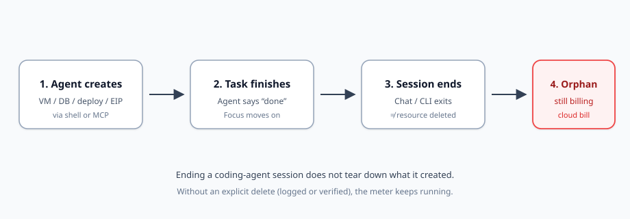
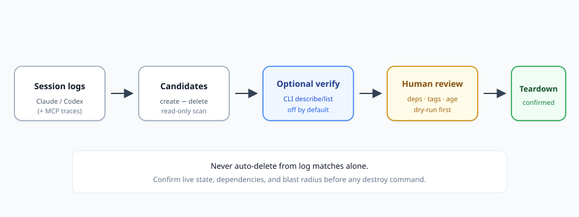

Coding agents no longer only edit files. They provision. Mid-task they spin up a GPU VM to reproduce a bug, create a throwaway Postgres on Neon, push a preview deploy, allocate a static IP, or leave a background script hammering a paid API with your key. When the chat says “done,” that sentence is about the *task*—not about the infrastructure the task touched.

The bill does not care that the session ended.

This is the same orphan pattern FinOps teams already know for unattached EBS volumes and idle Elastic IPs, now triggered by agents that can create resources faster than humans remember them. The fix is not “let the agent clean up after itself and hope.” The fix is a deliberate loop: **read-only discovery → optional live verify → human confirmation → teardown**. Tools such as [agent-leftovers](https://www.producthunt.com/products/agent-leftovers) illustrate one slice of that loop—session-log forensics for Claude Code and Codex—but the discipline matters more than any single CLI.

This report explains the lifecycle of agent-created cloud waste, where Claude Code, Codex, and MCP leave blind spots, what optional verification flags like `--verify` can prove, how local leftovers (processes, worktrees) differ from cloud leftovers, and a safe containment checklist you can run without turning cleanup into a second outage.

## The new shape of cloud waste

Classic orphan waste looks boring: a volume left after an instance terminate, an EIP allocated for a migration that finished last quarter, a snapshot whose source volume is gone. Scanners such as [aws-orphan-finder](https://github.com/moveeeax/aws-orphan-finder) and read-only MCP cost tools exist because those leftovers are common, measurable, and easy to miss in a busy account.

Agent-driven waste is the same physics with a worse clock. An engineer who opens the console to create a staging RDS usually remembers enough context to delete it—or at least tags it. An agent that creates three resources across two providers while chasing a failing test may never emit a matching delete. The session ends; the meter does not.

Three traits make this class dangerous:

1. **Speed.** Agents create faster than review rituals catch up.
2. **Opacity.** Creation may happen via shell, MCP tool call, or a console the human opened “just once.”
3. **False closure.** Ending a chat or CLI session feels like cleanup. It is not.

You need a mental model that separates “conversation over” from “resource gone.”

## Resource lifecycle: create → session end → orphan bill

*Figure 1. Ending a coding-agent session is not teardown. Without an explicit delete—logged or later verified—the resource keeps billing.*

Walk the stages:

**Create.** The agent needs compute, storage, a database, a preview URL, or a paid API call path. It runs a CLI (`gcloud`, `aws`, `vercel`), calls an MCP server (Supabase, Neon, Cloudflare, DigitalOcean, E2B, and similar), or asks you to click something in a console.

**Task finishes.** The agent reports success. Attention moves to the next prompt. No FinOps ticket is filed. Tags like `created-by=agent` may never have been applied.

**Session ends.** The Claude Code or Codex process exits. Local logs remain on disk. Cloud state is untouched unless something explicitly deleted it.

**Orphan bill.** Hours or days later, Cost Explorer or a provider invoice shows a GPU VM, a 250 GB disk, or a script still calling OpenAI/Anthropic with your key—exactly the failure mode described in write-ups of [agent-leftovers](https://newruntime.com/posts/agent-leftovers-open-source-cli-lists-cloud-resources-f5a587/).

The uncomfortable invariant: **session lifetime ≠ resource lifetime.** Treat that as a design constraint, not a bug report you hope someone else filed.

## Two layers of leftovers: laptop vs cloud bill

Before you hunt cloud orphans, separate two problems that people mix up.

**Local leftovers** burn RAM and disk on the machine where the agent ran: orphan processes, MCP server children adopted by `launchd`, git worktrees, scratch directories, idle Docker stacks. Read-only auditors in this layer—tools in the spirit of [tidewake](https://github.com/berkkorkmaz/tidewake) (scan processes/worktrees, print cleanup commands, delete nothing itself) and cleanup helpers such as [cc-reaper](https://github.com/theQuert/claude-code-cleanup)—matter because a dead laptop feels like an agent problem. They do **not** stop a Neon instance from billing you overnight.

**Cloud leftovers** burn money and sometimes security surface in accounts you already pay for: VMs, disks, databases, Workers, preview deploys, static IPs, lingering API scripts. Finding them requires log forensics, provider inventory, or both.

Solving only the local layer can make the machine feel healthy while the invoice grows. Solving only the cloud layer can leave dozens of worktrees and zombie Node processes. Run both tracks; do not pretend they are the same ticket.

## How log-based discovery works (and why it is useful)

Session-oriented coding agents already write detailed local logs. Claude Code typically keeps JSONL under `~/.claude/projects/` (or `CLAUDE_CONFIG_DIR`). Codex stores sessions under `~/.codex/sessions` (or `CODEX_HOME`). Those files are a ground-truth transcript of many shell actions the agent took.

A log auditor’s job is narrow and valuable:

- Parse creates (VM, DB, deploy, bucket, EIP, and so on).
- Match later deletes in the same log window.
- Skip creates that failed.
- Emit **candidates** plus suggested teardown commands for a human to review.

[agent-leftovers](https://www.producthunt.com/products/agent-leftovers) is a concrete example of this pattern: MIT-licensed, local, read-only by default, dozens of detection rules across GCP, AWS, Azure, Cloudflare, Vercel, Fly, Supabase, Terraform/Pulumi, and more. It can also flag agent-written scripts that call paid model APIs with the user’s key—including scripts that may still be running. It does not claim to be a live cloud inventory. That honesty is a feature.

Use log scanners as **hypothesis generators**, not as delete buttons.

## Blind spots: Claude Code, Codex, and MCP

Every detection method has holes. Name them so your process covers them.

### Shell-only vision (the original hole)

Early log scanners only saw what went through the agent’s shell. If the agent created a database through an MCP tool, or you clicked “Create” in the provider console after the agent asked you to, the shell transcript never saw a create. Product materials for agent-leftovers were explicit about this limit: *things made through MCP tools or a web console won’t show*.

### MCP coverage (partial, version-dependent)

As agents lean on MCP servers for Supabase, Neon, Vercel, Cloudflare, DigitalOcean, E2B, and similar hosts, creation moves out of shell strings and into tool payloads. v0.2-era updates for agent-leftovers add MCP detection for several of those servers. That closes a real gap—and opens a new honesty requirement: **MCP coverage is only as complete as the tool list and parsers you shipped.** A new MCP server or a renamed tool call can recreate the blind spot overnight.

### Console and out-of-band creates

Humans still open consoles. Agents still say “please create this in the UI.” Those resources never appear in Claude Code or Codex logs. Only provider inventory (or Cost Explorer anomalies) will catch them.

### Scripts and background jobs

An agent may write a Python script that calls a paid API, start it, and move on. The create of the *script file* is local; the ongoing *spend* is cloud/API. Log rules that look for API-calling scripts help, but a process started outside the logged shell, or restarted by a cron the agent added, can still hide.

### Cross-account and multi-region drift

Agents often default to whatever credential is on the machine. Resources may land in an unexpected region or project. A single-region Cost Explorer glance misses them. Multi-region list/describe is part of verification, not optional polish.

**Practical rule:** treat Claude Code and Codex logs as one camera angle. Add MCP traces when available. Still reconcile against cloud inventory for anything high-cost or long-lived.

## From logs to teardown: a safe workflow

*Figure 2. Safe path: logs → candidates → optional live verify → human review → teardown. Never jump from a log match to destroy.*

### Step 1 — Read-only candidate list

Run a local scan over recent days. Prefer tools that:

- Stay offline by default.
- Print findings without mutating cloud state.
- Exit non-zero when leftovers exist (handy for a daily cron or pre-merge check).

You want a list shaped like: *resource type, identifier if known, session/time hint, suggested teardown command (commented or clearly marked as unsafe until reviewed)*.

### Step 2 — Optional live verify

Some tools expose a flag such as `--verify`. In the agent-leftovers design, that flag is **off by default**. When enabled, it uses *your already-installed cloud CLIs* to run read-only `describe` / `list` style checks so a week-old log candidate can be marked still present or already gone. Nothing should leave the machine unless you opt in.

That is the right default. Verification needs credentials and network; audit-from-logs does not.

### Step 3 — Human confirmation

Before any destroy:

- Re-check live state yourself for high-blast items (databases, resource groups, buckets).
- Check dependencies (is this EIP still referenced? is the volume attached now?).
- Respect retention tags (`keep`, `DoNotDelete`, `finops:keep`).
- Prefer dry-run / plan output first—the same spirit as FinOps platforms that behave like `terraform plan` for cleanup and refuse to apply a stale plan.

### Step 4 — Teardown

Run the delete under change control appropriate to the blast radius. Snapshot disks before delete when data matters. Release EIPs only when unassociated. Treat “delete resource group / bucket” as irreversible content loss, not a tidy `rm`.

Automated destroy of low-risk orphans (unattached EBS, idle EIPs) appears in some FinOps hunters with **dry-run on by default**, age thresholds, and tag exclusions. That pattern can coexist with agent log audits—but agent candidates should still get a human gate until your tagging and ownership model is mature.

## What `--verify` (and peers) can prove—and cannot

Verification flags are easy to over-trust. Draw a hard line.

**Can often prove (when the CLI and resource type are covered):**

- A candidate ID still exists in the account/project/region you queried.
- A candidate is already gone (someone cleaned it up; stop worrying).
- Basic attributes from describe/list (state, attachment, region).

**Cannot safely prove:**

- That every agent-created resource was ever logged (console/MCP gaps remain).
- That every resource type is covered (new SKUs, preview products, renamed APIs).
- That delete is safe (dependencies, IAM, data retention, shared staging).
- That “not found” means “never existed” rather than “wrong region/account/profile.”
- That a matched teardown command is the least-destructive fix (stop vs terminate; snapshot vs delete).

Use verify to **refresh stale candidates**, not to authorize unattended destruction.

## Containment habits that beat heroic cleanups

Detection without policy is a recurring fire drill. Bake prevention into how agents are allowed to create.

**Tag on create.** Require `owner`, `purpose`, `expiry`, `created-by=agent`, and a ticket or session id when agents provision. Untagged agent resources should be noisy in review.

**Grace periods.** Do not delete a candidate the moment a log scan flags it. Age gates (for example, unattached volumes older than N days) are standard in FinOps zombie hunters for a reason: agents and humans both create short-lived staging that is still in use.

**Dry-run first.** Every cleanup path should print what it would do. Prefer commented teardown scripts over eager apply.

**Dependency checks.** Before releasing an EIP or deleting a disk, confirm association and attachment signals—not a single status field that can lie mid-detach.

**Multi-region / multi-project sweeps.** Schedule inventory across every region your credentials can touch. Agents do not respect your mental default region.

**Separate credentials.** Give agents scoped roles: create in a sandbox project, deny production destroy, force TTL where the provider supports it.

**Budget alarms.** Anomaly detection on daily spend catches the GPU VM the logs missed.

**Cron the audit.** A daily local scan with exit code 1 on findings is cheap insurance. Pair it with a weekly provider-side orphan report (EBS/EIP/snapshot classics).

## A realistic operating playbook

Here is a compact weekly rhythm that does not assume a perfect toolchain:

1. **Daily (laptop):** read-only local leftover scan (processes/worktrees) so agent mess does not hide as “my Mac is slow.”
2. **Daily (logs):** session-log cloud candidate scan for Claude Code / Codex (and MCP-aware rules if you have them).
3. **On demand:** `--verify` or manual CLI describe for anything expensive or older than your grace window.
4. **Weekly:** classic FinOps orphan inventory (unattached volumes, idle EIPs, stale snapshots) across regions—catches console creates logs never saw.
5. **Always:** human confirmation before destroy; snapshot when data is involved; refuse to auto-delete databases and NAT gateways from agent hints alone.

When a candidate looks like a product pitch, keep the discipline: **agent-leftovers is one case study of log-first, read-only audit**—useful because it encodes the create-minus-delete idea and documents MCP/`--verify` evolution honestly. Your FinOps outcome depends on the loop around it, not on adopting one binary as gospel.

## What “good” looks like in six months

Teams that absorb agent provisioning without lighting money on fire tend to share traits:

- Agents create mostly in sandboxes with hard spend caps.
- Every long-lived resource has an owner tag and an expiry.
- Log audits and cloud inventories both run; neither is trusted alone.
- Teardown is a reviewed change, not a side effect of “the agent said it cleaned up.”
- Local cleanup (RAM/disk) and cloud cleanup (invoice) have separate owners or at least separate checklists.

None of that requires blocking agents from the cloud. It requires treating **create** as a privileged act that always schedules a **prove-deleted** follow-up.

## Closing

Coding agents turned infrastructure create into a conversational side effect. Cloud billing still treats create as a contract. The gap between those worldviews is where orphan spend appears: after the session ends, before anyone asks whether the VM is still up.

Close the gap with boring engineering. Map the lifecycle. Scan logs. Admit MCP and console blind spots. Verify live state when you need freshness. Confirm with a human. Tear down with dry-runs, tags, grace periods, dependency checks, and multi-region eyes. Keep local process/worktree hygiene on a separate track from cloud FinOps.

The agents will keep shipping. Your job is to make sure “done” includes an answer to one question: **what did we create, and can we prove it is gone?**

## Figure notes (for editors)

| File | Placement | Purpose |
|------|-----------|---------|
| `./images/resource-lifecycle.svg` | After “Resource lifecycle…” heading | Shows create → task finish → session end → orphan bill |
| `./images/log-to-teardown.svg` | After “From logs to teardown…” heading | Shows logs → candidates → optional verify → human review → teardown |

## Sources and further reading

- [agent-leftovers on Product Hunt](https://www.producthunt.com/products/agent-leftovers) — product description, MCP coverage note, optional `--verify` behavior.
- [newruntime write-up of agent-leftovers](https://newruntime.com/posts/agent-leftovers-open-source-cli-lists-cloud-resources-f5a587/) — log paths, rule scope, read-only design, limits.
- [tidewake](https://github.com/berkkorkmaz/tidewake) — read-only local audit of processes/worktrees left by coding agents.
- [cc-reaper / claude-code-cleanup](https://github.com/theQuert/claude-code-cleanup) — local orphan process and worktree cleanup patterns.
- [aws-orphan-finder](https://github.com/moveeeax/aws-orphan-finder) — classic read-only orphan patterns (EIP, EBS, ENI, snapshots).
- Broader FinOps practice: dry-run defaults, age thresholds, keep tags, report-only handling for high-blast resources (RDS, NAT).
