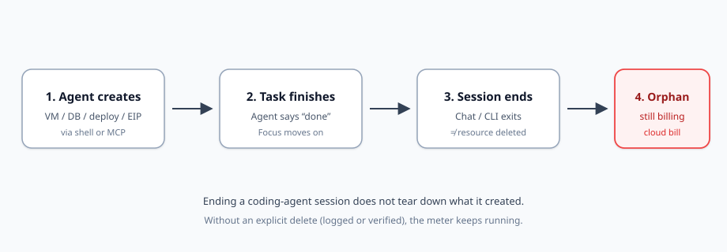
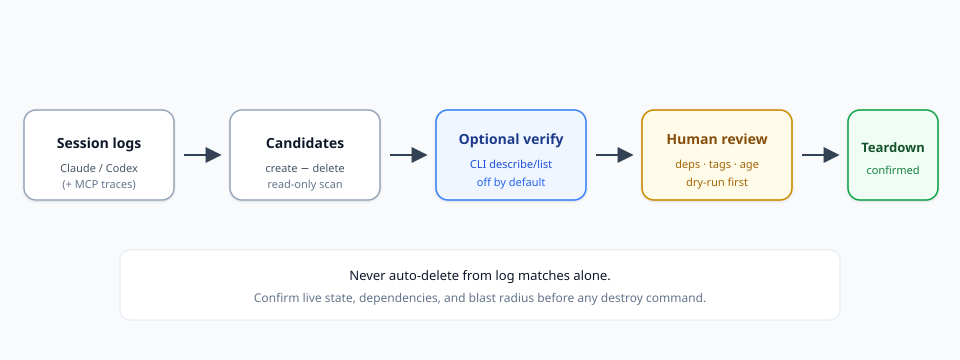

编程智能体不再只编辑文件。它们会置备资源。任务进行到一半，它们会拉起一台 GPU 虚拟机来复现缺陷，在 Neon 上创建一个一次性的 Postgres，推送一次预览部署，分配一个静态 IP，或者留下一段后台脚本，用你的密钥不停冲击付费 API。当聊天说“完成”时，这句话谈的是*任务*——不是这项任务接触过的基础设施。

账单并不在乎会话已经结束。

这与 FinOps 团队早已熟悉的孤儿模式相同：未挂载的 EBS 卷和闲置的 Elastic IP，如今由创建资源快过人类记忆的智能体触发。解决办法不是“让智能体自己事后清理，然后指望它做到”。解决办法是一条刻意的闭环：**只读发现 → 可选的实时核验 → 人工确认 → 拆除**。诸如 [agent-leftovers](https://www.producthunt.com/products/agent-leftovers) 这样的工具展示了这条闭环的一个切片——针对 Claude Code 和 Codex 的会话日志取证——但纪律比任何一个单独的 CLI 都更重要。

本报告说明智能体造成的云浪费的生命周期，Claude Code、Codex 和 MCP 会在哪些地方留下盲区，`--verify` 这类可选核验旗标能够证明什么，本地残留（进程、工作树）与云端残留有何不同，以及一份你可以执行、又不会把清理变成第二次故障的安全遏制清单。

## 云浪费的新形态

经典的孤儿浪费看起来乏味：实例终止后留下的卷、为上个季度已经完成的迁移而分配的 EIP、源卷已经消失的快照。之所以存在 [aws-orphan-finder](https://github.com/moveeeax/aws-orphan-finder) 这类扫描器以及只读的 MCP 成本工具，是因为那些残留很常见、可度量，并且在繁忙的账户里很容易被漏掉。

智能体驱动的浪费是同一套物理规律，只是时钟更糟。一位打开控制台去创建预发 RDS 的工程师，通常记得足够的上下文来删除它——或至少给它打上标签。一个在追查失败测试时跨两个提供商创建三项资源的智能体，可能永远不会发出一次对应的删除。会话结束了；计费器并没有停。

使这一类变得危险的三个特征：

1. **速度快。** 智能体创建资源的速度，超过评审仪式能跟上的速度。
2. **不透明。** 创建可能经由 shell、MCP 工具调用，或人类“就这一次”打开的控制台发生。
3. **虚假的收尾。** 结束一段聊天或 CLI 会话，感觉像是在清理。其实不是。

你需要一套心智模型，把“对话结束”和“资源已消失”分开。

## 资源生命周期：创建 → 会话结束 → 孤儿账单

*图 1. 结束一次编程智能体会话并不是拆除。没有一次明确的删除——记在日志里，或事后得到核验——资源就会继续计费。*

把各个阶段走一遍：

**创建。** 智能体需要计算、存储、数据库、预览 URL，或一条付费 API 调用路径。它运行 CLI（`gcloud`、`aws`、`vercel`），调用 MCP 服务器（Supabase、Neon、Cloudflare、DigitalOcean、E2B 及类似服务），或请你在控制台里点击某样东西。

**任务完成。** 智能体报告成功。注意力转到下一条提示。没有人提交 FinOps 工单。`created-by=agent` 这类标签可能从未被打上。

**会话结束。** Claude Code 或 Codex 进程退出。本地日志留在磁盘上。除非有东西明确删除过，否则云状态原封不动。

**孤儿账单。** 数小时或数天后，Cost Explorer 或提供商发票上出现一台 GPU 虚拟机、一块 250 GB 的磁盘，或一段仍在用你的密钥调用 OpenAI/Anthropic 的脚本——正是 [agent-leftovers](https://newruntime.com/posts/agent-leftovers-open-source-cli-lists-cloud-resources-f5a587/) 相关文章里描述的那种失败模式。

令人不安的不变量：**会话寿命 ≠ 资源寿命。** 把它当作设计约束，而不是一份你希望别人已经提交的缺陷报告。

## 两层残留：笔记本与云账单

在搜寻云端孤儿之前，先把人们常常混在一起的两个问题分开。

**本地残留**消耗智能体运行所在机器上的内存和磁盘：孤儿进程、被 `launchd` 收养的 MCP 服务器子进程、git 工作树、草稿目录、闲置的 Docker 栈。这一层的只读审计器——思路上类似 [tidewake](https://github.com/berkkorkmaz/tidewake) 的工具（扫描进程/工作树，打印清理命令，自身不删除任何东西）以及 [cc-reaper](https://github.com/theQuert/claude-code-cleanup) 这类清理辅助——之所以要紧，是因为一台死机的笔记本会让人觉得这是智能体的问题。它们**不会**阻止一个 Neon 实例通宵给你计费。

**云端残留**在你已经付费的账户里烧钱，有时还扩大安全暴露面：虚拟机、磁盘、数据库、Workers、预览部署、静态 IP、仍在逗留的 API 脚本。找到它们需要日志取证、提供商清单，或两者兼用。

只解决本地这一层，可以让机器感觉健康，发票却在增长。只解决云端这一层，可能留下几十个工作树和僵死的 Node 进程。两条线都要跑；不要假装它们是同一张工单。

## 基于日志的发现如何工作（以及它为什么有用）

面向会话的编程智能体已经会写下详细的本地日志。Claude Code 通常把 JSONL 放在 `~/.claude/projects/`（或 `CLAUDE_CONFIG_DIR`）下。Codex 把会话存在 `~/.codex/sessions`（或 `CODEX_HOME`）下。这些文件是智能体所执行的许多 shell 动作的真值转录。

日志审计器的工作窄，而且有价值：

- 解析创建（虚拟机、数据库、部署、存储桶、EIP 等等）。
- 在同一日志窗口里匹配后来的删除。
- 跳过失败的创建。
- 输出**候选**，以及供人工审阅的建议拆除命令。

[agent-leftovers](https://www.producthunt.com/products/agent-leftovers) 是这一模式的具体例子：MIT 许可、在本地运行、默认只读，有数十条检测规则，覆盖 GCP、AWS、Azure、Cloudflare、Vercel、Fly、Supabase、Terraform/Pulumi 等。它还可以标记智能体编写的、用用户密钥调用付费模型 API 的脚本——包括可能仍在运行的脚本。它并不声称自己是一份实时云清单。这份诚实本身就是一项特性。

把日志扫描器当作**假设生成器**，而不是删除按钮。

## 盲区：Claude Code、Codex 与 MCP

每一种检测方法都有洞。把它们点名说出来，你的流程才能盖住它们。

### 只看见 shell（最初的那个洞）

早期的日志扫描器只看见经过智能体 shell 的内容。如果智能体通过 MCP 工具创建了数据库，或者智能体请你去做之后，你在提供商控制台里点了“Create”，shell 转录里就从未出现过一次创建。agent-leftovers 的产品材料对这一限制说得很明确：*通过 MCP 工具或网页控制台做出的东西不会显示*。

### MCP 覆盖（部分覆盖，且随版本而变）

随着智能体愈发依赖面向 Supabase、Neon、Vercel、Cloudflare、DigitalOcean、E2B 及类似主机的 MCP 服务器，创建从 shell 字符串转移到工具载荷之中。agent-leftovers 在 v0.2 时期的更新，为其中若干服务器增加了 MCP 检测。这补上了一个真实的缺口——同时也提出一项新的诚实要求：**MCP 覆盖的完整程度，只等于你所交付的工具列表和解析器。** 一个新的 MCP 服务器，或一次被改名的工具调用，可以在一夜之间把这个盲区重新造出来。

### 控制台与带外创建

人类仍然会打开控制台。智能体仍然会说“请在 UI 里创建这个”。那些资源永远不会出现在 Claude Code 或 Codex 的日志里。只有提供商清单（或 Cost Explorer 的异常）才能抓住它们。

### 脚本与后台作业

智能体可能写一段调用付费 API 的 Python 脚本，把它启动起来，然后继续往下做。*脚本文件*的创建是本地的；持续的*花费*是云端/API。寻找调用 API 的脚本的日志规则有帮助，但在已记录的 shell 之外启动的进程，或由智能体添加的 cron 重新拉起的进程，仍然可能藏住。

### 跨账户与多区域漂移

智能体常常默认使用机器上已有的凭据。资源可能落到意料之外的区域或项目里。只瞥一眼单一区域的 Cost Explorer 就会漏掉它们。多区域的 list/describe 是核验的一部分，不是可有可无的打磨。

**实用规则：** 把 Claude Code 和 Codex 的日志当作一个机位。有 MCP 轨迹时就加上。对于任何高成本或长寿命的东西，仍然要与云清单对账。

## 从日志到拆除：一条安全的工作流

*图 2. 安全路径：日志 → 候选 → 可选的实时核验 → 人工审阅 → 拆除。绝不要从一次日志匹配直接跳到销毁。*

### 步骤 1 — 只读候选列表

对最近几天做一次本地扫描。优先选择这样的工具：

- 默认保持离线。
- 打印发现结果，而不改变云状态。
- 存在残留时以非零状态退出（便于每日 cron 或合并前检查）。

你想要的列表形状是这样：*资源类型、若已知则给出标识符、会话/时间提示、建议的拆除命令（加以注释，或明确标成未经审阅前不安全）*。

### 步骤 2 — 可选的实时核验

有些工具暴露 `--verify` 这样的旗标。在 agent-leftovers 的设计里，该旗标**默认关闭**。启用后，它使用*你已经安装好的云 CLI*，运行只读的 `describe` / `list` 风格检查，从而可以把一周前的日志候选标成仍然存在，或已经消失。除非你选择加入，否则不应有任何东西离开这台机器。

这是正确的默认。核验需要凭据和网络；从日志做审计则不需要。

### 步骤 3 — 人工确认

在任何销毁之前：

- 对高爆炸半径的项目（数据库、资源组、存储桶），亲自再核对实时状态。
- 检查依赖（这个 EIP 是否仍被引用？这卷现在是否已挂载？）。
- 尊重保留标签（`keep`、`DoNotDelete`、`finops:keep`）。
- 优先先看 dry-run / plan 输出——与那些在清理上表现得像 `terraform plan`、并拒绝应用过期 plan 的 FinOps 平台是同一种精神。

### 步骤 4 — 拆除

在与爆炸半径相称的变更控制下执行删除。数据要紧时，删除磁盘前先做快照。只在 EIP 未关联时才释放。把“删除资源组 / 存储桶”当作不可逆的内容丢失，而不是一次利落的 `rm`。

低风险孤儿（未挂载的 EBS、闲置的 EIP）的自动销毁，出现在一些 FinOps 猎手里，它们**默认开启 dry-run**，并带有年龄阈值和标签排除。这一模式可以与智能体日志审计共存——但在你的标签和所有权模型成熟之前，智能体候选仍应经过一道人工闸门。

## `--verify`（及同类旗标）能够证明什么——以及不能证明什么

核验旗标很容易被过度信任。划一条硬线。

**常常能够证明（当 CLI 和资源类型已被覆盖时）：**

- 某个候选 ID 在你所查询的账户/项目/区域中仍然存在。
- 某个候选已经消失（有人清掉了；不必再担心）。
- 来自 describe/list 的基本属性（状态、挂载、区域）。

**不能安全地证明：**

- 每一个由智能体创建的资源都曾经被记入日志（控制台/MCP 的缺口仍然在）。
- 每一种资源类型都被覆盖（新的 SKU、预览产品、被改名的 API）。
- 删除是安全的（依赖、IAM、数据保留、共享的预发环境）。
- “未找到”意味着“从未存在”，而不是“区域/账户/profile 弄错了”。
- 一条匹配到的拆除命令就是破坏性最小的修法（停止还是终止；做快照还是删除）。

用核验来**刷新陈旧的候选**，而不是授权无人值守的销毁。

## 胜过英勇式清理的遏制习惯

没有策略的检测，只是一场反复上演的消防演习。把预防做进允许智能体进行创建的方式之中。

**创建时打标签。** 智能体置备资源时，要求有 `owner`、`purpose`、`expiry`、`created-by=agent`，以及一张工单或一个会话 id。未打标签的智能体资源，在审阅中应当吵得让人注意。

**宽限期。** 不要在日志扫描刚刚标出某个候选的那一刻就删除它。年龄门槛（例如，未挂载卷超过 N 天）在 FinOps 僵尸猎手里是标准做法，这是有原因的：智能体和人类都会创建仍在使用中的短命预发环境。

**先做 dry-run。** 每一条清理路径都应当打印它将要做什么。优先使用注释掉的拆除脚本，而不是急于 apply。

**依赖检查。** 在释放 EIP 或删除磁盘之前，确认关联与挂载信号——而不是一个在分离过程中可能撒谎的单一状态字段。

**多区域 / 多项目清扫。** 对你的凭据能够触及的每一个区域安排清单扫描。智能体并不尊重你心里默认的那个区域。

**分开的凭据。** 给智能体范围受限的角色：在沙箱项目中创建，拒绝生产环境的销毁，在提供商支持的地方强制 TTL。

**预算告警。** 对每日花费做异常检测，能抓住日志漏掉的那台 GPU 虚拟机。

**用 cron 跑审计。** 每天做一次本地扫描，有发现时以退出码 1 结束，这是便宜的保险。把它和每周一次的提供商侧孤儿报告（EBS/EIP/快照这些经典项）配在一起。

## 一份现实的运营手册

下面是一套紧凑的每周节奏，它并不假设工具链是完美的：

1. **每日（笔记本）：** 只读的本地残留扫描（进程/工作树），以免智能体造成的混乱被藏成“我的 Mac 变慢了”。
2. **每日（日志）：** 针对 Claude Code / Codex 的会话日志云候选扫描（如果你有感知 MCP 的规则，也一并使用）。
3. **按需：** 对任何昂贵的、或老于你的宽限窗口的东西，使用 `--verify` 或手动用 CLI 做 describe。
4. **每周：** 跨区域的经典 FinOps 孤儿清单（未挂载卷、闲置 EIP、过期快照）——抓住日志从未见过的控制台创建。
5. **始终：** 销毁前由人确认；涉及数据时做快照；拒绝仅凭智能体的提示就自动删除数据库和 NAT 网关。

当某个候选读起来像产品推销时，守住这套纪律：**agent-leftovers 是日志优先、只读审计的一个案例研究**——它有用，是因为它把“创建减去删除”这一想法编码进去，并诚实地记录了 MCP/`--verify` 的演进。你的 FinOps 结果取决于围绕它的那条闭环，而不是把某一个二进制程序奉为圭臬。

## 六个月后“好”是什么样子

能够吸收智能体的资源置备、又不把钱点着烧的团队，往往有这些共同特征：

- 智能体主要在有硬性花费上限的沙箱里创建。
- 每一个长寿命资源都有所有者标签和到期时间。
- 日志审计和云清单都在运行；二者都不被单独信任。
- 拆除是一次经过审阅的变更，而不是“智能体说它已经清理过了”的副作用。
- 本地清理（内存/磁盘）和云清理（发票）有各自的负责人，或至少有各自的检查清单。

这些都不要求把智能体挡在云之外。它要求把**创建**当作一项特权行为，并且始终安排一次**证明已删除**的后续。

## 收尾

编程智能体把基础设施的创建变成了对话中的副作用。云计费仍然把创建当作一份合同。这两种世界观之间的缝隙，就是孤儿花费出现的地方：在会话结束之后，在任何人询问那台虚拟机是否还开着之前。

用乏味的工程把这条缝隙合上。画出生命周期。扫描日志。承认 MCP 和控制台的盲区。需要新鲜度时核验实时状态。由人来确认。拆除时带上 dry-run、标签、宽限期、依赖检查和多区域的眼睛。把本地进程/工作树的卫生，与云端 FinOps 分在不同的轨道上。

智能体会继续交付。你的工作是确保“完成”包含对一个问题的回答：**我们创建了什么，以及我们能否证明它已经消失？**

## 图注（供编辑）

| 文件 | 位置 | 用途 |
|------|-----------|---------|
| `./images/resource-lifecycle.svg` | “资源生命周期……”标题之后 | 展示创建 → 任务完成 → 会话结束 → 孤儿账单 |
| `./images/log-to-teardown.svg` | “从日志到拆除……”标题之后 | 展示日志 → 候选 → 可选核验 → 人工审阅 → 拆除 |

## 来源与延伸阅读

- [Product Hunt 上的 agent-leftovers](https://www.producthunt.com/products/agent-leftovers) — 产品描述、MCP 覆盖说明、可选的 `--verify` 行为。
- [newruntime 对 agent-leftovers 的文章](https://newruntime.com/posts/agent-leftovers-open-source-cli-lists-cloud-resources-f5a587/) — 日志路径、规则范围、只读设计、限制。
- [tidewake](https://github.com/berkkorkmaz/tidewake) — 对编程智能体留下的进程/工作树做只读本地审计。
- [cc-reaper / claude-code-cleanup](https://github.com/theQuert/claude-code-cleanup) — 本地孤儿进程与工作树的清理模式。
- [aws-orphan-finder](https://github.com/moveeeax/aws-orphan-finder) — 经典的只读孤儿模式（EIP、EBS、ENI、快照）。
- 更广泛的 FinOps 实践：默认 dry-run、年龄阈值、保留标签、对高爆炸半径资源（RDS、NAT）采用仅报告的处理方式。
