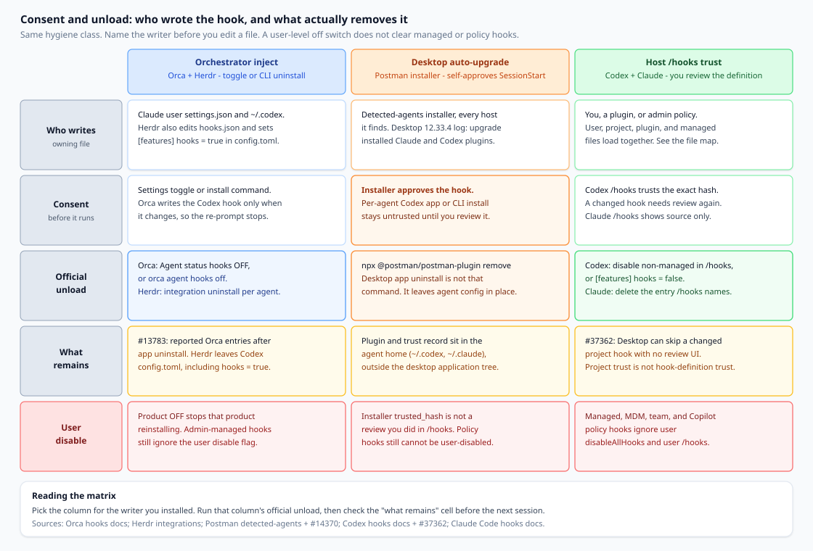
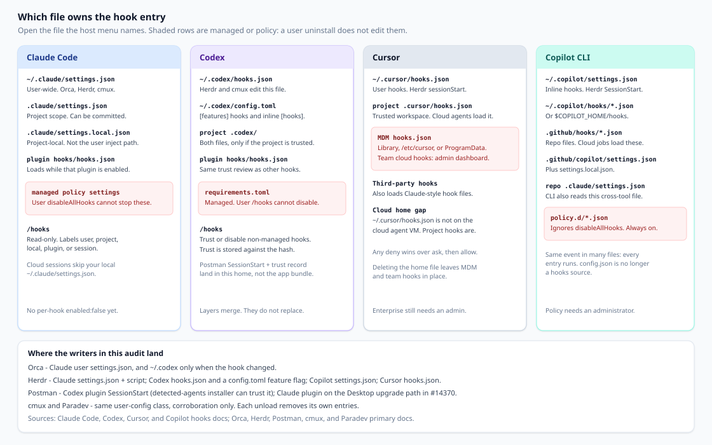

Claude Code, Codex, Cursor, and Copilot CLI run commands listed in hook config: a user `settings.json`, a `hooks.json`, a `config.toml`, a plugin manifest, and, on a managed machine, a policy file an administrator shipped. An orchestrator that wants session status, or a desktop app that wants its plugin present, writes those files on your machine.

Uninstalling the app is a different action from clearing those files. This is a decision document for the leftover, not a product launch and not a ranking of pane managers or API clients. Orca, Herdr, and Postman can each write host agent config. The hygiene class is the same: who consented, which file owns the entry, which official unload removes it, and which hooks a user-level disable flag cannot turn off.

## What you are actually deciding

Write one sentence before you edit JSON:

> After this install or uninstall, am I removing an orchestrator's managed status hooks, reversing a desktop installer that rewrote host agent config, or reviewing a hook the host still treats as untrusted—and which of those jobs does deleting the application not do?

If the sentence collapses to "I removed the app, so the agents are clean," the next SessionStart still reads `~/.claude` or `~/.codex`. A clean `git status` does not list those files.

## Three ways a hook arrives

**1. Orchestrator inject, with an official unload.** Orca and Herdr write hooks so a workspace can see session identity or working / waiting / done, and can resume a pane after its own restart. Both document how to remove what they wrote. cmux and Paradev (formerly Superset) write the same class of user config. They corroborate the pattern.

**2. Desktop auto-upgrade installer.** Postman's detected-agents installer approves its Codex SessionStart hook for you. A Desktop 12.33.4 log shows that installer running from an existing-user upgrade. Consent happens in the installer, not in a Codex `/hooks` click you remember.

**3. Host trust UX.** Codex does not run a non-managed hook until you review that exact definition. Trust is stored against a hash, so a changed hook needs review again. Claude Code's `/hooks` menu shows where each hook came from and does not toggle one hook. A vendor that leaves the hook untrusted is waiting on this surface. A vendor that writes the trust record has finished the step the host otherwise asks you to do.

Name the path, then open the file it writes. Replacing every `settings.json` deletes hooks and preferences you meant to keep.

*Figure 1. Three arrival paths for the same class of host-config write. Official unload is per writer. A user-level disable flag does not clear managed or policy hooks on Claude Code, Codex, Copilot CLI, or Cursor enterprise distribution.*

**Figure 1 reading.** Left: a setting or CLI both installs and removes managed entries, and you still diff the file, because an app uninstall and a feature flag do not always follow the toggle. Middle: approval can happen inside the installer, and removing the desktop app is not the documented plugin remove. Right: `/hooks` trusts or disables non-managed hooks, and a changed project hook can sit untrusted when the desktop UI never says so.

## Orca: the switch that removes managed hooks

Orca's agent-status hooks report working, waiting, and done into the Orca UI. Settings → Agents → Agent status hooks, off, removes those managed hooks and stops reinstalling them; on, it restores them without an app restart. The CLI is `orca agent hooks status`, `on`, and `off`, with `--json` ([Agent hooks and memory](https://www.onorca.dev/docs/agents/hooks-memory)).

On Claude Code the destination is `~/.claude/settings.json`. The report that asked for `settings.local.json` was closed as won't-fix: user-wide launches only discover hooks from `settings.json`, and `settings.local.json` loads at project scope ([orca#6879](https://github.com/stablyai/orca/issues/6879)). An audit that only opens the project-local file misses the inject.

Codex is a separate write. Orca puts its Codex hook in `~/.codex` only when something changed, so Codex is not asked to approve the same hook on every launch ([docs](https://www.onorca.dev/docs/agents/hooks-memory)). A quiet prompt means the definition settled. It does not mean the hook is gone.

The documented unload is the toggle or `orca agent hooks off`. Issue [#13783](https://github.com/stablyai/orca/issues/13783) includes user reports that entries remained after the app was uninstalled until someone removed the Orca-owned objects. Treat those comments as reports. If status says off and `/hooks` still shows an Orca command in user settings, delete that entry and leave every other hook. A third-party cleaner is not the documented unload.

**The ~100K figure is transcript size.** Issue [#20845](https://github.com/stablyai/orca/issues/20845) is titled as if managed hooks added about 100K tokens of model context each session. The report described a long portable `command` string, about three thousand characters, stored for many events and copied into on-disk `hook_success` attachments. On Claude Code 2.1.296 the maintainer reproduced that text in the session file and did not find those hook command strings in captured API request messages. The issue closed with no further change for that duplication. A separate PostCompact case was handled in Orca PR #25211.

Claude Code's docs match the split. For most events, stdout goes to the debug log and is not shown to the model. `SessionStart`, `UserPromptSubmit`, `UserPromptExpansion`, and `PostModelSwitch` are the exceptions: their plain-text stdout can become context the model sees ([Hooks](https://code.claude.com/docs/en/hooks)). Session-file growth from long `command` strings is not a measurement of the prompt. Read the event type when the question is what the model was told.

## Herdr: uninstall names the file, and leaves one flag

Herdr wants the session id so it can resume a pane after its own restart. Claude Code and Codex state still come from screen detection. The docs describe resume and state reporting, not a security gate ([Integrations](https://herdr.dev/docs/integrations/)).

`herdr integration install claude` writes `hooks/herdr-agent-state.sh` under `~/.claude` (or `$CLAUDE_CONFIG_DIR`) and updates `settings.json`. The config directory must already exist. `herdr integration uninstall claude` removes the matching entries and deletes the script.

`herdr integration install codex` writes `herdr-agent-state.sh`, updates `hooks.json`, and ensures `[features] hooks = true` in `config.toml`. Uninstall removes Herdr's `hooks.json` entries and the script, and leaves `config.toml` unchanged ([Integrations](https://herdr.dev/docs/integrations/)).

That flag is the decision. It enables Codex hooks for the whole user directory. Herdr does not flip it off, because `false` would also disable every other hook in that home. If Herdr was the only reason the feature was on, set `hooks = false`. If your own hooks should keep running, leave it and confirm Herdr's command lines are gone. Codex documents `hooks` as the feature key and `codex_hooks` as a deprecated alias ([Codex hooks](https://developers.openai.com/codex/hooks)).

The same family also writes a Copilot `SessionStart` entry in `settings.json`, a Cursor `sessionStart` entry in `~/.cursor/hooks.json`, and Devin entries in `config.json`. `uninstall claude` does not clear those. `herdr integration status` is the inventory. On Windows, read the live file before discarding a `.herdr-backup`.

## Postman: the installer can approve what /hooks would ask you to review

Postman is here because it writes host agent config, the same class as the orchestrators, with a different consent moment.

Issue [#14370](https://github.com/postmanlabs/postman-app-support/issues/14370) reports Postman Desktop 12.33.4. The quoted log records `auto-existing-upgrade` with `claude-code:installed` and `codex:installed`. On Codex that is a user-level plugin plus a SessionStart hook. The reporter traces the installer to `approvePostmanHook`, which records a trust hash for Postman's current SessionStart hook. The hook context steers Codex toward Postman skills for a wide band of API work: design, implementation, mocking, testing, monitoring, documentation, and deployment. The same report says Postman's MCP connection failed authentication. A failed login is not evidence that data left the machine.

Detected-agents docs state the shortcut in one sentence: on Codex the plugin adds a session-start hook, and "The installer approves the hook for you." If it cannot, it tells you to review the hook in Codex, and a later hook change is approved by running the installer again. Skills and MCP work without the hook; the hook is what makes Codex reach for the skills more reliably. Removal is `npx @postman/postman-plugin remove` (`uninstall` is an alias). `status` lists what is installed. `--agent` limits the command. `--dry-run` previews it ([Detected agents](https://learning.postman.com/docs/postman-plugin/install/detected-agents)).

The per-agent Codex path is the contrast. Install from the Codex app or with Codex's plugin commands and "The hook installs untrusted." The next start shows "Hooks need review." You approve it there, and Codex asks again after an update changes the hook. The detected-agents installer is the path that approves the hook for you ([Install for a specific agent](https://learning.postman.com/docs/postman-plugin/install/per-agent)).

Codex requires that review for non-managed hooks. `/hooks` lists sources, trusts a definition, or disables individual non-managed hooks. Trust follows the current hash. Managed hooks from system, MDM, cloud, or `requirements.toml` are trusted by policy and cannot be disabled in that user browser ([Codex hooks](https://developers.openai.com/codex/hooks)). An installer that stores the trust record has completed the review the host otherwise puts in front of you.

Uninstalling Postman Desktop does not run `postman-plugin remove`. The plugin and the trust record live under the agent config—in the #14370 report, `~/.codex`—and the detected-agents installer also targets Claude Code. The desktop application bundle is a different directory. After an upgrade you did not intend as a plugin install, run `status`, then `remove` for the agents you do not want, then open `/hooks` and confirm the SessionStart entry.

Issue [#37362](https://github.com/openai/codex/issues/37362) is the host side of the same surface. Codex Desktop skipped a changed project-local SessionStart hook: the project was trusted, the definition was not, and Desktop had no review control. Trusting it in the interactive CLI made the hook run. Project trust and hook-definition trust are different gates, so an installer-stored hash and a silent desktop skip are both reasons to open `/hooks`.

## cmux and Paradev only corroborate the shape

cmux uses hooks for running state, notifications, and session restore. Sessions outside a cmux shell need `~/.cmux/bin/cmux claude-hook install`, which writes `settings.json` under `$CLAUDE_CONFIG_DIR` or `~/.claude`. `~/.cmux/bin/cmux claude-hook uninstall` removes only cmux entries. Other agents use `cmux hooks setup` and `cmux hooks uninstall`. Codex lands in `~/.codex/hooks.json` and `config.toml`; Cursor's CLI lands in `~/.cursor/hooks.json`. Uninstall before you hand-edit generated files ([agent hooks](https://github.com/manaflow-ai/cmux/blob/main/docs/agent-hooks.md)).

Paradev, formerly Superset, installs lifecycle hooks and wrappers under `~/.paradev/bin` for the activity strip and finished / waiting notifications. The hooks no-op outside Paradev terminals because they look for a Paradev environment variable, and they still occupy the agent config while they no-op. Removal is the per-agent hooks toggle under Settings → Agents ([Agent status](https://docs.superset.sh/agent-status); [FAQ](https://docs.paradev.com/faq)). The FAQ also records the move from `~/.superset` to `~/.paradev`. An old directory name inside a command is a leftover to read.

Each unload removes its own entries. Orca's toggle does not delete Herdr's script. Herdr's Codex uninstall does not delete a Postman plugin.

## Audit the owner, the official unload, then the leftover

**1. Name the owner before you edit.** Claude Code `/hooks` labels user, project, local, plugin, or session ([Hooks](https://code.claude.com/docs/en/hooks)). Codex `/hooks` reviews, trusts, or disables non-managed hooks. Cursor merges enterprise, team, project, user, and plugin hooks, and any deny wins over ask, then allow ([Cursor hooks](https://cursor.com/docs/hooks)). Copilot CLI runs every match from policy, user, repository, and plugins ([Hooks reference](https://docs.github.com/en/copilot/reference/hooks-reference)).

**2. Run that writer's unload.** Orca: the Agent status hooks switch, or `orca agent hooks off`. Herdr: `herdr integration uninstall` per agent you installed. Postman: `npx @postman/postman-plugin remove`. cmux and Paradev: their uninstall or Settings toggle, for their entries only. "The command exited" is not yet "the file is clean."

**3. Diff the owning file.** Look for command lines that still name the vendor, companion scripts, a Codex `[features] hooks` value Herdr does not revert, a Postman plugin or marketplace table, and a `hooks.state` trust record for a plugin you removed. Delete those objects. Keep the rest. If you cannot tell them apart, stop at the status command (`orca agent hooks status`, `herdr integration status`, `npx @postman/postman-plugin status`) instead of blanking the file.

**4. User disable flags skip managed and policy hooks.**

Claude Code: `disableAllHooks` follows settings precedence, so a project file can override your user file. A one-shot settings override on the `claude` command can force it for one run. Set in user, project, or local settings, the flag cannot disable managed-policy hooks. Only the managed tier can disable managed hooks. `allowManagedHooksOnly` blocks user, project, local, and ordinary plugin hooks. There is still no per-hook off switch in the user file ([Hooks](https://code.claude.com/docs/en/hooks)).

Codex: `[features] hooks = false` in `config.toml` turns hooks off. An admin can pin `hooks = true` in `requirements.toml`, and can set `allow_managed_hooks_only = true` so user, project, session, and plugin hooks are ignored while managed hooks still load. Managed hooks cannot be switched off from the user `/hooks` browser. A flag that skips the trust prompt for one invocation does not remove the hook ([Codex hooks](https://developers.openai.com/codex/hooks)).

Copilot CLI: `disableAllHooks` inside one `.github/hooks/*.json` skips that file. On the repository's `.github/copilot/settings.json` it skips non-policy sources for that repo on the CLI. Files in `/etc/github-copilot/policy.d/*.json`, and the Windows policy paths, still run, including in an untrusted folder ([Hooks reference](https://docs.github.com/en/copilot/reference/hooks-reference)).

Cursor: deleting `~/.cursor/hooks.json` removes user hooks. It leaves MDM hooks (`/Library/Application Support/Cursor/hooks.json`, `/etc/cursor/hooks.json`, or `ProgramData\Cursor\hooks.json`) and team hooks from the dashboard. Cloud agents load the repo's `.cursor/hooks.json` and, on Enterprise, team and managed hooks. They do not load your home file ([Cursor hooks](https://cursor.com/docs/hooks)).

**5. Keep transcript bulk separate from what the model was told.** Orca #20845 is the template. Session files grow when a long `command` is copied into transcript attachments. That growth is on disk. It is not evidence the same text was sent as model context. SessionStart stdout is the other category: Claude Code can add it as model-visible context, and Postman's SessionStart is documented as a way to steer Codex toward Postman skills. That is a consent question. It is not the ~100K command-string claim.

## Which file to open

*Figure 2. The file that owns the entry depends on the host and the scope. Orchestrators in this article write the user-level files. Managed and policy files are a different owner, and a user uninstall does not edit them.*

**Figure 2 reading.** Claude user hooks are `~/.claude/settings.json`; project hooks are `.claude/settings.json`; `settings.local.json` is project-local and will not show Orca's user-wide inject. Codex splits `hooks.json` and `config.toml` across the user home and a trusted project, and adds plugin `hooks/hooks.json`. Cursor uses `hooks.json` for user and project, plus MDM and team hooks. Copilot CLI reads `~/.copilot/settings.json`, `~/.copilot/hooks/*.json`, `.github/hooks/*.json`, `.github/copilot/settings.json`, and the repo's `.claude/settings.json`. Policy files under `/etc/github-copilot/policy.d/` survive a user remove. A hook that reappears was loaded from a second path, or written again because the orchestrator switch was still on.

## What this audit leaves in place

**Admin-pinned hooks.** Claude managed settings, Codex `requirements.toml`, Copilot policy, and Cursor enterprise distribution are an admin change. A user `disableAllHooks` will not retire them. Read the source label before you call a vendor uninstall a failure.

**Hooks you still want.** Herdr leaving `[features] hooks = true` is the right leftover when other hooks should keep running. Postman's per-agent install is an ordinary untrusted plugin until you approve it.

**Cloud sessions.** Claude cloud sessions skip local `~/.claude/settings.json`. Cursor cloud agents skip `~/.cursor/hooks.json`. Copilot cloud jobs load `.github/hooks/*.json` from the clone. Audit the path that job loads.

**The inside of a hook you chose to trust.** This runbook stops at ownership, consent, and unload. If a remaining command is unfamiliar, disable that non-managed hook in the host UI or remove the vendor's entry, then read the script in the vendor's repository the way you would read any other dependency.

## Checklist before the next session

- [ ] Named the writer: Orca or Herdr, the Postman installer or Desktop upgrade, or a hook you added that the host has not trusted.
- [ ] Opened the file `/hooks` names—user, project, plugin, or managed—not the first `settings.json` a search returned.
- [ ] Ran that writer's official unload, and did not treat desktop-app uninstall as clearing agent config.
- [ ] Diffed leftovers: vendor commands, companion scripts, Herdr's Codex `config.toml` flag, Postman plugin entries and trust records.
- [ ] Left unrelated hooks in place.
- [ ] If you switched orchestrators, ran the other tool's unload too.
- [ ] Treated managed, MDM, team, and Copilot policy hooks as admin-owned when the source label says so.
- [ ] Opened Codex `/hooks` after an installer-written approval or a "Hooks need review" prompt. Project trust is not hook trust.
- [ ] Treated a large session file as transcript bulk when the growth is long `command` strings, and read SessionStart stdout separately when the question is what the model was told.
- [ ] Checked cloud or CI against repository hook paths, not only the home directory.

The next session runs whatever those files still list. Name the writer, unload on its terms, and read the file the host loads.
