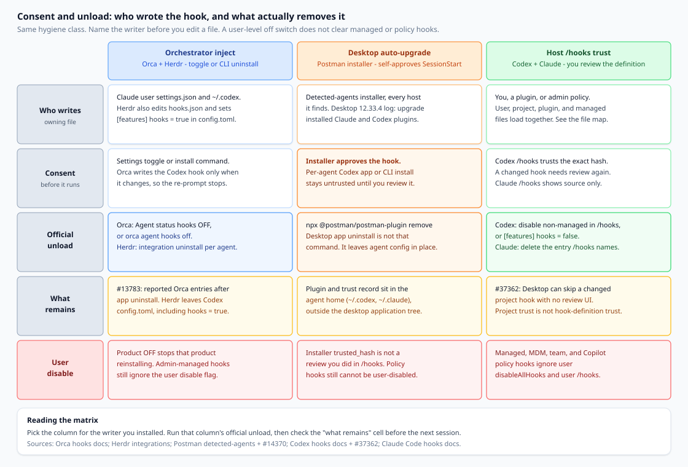
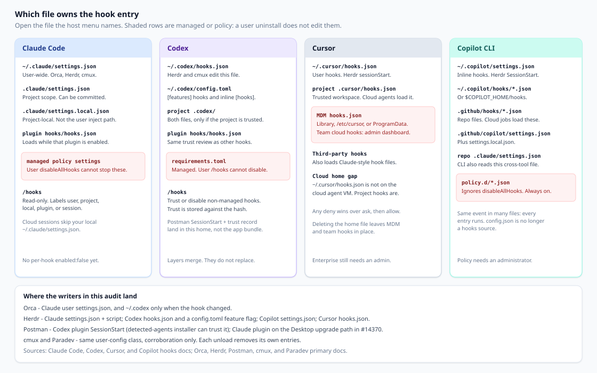

Claude Code、Codex、Cursor 和 Copilot CLI 会运行钩子配置中列出的命令：用户的 `settings.json`、一份 `hooks.json`、一份 `config.toml`、一份插件清单，以及在受管机器上由管理员下发的策略文件。想要会话状态的编排器，或想让自己的插件在场的桌面应用，会在你的机器上写入这些文件。

卸载应用与清除这些文件是不同的动作。本文是一份针对残留的决策文档，不是产品发布，也不是对窗格管理器或 API 客户端的排名。Orca、Herdr 和 Postman 都可以写入宿主智能体配置。卫生问题属于同一类：谁同意了，哪个文件拥有这条条目，哪一次官方卸除能移除它，以及哪些钩子是用户级禁用标志所关不掉的。

## 你实际在决定的是什么

编辑 JSON 之前，先写下一句话：

> 在这次安装或卸载之后，我是在移除编排器的受管状态钩子，还是在撤销一个改写了宿主智能体配置的桌面安装程序，还是在复查一条宿主仍视为不受信任的钩子——删除应用程序做不到其中的哪一件？

如果这句话收束成“我移除了应用，所以这些智能体是干净的”，下一次 SessionStart 仍会读取 `~/.claude` 或 `~/.codex`。干净的 `git status` 不会列出这些文件。

## 钩子到达的三种方式

**1. 编排器注入，并带有官方卸除。** Orca 和 Herdr 写入钩子，以便工作区能看到会话身份，或工作中 / 等待中 / 已完成，并能在自身重启后恢复一个窗格。二者都写明了如何移除它们写入的内容。cmux 和 Paradev（前称 Superset）写入同一类用户配置。它们印证了这一模式。

**2. 桌面自动升级安装程序。** Postman 的已检测智能体安装程序会替你批准它的 Codex SessionStart 钩子。一份 Desktop 12.33.4 日志显示，该安装程序在一次现有用户升级中运行。同意发生在安装程序里，而不是发生在你记得的那一次 Codex `/hooks` 点击里。

**3. 宿主信任体验。** 在你复查那条确切定义之前，Codex 不会运行非受管钩子。信任按哈希存储，因此改过的钩子需要再次复查。Claude Code 的 `/hooks` 菜单会显示每条钩子来自何处，并且不会开关其中单独的一条。把钩子留在不受信任状态的供应商，是在等这个界面。写入信任记录的供应商，已经完成了宿主原本会要求你做的那一步。

先点名路径，再打开它写入的文件。替换每一份 `settings.json`，会删掉你本想保留的钩子和偏好。

*图 1. 同一类宿主配置写入的三条到达路径。官方卸除按写入者分别进行。用户级禁用标志不会清除 Claude Code、Codex、Copilot CLI 或 Cursor 企业分发上的受管钩子或策略钩子。*

**图 1 读法。** 左侧：一项设置或 CLI 既能安装也能移除受管条目，你仍然要比对该文件，因为卸载应用和功能标志并不总是跟着这个开关走。中间：批准可以发生在安装程序内部，移除桌面应用并不是文档记载的插件移除。右侧：`/hooks` 会信任或禁用非受管钩子；当桌面界面从未说明这一点时，一条已更改的项目钩子可以处于不受信任状态。

## Orca：移除受管钩子的那个开关

Orca 的智能体状态钩子把工作中、等待中和已完成报告到 Orca 界面。设置 → 智能体 → 智能体状态钩子，关闭，会移除这些受管钩子并停止重新安装它们；打开，会在不重启应用的情况下恢复它们。CLI 是 `orca agent hooks status`、`on` 和 `off`，并可带上 `--json`（[智能体钩子与记忆](https://www.onorca.dev/docs/agents/hooks-memory)）。

在 Claude Code 上，写入目标是 `~/.claude/settings.json`。那份要求使用 `settings.local.json` 的报告以不予修复关闭：用户范围的启动只会从 `settings.json` 发现钩子，而 `settings.local.json` 在项目范围加载（[orca#6879](https://github.com/stablyai/orca/issues/6879)）。只打开项目本地文件的审计会漏掉这次注入。

Codex 是另一次写入。只有在有所变化时，Orca 才把它的 Codex 钩子放进 `~/.codex`，因此不会在每次启动时都要求 Codex 批准同一个钩子（[文档](https://www.onorca.dev/docs/agents/hooks-memory)）。提示归于安静，意味着定义已经稳定。这并不意味着钩子已经消失。

文档记载的卸除是这个开关，或 `orca agent hooks off`。议题 [#13783](https://github.com/stablyai/orca/issues/13783) 包含用户报告：应用被卸载之后条目仍然留着，直到有人移除 Orca 拥有的对象。把这些评论当作报告。如果状态显示为关闭，而 `/hooks` 仍在用户设置中显示一条 Orca 命令，就删除该条目，并留下其他每一条钩子。第三方清理工具不是文档记载的卸除。

**约 100K 这个数字是会话记录的大小。** 议题 [#20845](https://github.com/stablyai/orca/issues/20845) 的标题写得好像受管钩子在每次会话中为模型上下文增加了大约 100K token。报告描述的是一条很长的、可移植的 `command` 字符串，大约三千个字符，为许多事件所存储，并被复制进磁盘上的 `hook_success` 附件。在 Claude Code 2.1.296 上，维护者在会话文件中复现了这段文本，并且没有在捕获的 API 请求消息里找到这些钩子命令字符串。该议题关闭时，没有针对这一重复再做更改。一个单独的 PostCompact 情况在 Orca PR #25211 中得到处理。

Claude Code 的文档与这一区分相符。对大多数事件，标准输出进入调试日志，不会展示给模型。`SessionStart`、`UserPromptSubmit`、`UserPromptExpansion` 和 `PostModelSwitch` 是例外：它们的纯文本标准输出可以成为模型看到的上下文（[钩子](https://code.claude.com/docs/en/hooks)）。由很长的 `command` 字符串造成的会话文件增长，并不是对提示的测量。当问题是模型被告知了什么时，去读事件类型。

## Herdr：卸载会点名文件，并留下一个标志

Herdr 需要会话 id，以便在它自己重启之后恢复一个窗格。Claude Code 和 Codex 的状态仍然来自屏幕检测。文档描述的是恢复和状态报告，不是一道安全门（[集成](https://herdr.dev/docs/integrations/)）。

`herdr integration install claude` 会在 `~/.claude`（或 `$CLAUDE_CONFIG_DIR`）下写入 `hooks/herdr-agent-state.sh`，并更新 `settings.json`。配置目录必须已经存在。`herdr integration uninstall claude` 会移除匹配的条目并删除该脚本。

`herdr integration install codex` 会写入 `herdr-agent-state.sh`，更新 `hooks.json`，并确保 `config.toml` 中有 `[features] hooks = true`。卸载会移除 Herdr 的 `hooks.json` 条目和该脚本，并让 `config.toml` 保持不变（[集成](https://herdr.dev/docs/integrations/)）。

这个标志就是要做的决定。它为整个用户目录启用 Codex 钩子。Herdr 不会把它拨回关闭，因为 `false` 也会禁用该主目录中的其他每一条钩子。如果 Herdr 是这项功能处于开启的唯一原因，就设置 `hooks = false`。如果你自己的钩子应当继续运行，就留下它，并确认 Herdr 的命令行已经消失。Codex 把 `hooks` 记载为功能键，把 `codex_hooks` 记载为已弃用的别名（[Codex 钩子](https://developers.openai.com/codex/hooks)）。

同一系列还会在 `settings.json` 中写入一条 Copilot `SessionStart` 条目，在 `~/.cursor/hooks.json` 中写入一条 Cursor `sessionStart` 条目，并在 `config.json` 中写入 Devin 条目。`uninstall claude` 不会清除这些。`herdr integration status` 就是这份清单。在 Windows 上，先读正在生效的文件，再丢弃 `.herdr-backup`。

## Postman：安装程序可以批准 /hooks 原本会请你复查的内容

Postman 出现在这里，是因为它写入宿主智能体配置，与编排器属于同一类，只是同意发生的时刻不同。

议题 [#14370](https://github.com/postmanlabs/postman-app-support/issues/14370) 报告了 Postman Desktop 12.33.4。所引日志记录了 `auto-existing-upgrade`，并带有 `claude-code:installed` 和 `codex:installed`。在 Codex 上，那是一个用户级插件加上一条 SessionStart 钩子。报告者把安装程序追溯到 `approvePostmanHook`，它会为 Postman 当前的 SessionStart 钩子记录一个信任哈希。钩子上下文会把 Codex 引向 Postman 技能，覆盖很宽的一档 API 工作：设计、实现、模拟、测试、监控、文档和部署。同一份报告说 Postman 的 MCP 连接认证失败。登录失败并不是数据已经离开这台机器的证据。

已检测智能体文档用一句话说明这条捷径：在 Codex 上，该插件会添加一条会话开始钩子，并且“安装程序会替你批准该钩子。”如果它做不到，它会告诉你在 Codex 中复查该钩子，而之后的钩子变更要通过再次运行安装程序来批准。技能和 MCP 在没有该钩子时也能工作；该钩子让 Codex 更可靠地去取用这些技能。移除方式是 `npx @postman/postman-plugin remove`（`uninstall` 是别名）。`status` 列出已安装的内容。`--agent` 限制该命令。`--dry-run` 预览它（[已检测智能体](https://learning.postman.com/docs/postman-plugin/install/detected-agents)）。

按智能体安装的 Codex 路径是对照。从 Codex 应用安装，或用 Codex 的插件命令安装，则“钩子以不受信任状态安装。”下一次启动会显示“钩子需要复查。”你在那里批准它，而在更新改变该钩子之后，Codex 会再次询问。已检测智能体安装程序才是替你批准该钩子的路径（[为特定智能体安装](https://learning.postman.com/docs/postman-plugin/install/per-agent)）。

Codex 要求对非受管钩子进行这次复查。`/hooks` 列出来源、信任一个定义，或禁用单个非受管钩子。信任跟随当前哈希。来自系统、MDM、云端或 `requirements.toml` 的受管钩子按策略受信任，并且不能在该用户浏览界面中被禁用（[Codex 钩子](https://developers.openai.com/codex/hooks)）。把信任记录存下来的安装程序，已经完成了宿主原本放在你面前的那次复查。

卸载 Postman Desktop 并不会运行 `postman-plugin remove`。插件和信任记录位于智能体配置之下——在 #14370 的报告中是 `~/.codex`——而已检测智能体安装程序也会以 Claude Code 为目标。桌面应用程序包是另一个目录。在一次你并不打算作为插件安装的升级之后，运行 `status`，再对你不想要的智能体运行 `remove`，然后打开 `/hooks` 并确认 SessionStart 条目。

议题 [#37362](https://github.com/openai/codex/issues/37362) 是同一界面的宿主一侧。Codex Desktop 跳过了一条已更改的项目本地 SessionStart 钩子：项目是受信任的，定义不是，而 Desktop 没有复查控件。在交互式 CLI 中信任它，才使该钩子运行。项目信任和钩子定义信任是不同的门，因此安装程序存下的哈希和桌面端的静默跳过，都是打开 `/hooks` 的理由。

## cmux 和 Paradev 只是印证这一形态

cmux 用钩子处理运行状态、通知和会话恢复。cmux shell 之外的会话需要 `~/.cmux/bin/cmux claude-hook install`，它会在 `$CLAUDE_CONFIG_DIR` 或 `~/.claude` 下写入 `settings.json`。`~/.cmux/bin/cmux claude-hook uninstall` 只移除 cmux 条目。其他智能体使用 `cmux hooks setup` 和 `cmux hooks uninstall`。Codex 落在 `~/.codex/hooks.json` 和 `config.toml`；Cursor 的 CLI 落在 `~/.cursor/hooks.json`。在手工编辑生成的文件之前先卸载（[智能体钩子](https://github.com/manaflow-ai/cmux/blob/main/docs/agent-hooks.md)）。

Paradev，前称 Superset，会在 `~/.paradev/bin` 下安装生命周期钩子和包装器，用于活动条以及已完成 / 等待中通知。这些钩子在 Paradev 终端之外会空操作，因为它们查找一个 Paradev 环境变量，而在空操作期间它们仍然占据智能体配置。移除方式是设置 → 智能体之下的按智能体钩子开关（[智能体状态](https://docs.superset.sh/agent-status)；[常见问题](https://docs.paradev.com/faq)）。常见问题也记录了从 `~/.superset` 迁到 `~/.paradev`。命令里的旧目录名是一处要读的残留。

每一次卸除只移除它自己的条目。Orca 的开关不会删除 Herdr 的脚本。Herdr 的 Codex 卸载不会删除 Postman 插件。

## 审计所有者、官方卸除，然后是残留

**1. 编辑之前先点名所有者。** Claude Code 的 `/hooks` 会标注用户、项目、本地、插件或会话（[钩子](https://code.claude.com/docs/en/hooks)）。Codex 的 `/hooks` 会复查、信任或禁用非受管钩子。Cursor 会合并企业、团队、项目、用户和插件钩子，并且任何拒绝都优先于询问，然后才是允许（[Cursor 钩子](https://cursor.com/docs/hooks)）。Copilot CLI 会运行来自策略、用户、仓库和插件的每一个匹配（[钩子参考](https://docs.github.com/en/copilot/reference/hooks-reference)）。

**2. 运行该写入者的卸除。** Orca：智能体状态钩子开关，或 `orca agent hooks off`。Herdr：对你安装过的每个智能体执行 `herdr integration uninstall`。Postman：`npx @postman/postman-plugin remove`。cmux 和 Paradev：它们的卸载或设置开关，仅针对它们的条目。“命令已退出”还不是“文件已经干净”。

**3. 比对拥有该条目的文件。** 寻找仍然点名该供应商的命令行、配套脚本、Herdr 不会还原的 Codex `[features] hooks` 值、Postman 插件或市场表，以及你已移除插件的 `hooks.state` 信任记录。删除这些对象。保留其余。如果无法把它们区分开，就停在状态命令（`orca agent hooks status`、`herdr integration status`、`npx @postman/postman-plugin status`），而不是把文件清空。

**4. 用户禁用标志会跳过受管钩子和策略钩子。**

Claude Code：`disableAllHooks` 遵循设置优先级，因此项目文件可以覆盖你的用户文件。在 `claude` 命令上的一次性设置覆盖，可以强制它只对一次运行生效。设在用户、项目或本地设置中时，该标志不能禁用受管策略钩子。只有受管层才能禁用受管钩子。`allowManagedHooksOnly` 会拦截用户、项目、本地和普通插件钩子。用户文件中仍然没有逐钩子的关闭开关（[钩子](https://code.claude.com/docs/en/hooks)）。

Codex：`config.toml` 中的 `[features] hooks = false` 会关掉钩子。管理员可以在 `requirements.toml` 中钉住 `hooks = true`，并可以设置 `allow_managed_hooks_only = true`，从而在受管钩子仍然加载的同时，忽略用户、项目、会话和插件钩子。受管钩子不能从用户的 `/hooks` 浏览器中关掉。一个为单次调用跳过信任提示的标志并不会移除该钩子（[Codex 钩子](https://developers.openai.com/codex/hooks)）。

Copilot CLI：某一个 `.github/hooks/*.json` 内的 `disableAllHooks` 会跳过该文件。写在仓库的 `.github/copilot/settings.json` 上时，它会让 CLI 对该仓库跳过非策略来源。`/etc/github-copilot/policy.d/*.json` 中的文件，以及 Windows 策略路径，仍然会运行，包括在不受信任的文件夹中（[钩子参考](https://docs.github.com/en/copilot/reference/hooks-reference)）。

Cursor：删除 `~/.cursor/hooks.json` 会移除用户钩子。它会留下 MDM 钩子（`/Library/Application Support/Cursor/hooks.json`、`/etc/cursor/hooks.json` 或 `ProgramData\Cursor\hooks.json`）以及来自仪表板的团队钩子。云端智能体会加载仓库的 `.cursor/hooks.json`，并在 Enterprise 上加载团队钩子和受管钩子。它们不会加载你的主目录文件（[Cursor 钩子](https://cursor.com/docs/hooks)）。

**5. 把会话记录的体积与模型被告知的内容分开。** Orca #20845 是模板。当一条很长的 `command` 被复制进会话记录附件时，会话文件会增长。这一增长在磁盘上。它并不是同一段文本被作为模型上下文发送的证据。SessionStart 的标准输出是另一类：Claude Code 可以把它加为模型可见的上下文，而 Postman 的 SessionStart 在文档中是一种把 Codex 引向 Postman 技能的方式。那是一个同意问题。它不是约 100K 命令字符串的那种主张。

## 该打开哪个文件

*图 2. 拥有该条目的文件取决于宿主和范围。本文中的编排器写入用户级文件。受管文件和策略文件是另一个所有者，用户卸载不会编辑它们。*

**图 2 读法。** Claude 的用户钩子是 `~/.claude/settings.json`；项目钩子是 `.claude/settings.json`；`settings.local.json` 是项目本地的，不会显示 Orca 的用户范围注入。Codex 把 `hooks.json` 和 `config.toml` 分放在用户主目录和一个受信任的项目中，并加上插件的 `hooks/hooks.json`。Cursor 对用户和项目使用 `hooks.json`，另加 MDM 钩子和团队钩子。Copilot CLI 读取 `~/.copilot/settings.json`、`~/.copilot/hooks/*.json`、`.github/hooks/*.json`、`.github/copilot/settings.json`，以及仓库的 `.claude/settings.json`。`/etc/github-copilot/policy.d/` 下的策略文件在用户移除之后仍然存在。一条重新出现的钩子，是从第二条路径加载的，或是因为编排器开关仍然开着而被再次写入的。

## 这次审计留在原地的内容

**管理员钉住的钩子。** Claude 受管设置、Codex 的 `requirements.toml`、Copilot 策略，以及 Cursor 企业分发，是管理员的更改。用户的 `disableAllHooks` 不会让它们退役。在你把供应商卸载称为失败之前，先读来源标签。

**你仍然想要的钩子。** 当其他钩子应当继续运行时，Herdr 留下 `[features] hooks = true` 是正确的残留。在你批准之前，Postman 的按智能体安装是一个普通的不受信任插件。

**云端会话。** Claude 云端会话会跳过本地的 `~/.claude/settings.json`。Cursor 云端智能体会跳过 `~/.cursor/hooks.json`。Copilot 云端作业会从克隆中加载 `.github/hooks/*.json`。审计该作业所加载的路径。

**你选择信任的钩子的内部。** 这份操作手册止于所有权、同意和卸除。如果残留的命令并不熟悉，就在宿主界面中禁用该非受管钩子，或移除该供应商的条目，然后像阅读任何其他依赖一样，到供应商的仓库里阅读该脚本。

## 下一次会话之前的清单

- [ ] 已点名写入者：Orca 或 Herdr、Postman 安装程序或 Desktop 升级，或一条你添加的、宿主尚未信任的钩子。
- [ ] 已打开 `/hooks` 所点名的文件——用户、项目、插件或受管——而不是搜索返回的第一份 `settings.json`。
- [ ] 已运行该写入者的官方卸除，并且没有把桌面应用卸载当作清除智能体配置。
- [ ] 已比对残留：供应商命令、配套脚本、Herdr 的 Codex `config.toml` 标志、Postman 插件条目和信任记录。
- [ ] 已把无关的钩子留在原地。
- [ ] 如果更换了编排器，也已运行另一个工具的卸除。
- [ ] 当来源标签如此标明时，已把受管、MDM、团队和 Copilot 策略钩子视为管理员所有。
- [ ] 在安装程序写入的批准或“钩子需要复查”提示之后，已打开 Codex 的 `/hooks`。项目信任不是钩子信任。
- [ ] 当增长来自很长的 `command` 字符串时，已把很大的会话文件当作会话记录的体积，并在问题是模型被告知了什么时单独阅读 SessionStart 的标准输出。
- [ ] 已按仓库钩子路径检查云端或 CI，而不只是主目录。

下一次会话会运行这些文件仍然列出的内容。点名写入者，按其条件卸除，并阅读宿主所加载的文件。
