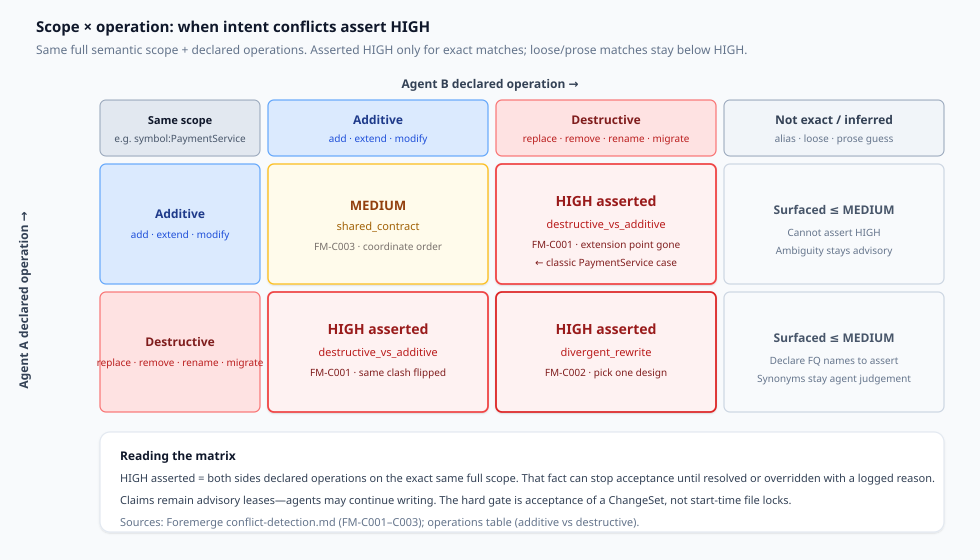
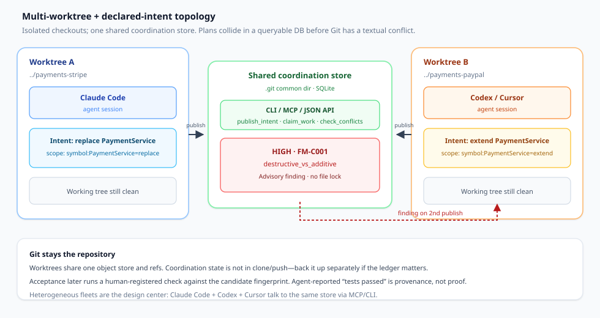

Git worktrees let Claude Code, Codex, and Cursor edit the same repository without stepping on each other’s working trees. That solves *file* contention. It does not solve *plan* contention. Two agents can produce clean diffs in separate trees, merge without a textual conflict, and still leave the product in a state that cannot be true: one replaced the extension point the other just extended.

This article is a decision document for that class of failure. The question is not “which multi-agent reviewer is best.” It is: **which conflict type are you actually coordinating before you spin N agents?** Foremerge is one open-source implementation of *write-time declared intents*—a case study, not a soft launch.

## What you are actually deciding

Write the decision as one sentence before you open the next worktree:

> For this batch of parallel tasks, am I preventing **incompatible declared plans** (scope + operation that cannot both be true), enforcing a **shared contract before implementation**, relying on **post-write mutual review**, or sequencing work through **ownership / orchestration**—and which of those failures will Git *not* catch?

If the answer collapses to “just give each agent a worktree and merge when green,” you are outsourcing semantic collisions to human review after tokens are already spent. Worktree isolation and CI are necessary. They are not a plan whiteboard.

## Four conflict strategies (pick the class, not the brand)

Teams mix these strategies; treating them as interchangeable products is how articles turn into roundups. Name the mechanism.

**1. Deterministic intent claims (write-time).** Before editing, each agent publishes what it will touch as structured scope plus operation (`symbol:PaymentService=replace`). A local rule engine compares declarations. Same inputs → same finding. No model sits in the detection path. Foremerge is built for this pattern ([foremerge.com](https://foremerge.com/); [naw103/foremerge](https://github.com/naw103/foremerge)).

**2. Contract / interface-first merge.** Shared APIs, schemas, and response shapes are settled (or owned) *before* parallel implementation. Dependent agents wait or rebase onto the agreed contract. Uno’s parallel-agents guidance states the failure plainly: different filenames do not guarantee independent behavior; an API and its consumer can disagree while Git merges both ([Parallel coding agents](https://uno.engineering/parallel-coding-agents)).

**3. LLM mutual review (post-write contrast only).** After patches exist, agents (or a judge model) read diffs and argue about compatibility. Useful as *review assist*; weak as the *primary* early-warning layer, because cost is paid before the argument starts and judgements can drift run to run. This article names the pattern as contrast—not as a product comparison board.

**4. Ownership orchestration.** Humans (or an orchestration layer) assign remit per area, queues, and escalation when requirements compete. An HN discussion of Foremerge described teams keeping code ownership and letting agents negotiate across areas with engineer escalation ([Show HN thread](https://news.ycombinator.com/item?id=49789356)). Uno’s orchestration write-up puts a decision owner on each outcome and resolves shared-module ownership before parallel edits ([Coding agent orchestration](https://uno.engineering/coding-agent-orchestration)).

Intent claims catch “both plans cannot be true” early when agents *declare*. Contracts catch interface drift when someone owns the boundary. Ownership catches remit fights. Mutual review catches leftovers after the fact. Choose the layer that matches the collision you keep rediscovering in merge review.

A useful smoke test: if your last expensive rework had clean diffs and a failed *meaning* (stranded callers, two schemas for one concept, two owners of one module), start with intent claims plus contract-first for shared surfaces. If the rework was two teams arguing product requirements with correct code on both sides, start with ownership orchestration. If the rework was “nobody looked at the other PR,” fix review capacity before buying another coordinator.

## Scope × operation: when HIGH conflicts fire

Intent claims only work if the vocabulary is facts, not vibes. Foremerge’s detector compares `ScopeClaim`s: a semantic scope (`symbol:…`, `api:…`, `schema:…`, `contract:…`, and related kinds) plus a declared operation. Additive operations (`add`, `extend`, `modify`) preserve what other work may depend on. Destructive operations (`replace`, `remove`, `rename`, `migrate`) do not ([conflict-detection.md](https://docs.rs/crate/foremerge/latest/source/docs/conflict-detection.md)).

*Figure 1. Same full scope + declared operations. FM-C001 (`destructive_vs_additive`) and FM-C002 (`divergent_rewrite`) can assert HIGH when both sides declare exact overlap. FM-C003 (`shared_contract`) stays MEDIUM for additive×additive. Loose alias matches and prose-inferred operations are surfaced below HIGH—ambiguity must not stop acceptance.*

**Asserted vs surfaced.** A finding is *asserted* only when both sides declared an operation on the *exact* same full scope. That is a fact from two declarations, so severity may reach HIGH. Everything else—name-only alias matches, cross-kind key matches, Jaccard-ish scope tokens, or operations guessed from prose—is *surfaced* and capped below HIGH ([conflict-detection.md](https://docs.rs/crate/foremerge/latest/source/docs/conflict-detection.md)). The trust model is deliberate: a coordination layer that cries HIGH on guesses gets ignored within a week.

**Headline case.** Agent A: replace `PaymentService` with `StripePaymentService`. Agent B: extend `PaymentService` with PayPal. No overlapping lines required. Git merges both; the PayPal work can land on a class nothing calls. Foremerge raises `HIGH` `destructive_vs_additive` (rule FM-C001) when both declare `symbol:PaymentService` with opposing operation classes—before either tree changes ([foremerge.com](https://foremerge.com/); [Show HN](https://news.ycombinator.com/item?id=49789356)).

**Figure 1 reading:** HIGH is reserved for declared opposition on one exact scope. Use it to force a human or recorded resolution *before* acceptance—not as a filesystem lock at start time.

Additive×additive (`shared_contract`) is the noisy neighbor: two extends may be fine after an ordered dependency, or they may invent incompatible APIs. Foremerge keeps that MEDIUM so agents coordinate without pretending the tool proved incompatibility. Schema/migration/config overlaps get migration-order suggestions instead of a generic “introduce a provider” pitch—wrong advice for a table rename is worse than silence ([conflict-detection.md](https://docs.rs/crate/foremerge/latest/source/docs/conflict-detection.md)).

## Multi-worktree + declaration topology

Isolation and shared awareness are different layers. Each agent keeps a worktree. Coordination state lives in one SQLite database under the repository’s Git common directory, so linked worktrees share the picture automatically ([foremerge.com](https://foremerge.com/); [README](https://github.com/naw103/foremerge)).

*Figure 2. Claude Code in worktree A and Codex/Cursor in worktree B publish intents (not diffs) into one store. The second publish returns the FM-C001 finding while both trees are still clean. Git remains the durable repository; the store is local coordination, not clone/push cargo.*

Protocol surfaces are provider-neutral: CLI, stdio MCP (eighteen tools in the public docs), and a loopback HTTP API. `foremerge setup all` wires Claude Code, Codex, and Cursor so heterogeneous fleets share one store ([foremerge.com](https://foremerge.com/)). Claims are leased advisories: two agents may claim the same scope; overlap warns; neither is hard-blocked ([limitations.md](https://raw.githubusercontent.com/naw103/foremerge/main/docs/limitations.md)).

Lifecycle language on the site runs intent → claimed → in progress → provisional → validated → accepted → committed. Agent-reported test results are provenance. Acceptance requires Foremerge-executed validation against the exact Git fingerprint of the candidate; changes after validation stale the evidence ([foremerge.com](https://foremerge.com/)). That gate is *acceptance*, not “outer-loop product done”—do not confuse it with a merge queue or host branch protection. Git still merges and pushes.

Uno’s parallel guide lands on a complementary topology: separate checkouts *and* separate running apps (ports, fixture data), then test the *combined* behavior before merge ([Parallel coding agents](https://uno.engineering/parallel-coding-agents)). Intent topology answers “did the plans collide?” Isolation topology answers “did the processes collide?” You usually need both when agents start servers, not only when they edit symbols.

## Foremerge as one implementation case

Facts from the site, GitHub, docs, and Show HN—not an endorsement score.

**What it is.** Open-source coordination protocol “built above Git.” One Rust binary. Apache-2.0. Local-first MVP (site and README describe `0.6.0` as pre-1.0; schemas may still change; published coordinated-vs-uncoordinated benchmarks are explicitly *not* claimed yet) ([foremerge.com](https://foremerge.com/); [README](https://github.com/naw103/foremerge)).

**Origin story (verified).** Maintainer Nick Woodhead describes a concrete wreck: one agent replacing a payment service class while another extended the same class from a backlog ticket—clean trees, clean merge, stranded extension point, a day of refactor. The tool was extracted from internal use at GPTree and open-sourced ([31 questions](https://foremerge.com/blog/31-questions-coordinating-parallel-coding-agents/); [Show HN](https://news.ycombinator.com/item?id=49789356)).

**Detection stance.** Deterministic, explainable, heuristic. No LLM judge, no embeddings, no full AST proof of compatibility ([conflict-detection.md](https://docs.rs/crate/foremerge/latest/source/docs/conflict-detection.md)). Suggestions (e.g. introduce a `PaymentProvider` contract) are heuristic advice, not automatic design decisions ([foremerge.com](https://foremerge.com/)).

**What it refuses.** Hard file locks (stale lock → fleet gridlock; semantic locks cannot be enforced without intercepting writes). Guessing synonymy at HIGH. Trusting an agent’s word that tests passed. Becoming a merge queue ([31 questions](https://foremerge.com/blog/31-questions-coordinating-parallel-coding-agents/); [limitations.md](https://raw.githubusercontent.com/naw103/foremerge/main/docs/limitations.md)).

**Scale note from Show HN.** The author reported testing up to 98 parallel agents on one repo in their environment, and replaying 76 intents with one flagged conflict plus a named blind spot (class name vs internal method claim). Treat those as maintainer-reported anecdotes, not published benchmarks—the project itself says quantitative coordinated-vs-uncoordinated results are not public yet ([Show HN](https://news.ycombinator.com/item?id=49789356); [foremerge.com](https://foremerge.com/)).

**Primary user (maintainer’s answer).** Solo power users running two or more agents on one machine today; fleets and teams are the later story pending further validation ([31 questions](https://foremerge.com/blog/31-questions-coordinating-parallel-coding-agents/)). That matches how most Claude Code + Codex dual-client setups actually look: one engineer, many worktrees, no distributed consensus needed yet.

## Blind spots: drift, fuzzy scopes, advisory leases

Coordination layers fail where declarations lie or lag.

**Undeclared drift.** The initial intent need not list every file; it must be right about destructive parts. Plans can be republished when they change. Detecting drift between declared scopes and actual edits is described as roadmap work in the Q&A—not a finished guarantee ([31 questions](https://foremerge.com/blog/31-questions-coordinating-parallel-coding-agents/); [Show HN](https://news.ycombinator.com/item?id=49789356)). If the agent never publishes, the whiteboard stays blank.

**Fuzzy and synonym scopes.** `PaymentService` vs `BillingService` will not assert HIGH from string rules alone. Alias matches without full qualification surface below HIGH. Agents (or humans) record assessments when they recognize cross-label overlap; language adapters that resolve symbols structurally are a stated direction, not a finished universal graph ([31 questions](https://foremerge.com/blog/31-questions-coordinating-parallel-coding-agents/); [conflict-detection.md](https://docs.rs/crate/foremerge/latest/source/docs/conflict-detection.md)).

**Advisory leases vs hard locks.** Claims warn; they do not serialize writers. The hard stop for HIGH is at ChangeSet acceptance (unresolved HIGH must be resolved or overridden with a logged reason)—not at the first keystroke ([Show HN](https://news.ycombinator.com/item?id=49789356); [31 questions](https://foremerge.com/blog/31-questions-coordinating-parallel-coding-agents/)). An agent that ignores warnings can still ship damage until acceptance or human review.

**Empty conflicts ≠ forever clear.** Conflict checks run when the *later* intent publishes. There are no push notifications to the earlier agent; it learns on the next status check. Treat an empty conflicts array as “none known yet,” not “none will exist” ([limitations.md](https://raw.githubusercontent.com/naw103/foremerge/main/docs/limitations.md)).

**Acceptance gates vs start-time claims.** Validation binds to a fingerprint and runs a human-registered check by *name* (agents do not supply arbitrary argv over MCP). That proves the named check exited clean on that fingerprint—not that the test suite was complete, hermetic, or ungameable ([limitations.md](https://raw.githubusercontent.com/naw103/foremerge/main/docs/limitations.md)). Claims answer “what are we about to mean?” Acceptance answers “did this candidate survive the check we registered?”

**Local-only.** The open-source store is one machine / one Git common dir. Multi-machine shared mode is roadmap, not in the box ([foremerge.com](https://foremerge.com/)).

## Practical rules for Claude Code / Codex / Cursor

Use these when you already run parallel worktrees on one laptop or workstation.

1. **Split by independent decisions first.** If two tasks share an unsettled API or schema, settle the contract (or sequence them) before parallel implementation—the Uno rule still applies whether or not you install a coordinator ([Parallel coding agents](https://uno.engineering/parallel-coding-agents)).

2. **Wire the same store into every client.** Run setup for Claude Code, Codex, and Cursor against the same repository so declarations meet. A single-client habit collapses when Codex extends what Claude is replacing.

3. **Declare operations, don’t hope summaries imply them.** Prefer `symbol:Foo=replace` over prose that might mean extend. HIGH severity depends on declared operations ([conflict-detection.md](https://docs.rs/crate/foremerge/latest/source/docs/conflict-detection.md)).

4. **Use fully qualified scope keys when you care about HIGH.** Alias-only matches will not assert. Declare the name both agents mean.

5. **Re-check after the other agent publishes.** The first publisher’s empty conflict list can go stale. Poll `check_conflicts` (or equivalent) before accepting a ChangeSet.

6. **Treat HIGH as a human decision with a log.** Coordinate, re-scope, or override with rationale. Do not silently proceed and “fix it in CI.”

7. **Register a real acceptance check.** Prefer a fast build/typecheck that would catch a broken handoff. An always-pass check or “advisory” policy that records `UNVERIFIED` should be an explicit choice, not an accident ([README](https://github.com/naw103/foremerge)).

8. **Keep ownership for remit fights.** Intent claims do not replace CODEOWNERS, architecture review, or product arbitration when two teams want incompatible requirements.

9. **Do not use chat memory as the shared whiteboard.** A parent session that “remembers” both plans is not durable across clients. If Codex never saw Claude’s replace intent, Git will still merge the extend. Persist declarations where every client reads them.

10. **Budget review capacity with agent count.** Uno’s rule of thumb applies regardless of coordinator: adding agents helps only while humans can inspect handoffs ([Parallel coding agents](https://uno.engineering/parallel-coding-agents)). A clean intent ledger with an unread PR queue is still a queue.

## What this does not solve

**Runtime races without declarations.** Two agents hammering the same port, fixture DB, or undeclared env key are an isolation problem. Worktrees and environment separation (or Uno-style separate computers) address that; intent claims do not invent undeclared scopes.

**Malicious or adversarial agents.** Foremerge’s threat model is fallible agents, not adversaries. Local MCP/API callers self-assert agent identity; anyone who can reach the daemon can act as a registered agent. Validation runs without a sandbox. OS isolation is a different layer ([limitations.md](https://raw.githubusercontent.com/naw103/foremerge/main/docs/limitations.md); [31 questions](https://foremerge.com/blog/31-questions-coordinating-parallel-coding-agents/)).

**Gated-build “done” definitions.** Acceptance that a named check passed on a fingerprint is not a full definition of product done, merge-queue policy, or host branch protection. Git hosting still gates merges; Foremerge informs ([31 questions](https://foremerge.com/blog/31-questions-coordinating-parallel-coding-agents/)).

**Post-write review as a substitute for write-time claims.** Mutual LLM review can still help after patches exist. It is a different conflict class: later, costlier, non-deterministic if a model judges. Do not frame this article as a bake-off of review agents.

## Checklist before running parallel agents on one repo

- [ ] Named the conflict class: incompatible plans · unsettled contracts · remit/ownership · post-write review leftovers.
- [ ] Tasks that share an unsettled interface are sequenced or given an owner for the contract.
- [ ] Each agent has its own worktree (and non-colliding ports/data if they run apps).
- [ ] If using intent claims: every client publishes scope+operation before destructive edits; FQ keys where HIGH matters.
- [ ] Agents know claims are advisory; HIGH unresolved blocks *acceptance*, not necessarily typing.
- [ ] Earlier agents re-check conflicts; empty ≠ forever.
- [ ] A human-registered verification check exists (or `UNVERIFIED` is an explicit policy).
- [ ] Synonym / rename collisions have a human or assessment path—rules will not invent synonymy at HIGH.
- [ ] Review still owns architecture; the coordinator owns visibility and provenance.

Parallel agents multiply throughput only while integration stays honest. Declare the plans that cannot both be true *before* the diffs look fine—or own the contract and the review queue that will catch what declarations miss.
