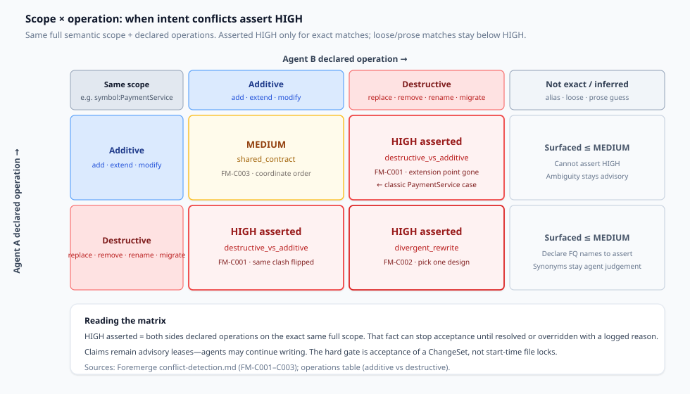
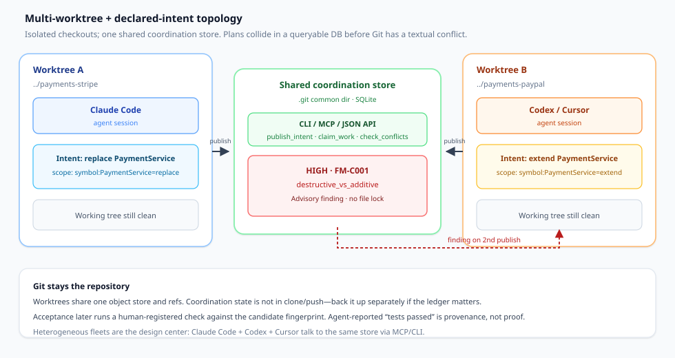

Git 工作树让 Claude Code、Codex 和 Cursor 编辑同一仓库，而不互相踩到对方的工作树。这解决的是*文件*争用。它并不解决*计划*争用。两个智能体可以在各自的树里产出干净的 diff，合并时没有文本冲突，却仍把产品留在一种不可能成立的状态：一方替换了另一方刚刚扩展的扩展点。

本文是针对这类失败的决策文档。问题不是“哪个多智能体审查器最好”。而是：**在你拉起 N 个智能体之前，你实际在协调的是哪一种冲突？** Foremerge 是*写入时声明意图*的一个开源实现——案例研究，而不是软启动。

## 你实际在做的决定

在打开下一个工作树之前，把决定写成一句话：

> 对这一批并行任务，我是在防止**互不相容的已声明计划**（范围 + 操作不可能同时为真），在实现之前强制一份**共享契约**，依赖**写入后的互审**，还是通过**所有权 / 编排**来为工作排序——而这些失败里，哪些是 Git *抓不到*的？

如果答案塌缩成“给每个智能体一棵工作树，变绿再合并”，你就是在 token 已经花掉之后，把语义碰撞外包给人类审查。工作树隔离和 CI 是必要的。它们不是一块计划白板。

## 四种冲突策略（选类别，不选品牌）

团队会混用这些策略；把它们当成可以互换的产品，文章就会变成盘点。点出机制的名字。

**1. 确定性意图声明（写入时）。** 编辑之前，每个智能体把自己将要触碰的内容发布为结构化范围加操作（`symbol:PaymentService=replace`）。本地规则引擎比较这些声明。相同输入 → 相同发现。检测路径上没有模型。Foremerge 就是为这一模式而建的（[foremerge.com](https://foremerge.com/)；[naw103/foremerge](https://github.com/naw103/foremerge)）。

**2. 契约 / 接口优先的合并。** 共享的 API、模式和响应形状在并行实现*之前*就已敲定（或已有所有者）。依赖方等待，或变基到已商定的契约上。Uno 的并行智能体指南把失败说得很明白：文件名不同并不保证行为彼此独立；API 与其消费方可以互相不一致，而 Git 仍会把两边都合并（[并行编程智能体](https://uno.engineering/parallel-coding-agents)）。

**3. LLM 互审（仅写入后对照）。** 补丁已经存在之后，智能体（或一个裁判模型）阅读 diff 并争论兼容性。作为*审查辅助*有用；作为*主要*的早期预警层则偏弱，因为争论开始之前成本已经付出，而且判断可能一次次运行而漂移。本文把这一模式作为对照来命名——不是一块产品对比板。

**4. 所有权编排。** 人（或一层编排）按区域分配职权、队列，以及需求相争时的升级。一场关于 Foremerge 的 HN 讨论描述了这样的做法：团队保留代码所有权，让智能体跨区域协商，并由工程师升级（[Show HN 讨论帖](https://news.ycombinator.com/item?id=49789356)）。Uno 的编排文章为每个结果指定一位决策负责人，并在并行编辑之前解决共享模块的所有权（[编程智能体编排](https://uno.engineering/coding-agent-orchestration)）。

意图声明在智能体*做出声明*时，及早抓住“两份计划不可能同时为真”。契约在有人拥有边界时抓住接口漂移。所有权抓住职权之争。互审在事后抓住遗漏。选择与你在合并审查里一再重新撞见的那种碰撞相匹配的层。

一个有用的冒烟测试：如果你上一次昂贵的返工有干净的 diff，失败的是*含义*（调用方被搁浅、一个概念两套模式、一个模块两个所有者），就从意图声明加上共享表面的契约优先开始。如果返工是两个团队在争论产品需求、两边代码都正确，就从所有权编排开始。如果返工是“没人看另一份 PR”，先补上审查能力，再买另一个协调器。

## 范围 × 操作：HIGH 冲突何时触发

意图声明只有在词汇是事实、而不是凭感觉时才管用。Foremerge 的检测器比较 `ScopeClaim`：一个语义范围（`symbol:…`、`api:…`、`schema:…`、`contract:…` 及相关种类）加上一个已声明的操作。加性操作（`add`、`extend`、`modify`）保留其他工作可能依赖的东西。破坏性操作（`replace`、`remove`、`rename`、`migrate`）则不会（[conflict-detection.md](https://docs.rs/crate/foremerge/latest/source/docs/conflict-detection.md)）。

*图 1. 相同的完整范围 + 已声明操作。当双方都声明精确重叠时，FM-C001（`destructive_vs_additive`）和 FM-C002（`divergent_rewrite`）可以断言 HIGH。FM-C003（`shared_contract`）对加性×加性保持 MEDIUM。松散的别名匹配和从行文推断的操作被呈现在 HIGH 之下——歧义不得阻止接受。*

**已断言与已呈现。** 一项发现只有在双方都对*完全相同*的完整范围声明了操作时，才被*断言*。那是来自两份声明的事实，因此严重级别可以达到 HIGH。其余一切——仅名称的别名匹配、跨种类的键匹配、近似 Jaccard 的范围词元，或从行文猜测的操作——都是*呈现*，并且上限低于 HIGH（[conflict-detection.md](https://docs.rs/crate/foremerge/latest/source/docs/conflict-detection.md)）。信任模型是刻意的：一个协调层若对猜测大喊 HIGH，一周之内就会被无视。

**头条案例。** 智能体 A：用 `StripePaymentService` 替换 `PaymentService`。智能体 B：用 PayPal 扩展 `PaymentService`。不需要重叠的行。Git 把两边都合并；PayPal 的工作可能落在一个无人调用的类上。当双方都以对立的操作类别声明 `symbol:PaymentService` 时，Foremerge 会提出 `HIGH` `destructive_vs_additive`（规则 FM-C001）——在任一棵树发生变化之前（[foremerge.com](https://foremerge.com/)；[Show HN](https://news.ycombinator.com/item?id=49789356)）。

**图 1 的读法：** HIGH 保留给在一个精确范围上已声明的对立。用它迫使人或已记录的决议发生在接受*之前*——而不是当作开始时的文件系统锁。

加性×加性（`shared_contract`）是吵闹的邻居：两次扩展在排好依赖顺序之后可能没问题，也可能发明出互不兼容的 API。Foremerge 把它保持在 MEDIUM，让智能体去协调，而不假装工具证明了不兼容。模式 / 迁移 / 配置的重叠得到的是迁移顺序建议，而不是一句泛泛的“引入一个 provider”——对表重命名给出错误建议，比沉默更糟（[conflict-detection.md](https://docs.rs/crate/foremerge/latest/source/docs/conflict-detection.md)）。

## 多工作树 + 声明拓扑

隔离与共享感知是不同的层。每个智能体保留一棵工作树。协调状态位于仓库的 Git 公共目录下的一个 SQLite 数据库中，因此已链接的工作树会自动共享这幅图景（[foremerge.com](https://foremerge.com/)；[README](https://github.com/naw103/foremerge)）。

*图 2. 工作树 A 中的 Claude Code 与工作树 B 中的 Codex/Cursor 把意图（不是 diff）发布到同一个存储。第二次发布在两棵树仍然干净时返回 FM-C001 发现。Git 仍是持久的仓库；该存储是本地协调，不是克隆/推送要携带的货物。*

协议对外表面与提供方无关：CLI、stdio MCP（公开文档中的十八个工具），以及一个回环 HTTP API。`foremerge setup all` 会接好 Claude Code、Codex 和 Cursor，使异构舰队共享同一个存储（[foremerge.com](https://foremerge.com/)）。声明是带租约的建议：两个智能体可以认领同一范围；重叠会警告；任何一方都不会被硬阻塞（[limitations.md](https://raw.githubusercontent.com/naw103/foremerge/main/docs/limitations.md)）。

站点上的生命周期用语依次是：意图 → 已认领 → 进行中 → 暂定 → 已验证 → 已接受 → 已提交。智能体报告的测试结果是出处。接受要求由 Foremerge 针对候选的确切 Git 指纹执行验证；验证之后的变更会使证据过期（[foremerge.com](https://foremerge.com/)）。那道门是*接受*，不是“外环上的产品完成”——不要把它和合并队列或宿主分支保护混为一谈。Git 仍然负责合并与推送。

Uno 的并行指南落到一个互补的拓扑：分开的检出*以及*分开运行的应用（端口、夹具数据），然后在合并之前测试*组合后*的行为（[并行编程智能体](https://uno.engineering/parallel-coding-agents)）。意图拓扑回答“计划相撞了吗？”隔离拓扑回答“进程相撞了吗？”当智能体启动服务器时，你通常两者都需要，而不只是在它们编辑符号时。

## 把 Foremerge 当作一个实现案例

来自站点、GitHub、文档和 Show HN 的事实——不是一份背书评分。

**它是什么。** 开源协调协议，“建在 Git 之上”。一个 Rust 二进制。Apache-2.0。本地优先的 MVP（站点与 README 把 `0.6.0` 描述为 1.0 之前；模式仍可能变化；已发表的协调与未协调对比基准被明确标为*尚未*声称）（[foremerge.com](https://foremerge.com/)；[README](https://github.com/naw103/foremerge)）。

**起源故事（已核实）。** 维护者 Nick Woodhead 描述了一次具体的翻车：一个智能体在替换一个支付服务类，另一个智能体则根据积压工单扩展同一个类——树是干净的，合并是干净的，扩展点被搁浅，一天的重构。该工具从 GPTree 的内部使用中抽出并开源（[31 个问题](https://foremerge.com/blog/31-questions-coordinating-parallel-coding-agents/)；[Show HN](https://news.ycombinator.com/item?id=49789356)）。

**检测立场。** 确定性、可解释、启发式。没有 LLM 裁判，没有嵌入，没有对兼容性的完整 AST 证明（[conflict-detection.md](https://docs.rs/crate/foremerge/latest/source/docs/conflict-detection.md)）。建议（例如引入一份 `PaymentProvider` 契约）是启发式忠告，不是自动的设计决定（[foremerge.com](https://foremerge.com/)）。

**它拒绝什么。** 硬文件锁（过期的锁 → 舰队堵死；若不拦截写入，语义锁无法强制执行）。在 HIGH 上猜测同义。相信智能体所说的“测试已通过”。变成一条合并队列（[31 个问题](https://foremerge.com/blog/31-questions-coordinating-parallel-coding-agents/)；[limitations.md](https://raw.githubusercontent.com/naw103/foremerge/main/docs/limitations.md)）。

**来自 Show HN 的规模说明。** 作者报告在自己的环境里对一个仓库测试了多达 98 个并行智能体，并重放了 76 条意图，其中有一个被标记的冲突，外加一个被点名的盲点（类名与内部方法声明之别）。把这些当作维护者报告的轶事，而不是已发表的基准——项目本身说，量化的协调与未协调结果尚未公开（[Show HN](https://news.ycombinator.com/item?id=49789356)；[foremerge.com](https://foremerge.com/)）。

**主要用户（维护者的回答）。** 今天在一台机器上运行两个或更多智能体的个人高阶用户；舰队和团队是后话，尚待进一步验证（[31 个问题](https://foremerge.com/blog/31-questions-coordinating-parallel-coding-agents/)）。这与大多数 Claude Code + Codex 双客户端配置的实际样子相符：一位工程师，许多工作树，尚不需要分布式共识。

## 盲点：漂移、模糊范围、建议性租约

协调层会在声明说谎或滞后的地方失败。

**未声明的漂移。** 最初的意图不必列出每一个文件；它对破坏性部分必须正确。计划变化时可以重新发布。在问答中，检测已声明范围与实际编辑之间的漂移被描述为路线图上的工作——不是已经完成的保证（[31 个问题](https://foremerge.com/blog/31-questions-coordinating-parallel-coding-agents/)；[Show HN](https://news.ycombinator.com/item?id=49789356)）。如果智能体从不发布，白板就一直是空白。

**模糊范围与同义范围。** 单靠字符串规则，`PaymentService` 与 `BillingService` 不会断言 HIGH。没有完整限定的别名匹配呈现在 HIGH 之下。当智能体（或人）认出跨标签的重叠时，他们记录评估；从结构上解析符号的语言适配器是已说明的方向，不是一张已经完成的通用图（[31 个问题](https://foremerge.com/blog/31-questions-coordinating-parallel-coding-agents/)；[conflict-detection.md](https://docs.rs/crate/foremerge/latest/source/docs/conflict-detection.md)）。

**建议性租约与硬锁。** 声明会警告；它们并不把写入者串行化。HIGH 的硬停止在 ChangeSet 接受之时（未解决的 HIGH 必须被解决，或带着一条已记录的理由被覆盖）——不在第一次击键（[Show HN](https://news.ycombinator.com/item?id=49789356)；[31 个问题](https://foremerge.com/blog/31-questions-coordinating-parallel-coding-agents/)）。无视警告的智能体在接受或人类审查之前，仍然可能把损害交出去。

**空的冲突 ≠ 永远无事。** 冲突检查在*较晚*的意图发布时运行。没有推送给较早那个智能体的通知；它在下一次状态检查时才得知。把空的冲突数组当作“目前尚无已知”，而不是“将不会存在”（[limitations.md](https://raw.githubusercontent.com/naw103/foremerge/main/docs/limitations.md)）。

**接受门与开始时的声明。** 验证绑定到一枚指纹，并按*名称*运行一项由人注册的检查（智能体不通过 MCP 提供任意 argv）。这证明该命名检查在该指纹上干净退出——并不证明测试套件完整、封闭或无法被钻空子（[limitations.md](https://raw.githubusercontent.com/naw103/foremerge/main/docs/limitations.md)）。声明回答“我们即将表达的含义是什么？”接受回答“这个候选是否挺过了我们注册的检查？”

**仅本地。** 开源存储是一台机器 / 一个 Git 公共目录。多机共享模式在路线图上，并不在现成交付里（[foremerge.com](https://foremerge.com/)）。

## Claude Code / Codex / Cursor 的实用规则

当你已经在一台笔记本或工作站上运行并行工作树时，使用这些规则。

1. **先按独立决策拆分。** 如果两个任务共享一份未敲定的 API 或模式，在并行实现之前先敲定契约（或把它们排成顺序）——无论你是否安装协调器，Uno 的规则仍然适用（[并行编程智能体](https://uno.engineering/parallel-coding-agents)）。

2. **把同一个存储接到每一个客户端。** 针对同一仓库，为 Claude Code、Codex 和 Cursor 运行 setup，让声明能够会合。只习惯单客户端的做法，会在 Codex 去扩展 Claude 正在替换的东西时崩溃。

3. **声明操作，不要指望摘要能隐含它们。** 优先使用 `symbol:Foo=replace`，而不是一段可能意指扩展的行文。HIGH 严重级别取决于已声明的操作（[conflict-detection.md](https://docs.rs/crate/foremerge/latest/source/docs/conflict-detection.md)）。

4. **当你在意 HIGH 时，使用完全限定的范围键。** 仅别名的匹配不会形成断言。声明两个智能体所指的那个名字。

5. **在另一个智能体发布之后重新检查。** 第一个发布者的空冲突列表可能变陈旧。在接受 ChangeSet 之前轮询 `check_conflicts`（或等价物）。

6. **把 HIGH 当作带日志的人类决定。** 去协调、重新划定范围，或带着理由覆盖。不要默默继续并“在 CI 里修”。

7. **注册一项真正的接受检查。** 优先选择能抓住交接断裂的快速构建/类型检查。一项永远通过的检查，或会记录 `UNVERIFIED` 的“advisory”策略，应当是明确的选择，而不是意外（[README](https://github.com/naw103/foremerge)）。

8. **把所有权留给职权之争。** 当两个团队想要互不相容的需求时，意图声明并不取代 CODEOWNERS、架构审查或产品仲裁。

9. **不要把聊天记忆当作共享白板。** 一个“记得”两份计划的父会话，并不能跨客户端持久保存。如果 Codex 从未看见 Claude 的替换意图，Git 仍会合并那次扩展。把声明持久化到每个客户端都会读取的地方。

10. **按智能体数量为审查能力做预算。** 无论有没有协调器，Uno 的经验法则都适用：只有在人类能够检查交接时，增加智能体才有帮助（[并行编程智能体](https://uno.engineering/parallel-coding-agents)）。一本干净的意图账本配上一条未读的 PR 队列，仍然是一条队列。

## 这并不解决什么

**没有声明的运行时竞态。** 两个智能体猛敲同一个端口、夹具数据库或未声明的环境变量键，这是隔离问题。工作树与环境分离（或 Uno 那种分开的计算机）处理这一点；意图声明不会发明出未声明的范围。

**恶意或对抗性智能体。** Foremerge 的威胁模型是会出错的智能体，不是对手。本地 MCP/API 调用者自行断言智能体身份；任何能够到达守护进程的人都可以充当已注册智能体。验证在没有沙箱的情况下运行。操作系统隔离是另一层（[limitations.md](https://raw.githubusercontent.com/naw103/foremerge/main/docs/limitations.md)；[31 个问题](https://foremerge.com/blog/31-questions-coordinating-parallel-coding-agents/)）。

**门控构建的“完成”定义。** 一项命名检查在某个指纹上通过，并不是产品完成、合并队列策略或宿主分支保护的完整定义。Git 托管仍然把守合并；Foremerge 提供信息（[31 个问题](https://foremerge.com/blog/31-questions-coordinating-parallel-coding-agents/)）。

**以写入后审查代替写入时声明。** 补丁存在之后，LLM 互审仍然可以有帮助。它是不同的冲突类别：更晚、更贵，若由模型来裁判则不确定。不要把本文框成审查智能体的评比。

## 在一个仓库上运行并行智能体之前的清单

- [ ] 点明冲突类别：互不相容的计划 · 未敲定的契约 · 职权/所有权 · 写入后审查的遗留。
- [ ] 共享未敲定接口的任务已被排成顺序，或已为契约指定所有者。
- [ ] 每个智能体有自己的工作树（若它们运行应用，则还有互不碰撞的端口/数据）。
- [ ] 若使用意图声明：每个客户端在破坏性编辑之前发布范围+操作；在 HIGH 要紧之处使用完全限定键。
- [ ] 智能体知道声明是建议性的；未解决的 HIGH 阻塞的是*接受*，不一定是打字。
- [ ] 较早的智能体重新检查冲突；空 ≠ 永远。
- [ ] 存在一项由人注册的验证检查（或者 `UNVERIFIED` 是明确的策略）。
- [ ] 同义 / 重命名碰撞有人类或评估路径——规则不会在 HIGH 上发明同义关系。
- [ ] 审查仍然拥有架构；协调器拥有可见性与出处。

并行智能体只有在集成保持诚实时才会放大吞吐。在 diff 看起来没问题*之前*，声明那些不可能同时为真的计划——或者拥有那份契约，以及将会抓住声明所遗漏之物的审查队列。
