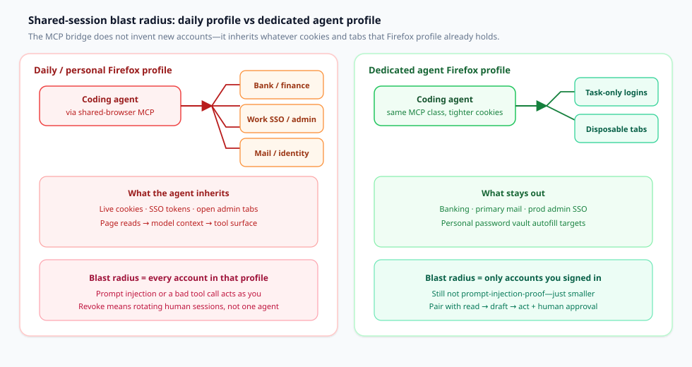
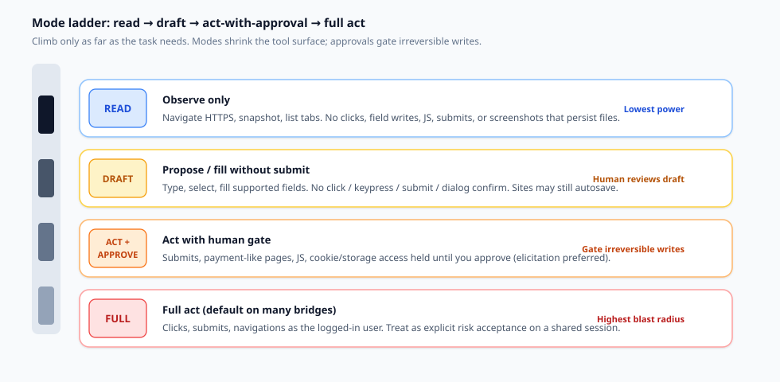

A coding agent that can click inside the Firefox you already use is convenient for one reason: **your logins are already there**. That convenience is also the security decision. The agent does not mint a new identity; it borrows yours—cookies, SSO, open admin tabs, and whatever password-manager autofill the page can see.

This article is a decision document for engineers wiring Claude Code, Codex, or OpenCode to a browser MCP. The axis is **shared human session versus separate automation browser**. Kitsune is one concrete Firefox-family implementation of the shared-session pattern—not a soft launch post. The comparison set is Kitsune, firefox-bridge / Agent Bridge–class tools, Playwright MCP, and Claude in Chrome.

## What you are actually deciding

Write the decision as one sentence before you register another browser MCP:

> Given this task’s need for live logins, will I attach the agent to a **real Firefox profile I also use** (accepting that cookies and open tabs become agent tool surface), or will I drive a **separate automation browser** whose sessions I can wipe without touching my daily bank, mail, and work SSO?

If the answer collapses to “just point the MCP at my everyday profile so I do not have to log in again,” you are choosing maximum convenience and maximum blast radius in one stroke. Modes and approvals can shrink what the agent *does*; they do not shrink what the agent *can reach* once it reads a malicious page as you.

## Two axes—not engine freshness

Shared-session bridges and launched automation browsers solve different trust problems.

**Shared human session (extension + local bridge).** The agent attaches to Firefox, Zen, or LibreWolf you already have open. Cookies and extensions stay put. Kitsune documents Claude Code, Codex, Pi, and OpenCode on that path—no Playwright/WebDriver install required ([Kitsune README](https://github.com/junyeong-nero/kitsune)). firefox-bridge makes the same class of claim for real logged-in Firefox tabs ([firefox-bridge](https://github.com/raychao-oao/firefox-bridge)); Firefox Agent Bridge is another WebExtension + native-host design for a live profile ([firefox-agent-bridge](https://github.com/1jehuang/firefox-agent-bridge)).

**Separate automation browser (Playwright MCP default).** Playwright MCP launches a browser it controls. Profiles may be persistent, `--isolated` (in-memory), seeded from storage state, or optionally attached to existing Chrome tabs via Playwright’s extension ([Playwright MCP README — User profile](https://github.com/microsoft/playwright-mcp)). Kitsune notes Playwright MCP was not designed to share a browser with a person ([Kitsune README](https://github.com/junyeong-nero/kitsune)).

**Claude in Chrome** is shared-session on Chrome: side-panel/extension work in your tabs, with Anthropic classifiers and permission modes ([Use Claude in Chrome safely](https://support.claude.com/en/articles/12902428-use-claude-in-chrome-safely)).

This axis is **whose cookies the agent inherits**—not which browser binary is newer.

## Shared-session blast radius

When an agent shares your Firefox, every authenticated surface in that profile is in play: bank, work SSO, mail, cloud consoles, and any cookie the site still trusts. Page text enters model context; clicks and types run **as you**. Kitsune’s security section states it flatly: a page can contain instructions, and the agent acts with every account you are logged into ([Kitsune guide — Security](https://github.com/junyeong-nero/kitsune/blob/main/docs/guide.md)).

*Figure 1. Left: daily profile fans cookies, SSO, and open sensitive tabs into the agent tool surface—blast radius equals every account in that profile. Right: a dedicated agent profile holds only task logins; banking, primary mail, and prod admin SSO stay out. Modes still do not stop prompt injection; they only shrink what is reachable.*

Anthropic gives the Chrome version of the same move: separate profile without sensitive accounts; avoid banking, healthcare, government, and sensitive work sites; screenshots of visible tabs join the conversation ([Use Claude in Chrome safely](https://support.claude.com/en/articles/12902428-use-claude-in-chrome-safely)). Kitsune’s Firefox guidance matches: dedicated profile; keep banking, mail, and work SSO out; treat sessions, screenshots, and tool logs as sensitive ([Kitsune README](https://github.com/junyeong-nero/kitsune); [guide — Security](https://github.com/junyeong-nero/kitsune/blob/main/docs/guide.md)).

**Figure 1 reading:** shared-session MCP is rarely wrong as a pattern—it is wrong *for that profile*. Put task logins in the agent profile; leave the daily vault alone.

## Mode ladder: read → draft → act

Once you accept a shared session, the next control is **how far the agent may go** before a human gate. Kitsune’s `KITSUNE_MODE=read|draft|act` (default `act`) limits both the tools published and the requests the bridge accepts ([Kitsune guide — Task modes](https://github.com/junyeong-nero/kitsune/blob/main/docs/guide.md)):

| Mode | What the agent can do (Kitsune) |
| --- | --- |
| **read** | Read tools + HTTPS/`about:blank` navigate/scroll; list-only tabs (`new_tab` for a background tab). No clicks, field writes, JS, submits, or file screenshots. |
| **draft** | Read surface + type/select/fill (and check with `browse`). No click, keypress, submit, dialog confirm, or JS. Ask-before-act forced for sensitive/payment-like targets. Sites may still autosave. |
| **act** | Full behavior, plus whatever ask-before-act policy you set separately. |

Ask-before-act is a separate opt-in (or lockable) policy for submits, payment-like pages, agent JS, cookie/storage, clipboard, and downloads. On Claude Code and Codex, elicitation asks in the client so approval never passes through the agent; without elicitation, a confirm token guards accidents but does **not** prove a human approved ([Kitsune guide — Ask-before-act](https://github.com/junyeong-nero/kitsune/blob/main/docs/guide.md)).

*Figure 2. Climb only as far as the task needs. Read observes. Draft fills without submit. Act-with-approval gates irreversible writes. Full act is an explicit risk acceptance on a shared session—not the quiet default you want on a daily profile.*

Map the ladder to work:

1. **Research** → `read` (or Claude in Chrome on trusted sites, manual approve).
2. **Fill for a human to finish** → `draft`, then you submit.
3. **Book, send, purchase, delete** → `act` only with ask-before-act locked, on a profile that lacks accounts you cannot afford to lose.
4. **Never** treat chat “please don’t submit” as a substitute for elicitation or a locked policy.

Kitsune defaults user/other-client tabs to **read-only** (`user_tab_read_only` unless `KITSUNE_USER_TABS=writable` or an explicit handoff). That reduces interference with the tab you are viewing; it is not cookie isolation ([Kitsune guide — Protecting your tabs](https://github.com/junyeong-nero/kitsune/blob/main/docs/guide.md)).

## Kitsune as an implementation case

Facts from the repo and PyPI—not an endorsement score.

**What it is.** Twin packages `kitsune-browser-mcp` and `kitsune-browser` (same version). The MCP package installs the browser package and exposes `kitsune` / bridge status ([PyPI: kitsune-browser-mcp](https://pypi.org/project/kitsune-browser-mcp/); [GitHub](https://github.com/junyeong-nero/kitsune)). PyPI showed **v0.7.1** when this article was sourced.

**How it attaches.** Agent → stdio MCP → local bridge (`127.0.0.1` HTTP + bearer) → WebSocket to a Firefox-family extension (`moz-extension://` only) → content scripts ([Kitsune guide — How it works](https://github.com/junyeong-nero/kitsune/blob/main/docs/guide.md)). Wrong `Host` headers are rejected; no CORS headers, so ordinary pages cannot call the API. That still does **not** stop prompt injection, local token theft, sensitive page reads, or acting as you.

**Tool surface.** Defaults to Playwright MCP’s 25 core tools (same names/schemas) while driving your browser. Extra groups via `KITSUNE_CAPS`; `storage` and `history` stay out of `all` because they touch cookies, clipboard, history, and bookmarks ([Kitsune README — Choosing tools](https://github.com/junyeong-nero/kitsune)).

**Install sketch (re-check docs before shipping).** Claude Code: `claude mcp add --scope user kitsune -- uvx --from kitsune-browser-mcp kitsune`. Codex: `codex mcp add kitsune -- uvx --from kitsune-browser-mcp kitsune`. OpenCode: local `mcp.kitsune` command in `opencode.json`. Install the matching extension; keep the browser open ([Kitsune README — MCP setup](https://github.com/junyeong-nero/kitsune)).

**Ergonomics vs security.** Background agent tabs and write-pausing while you type are UX. Kitsune’s shared-browser benchmark (tab-in-front vs Playwright MCP) is positioning, not a security proof ([Kitsune README — Benchmark](https://github.com/junyeong-nero/kitsune)).

## Comparison: session model, isolation, approvals, cookie ownership

Use the table to pick a fit for a workload. Do not treat it as a ranking.

| Dimension | **Kitsune** | **firefox-bridge / Agent Bridge class** | **Playwright MCP** | **Claude in Chrome** |
| --- | --- | --- | --- | --- |
| **Session model** | Extension + local bridge on Firefox / Zen / LibreWolf you already have open | WebExtension + native messaging host on real Firefox tabs (firefox-bridge); similar live-profile bridge designs (e.g. Firefox Agent Bridge) | Launches Playwright-managed browser by default; optional extension path to existing Chrome tabs | Chrome extension / side panel in the user’s Chrome |
| **Who owns cookies** | Your Firefox-family profile | Your Firefox profile | Playwright user-data dir, isolated memory profile, storage-state seed, or attached browser—depending on flags | Your Chrome profile (or org-managed profile) |
| **Profile isolation** | Operator-chosen: dedicated profile strongly recommended; not automatic | Operator-chosen; same blast-radius math as any shared session | Built-in persistent / `--isolated` / `--user-data-dir` / `--storage-state` controls | Anthropic recommends a separate profile without sensitive accounts |
| **Approval / mode gates** | `KITSUNE_MODE` read/draft/act; opt-in/lockable ask-before-act; user tabs read-only by default; elicitation on Claude Code / Codex | Tool- and site-policy varies by project (e.g. blacklist confirmations on firefox-bridge)—verify in that repo’s README | Client-level permissions; Playwright MCP states it is **not** a security boundary | Classifiers, action screening, manual vs automatic approve, site block/allow lists (Team/Enterprise) |
| **Named coding agents** | Claude Code, Codex, Pi, OpenCode documented | Claude Code, Codex called out on firefox-bridge | Broad MCP client list including Claude Code and Codex | Claude Code / Cowork / Chrome side panel per Anthropic |
| **Not a fix for** | Prompt injection; local token theft; heuristic redaction gaps | Same shared-session class risks | Untrusted pages in a powerful automation browser still need host isolation and client policy | Prompt injection risk “not zero”; screenshots capture visible sensitive UI |

Sources for the rows: [Kitsune README / guide](https://github.com/junyeong-nero/kitsune), [kitsune-browser-mcp on PyPI](https://pypi.org/project/kitsune-browser-mcp/), [firefox-bridge](https://github.com/raychao-oao/firefox-bridge), [firefox-agent-bridge](https://github.com/1jehuang/firefox-agent-bridge), [Playwright MCP README](https://github.com/microsoft/playwright-mcp), [Use Claude in Chrome safely](https://support.claude.com/en/articles/12902428-use-claude-in-chrome-safely).

**Selection shortcuts**

- Need **logged-in Firefox research in background tabs while you keep typing** → shared-session class (Kitsune or a firefox-bridge / Agent Bridge tool); start in `read` or `draft`.
- Need **repeatable automation with wipeable state** → Playwright MCP with isolated or disposable profiles; do not confuse its optional extension attach with “safe shared daily Chrome.”
- Need **Chrome + Anthropic’s permission UX and org allowlists** → Claude in Chrome, still on a non-sensitive profile.
- Need **debugger / profiler depth in Firefox** → Mozilla’s Firefox DevTools MCP is a different product (remote-debugging attach), not a shared-session convenience layer ([Kitsune positioning table](https://github.com/junyeong-nero/kitsune); [firefox-devtools-mcp](https://github.com/mozilla/firefox-devtools-mcp)).

## Practical rules for Claude Code, Codex, and OpenCode

Apply whether you pick Kitsune, another Firefox bridge, Playwright MCP, or Claude in Chrome.

1. **Dedicated profile first.** Sign in only to accounts the task needs. Kitsune and Anthropic both say this; treat exceptions as documented risk acceptance.
2. **Lowest mode that finishes the job.** Set `KITSUNE_MODE=read` or `draft` in MCP env—not only in chat. Mode changes what the bridge accepts.
3. **Lock ask-before-act for `act`.** Prefer `KITSUNE_ASK_BEFORE_ACT=1`. Prefer elicitation clients (Claude Code, Codex) so approval is not a replayable token.
4. **Leave `storage` / `history` off** unless you have a written reason for cookies, clipboard, history, or bookmarks.
5. **Keep user tabs read-only.** Agent-owned background tabs only; no `KITSUNE_USER_TABS=writable` on a banking laptop.
6. **Separate MCP regs by trust.** Research (read-mode) and checkout helpers must not silently share one loose config.
7. **OpenCode / JSON clients:** put mode and caps in the server `env` next to the command ([Kitsune README — OpenCode](https://github.com/junyeong-nero/kitsune)).
8. **Playwright MCP when you do not need human cookies.** Prefer isolated/disposable profiles. Playwright MCP is not a security boundary—use client permissions ([Playwright MCP README — Security](https://github.com/microsoft/playwright-mcp)).
9. **Claude in Chrome:** trusted sites first; manual approve on unfamiliar hosts; no side panel on regulated/sensitive pages; use org allowlists ([safety](https://support.claude.com/en/articles/12902428-use-claude-in-chrome-safely); [admin controls](https://support.claude.com/en/articles/13065128-claude-in-chrome-admin-controls)).
10. **Treat the transcript as sensitive.** Bridge audit redaction does not scrub MCP chat or model context.

## What this does not solve

Say these before you connect the bridge.

**Prompt injection.** Kitsune: none of its controls prevent it ([README](https://github.com/junyeong-nero/kitsune); [guide](https://github.com/junyeong-nero/kitsune/blob/main/docs/guide.md)). Anthropic: classifiers help; residual risk is non-zero ([Use Claude in Chrome safely](https://support.claude.com/en/articles/12902428-use-claude-in-chrome-safely)). Removing submit tools reduces damage; it does not make page text trustworthy.

**Hostile page content.** Password/OTP/card redaction is heuristic. `browser_evaluate` can read what the page can; visually masked fields are not safely hidden from the agent ([Kitsune guide — Security](https://github.com/junyeong-nero/kitsune/blob/main/docs/guide.md)).

**Cookie dump / session theft.** Enabling storage tools—or agent JS on a page that can exfiltrate tokens—ends the shared session. Trusting your coding agent is not trusting every URL it opens.

**Confirm tokens without elicitation.** A token returned to the model can be replayed by the model—accident guard, not human proof ([Kitsune guide](https://github.com/junyeong-nero/kitsune/blob/main/docs/guide.md)).

**Local processes as you.** Localhost bearer tokens are in scope for anything running as your user.

**Daily profile + sensitive accounts.** Kitsune and Claude in Chrome both say no. Doing it anyway accepts one injected instruction acting on bank, mail, and admin SSO.

## Checklist before connecting any shared-browser MCP

Use this as a go / no-go before `claude mcp add`, `codex mcp add`, or an OpenCode `mcp` block.

1. **Name the profile.** Is it a dedicated agent profile, or your daily one? If daily, stop.
2. **Inventory logins in that profile.** List SSO, mail, cloud consoles, payment sites. Remove anything the task does not need.
3. **Pick the mode.** `read`, `draft`, or `act`—written down, set in env, not only asked in chat.
4. **Pick the approval posture.** Locked ask-before-act / manual approve / elicitation client. Confirm how decline looks in *your* client.
5. **Cap tools.** Disable storage, history, evaluate/JS, and download groups unless required.
6. **Confirm tab ownership rules.** Prefer agent-owned background tabs; keep user tabs read-only.
7. **Decide wipe procedure.** How do you clear cookies or delete the profile after a bad session?
8. **Decide monitoring.** Who watches unexpected navigations, new domains, or sudden “help me export my data” behavior?
9. **Write the exception.** Any shared daily-profile use needs an owner, a time box, and a compensating control (usually: human on every submit + no storage tools).
10. **Re-read first-party security pages** for the exact bridge you installed—READMEs change faster than blog posts.

## Closing: share the session only when the cookies are worth the risk

Shared Firefox MCP is powerful because it is honest: the agent is you, with your cookies. Kitsune makes that usable for Claude Code, Codex, and OpenCode via background tabs, read/draft/act, and optional ask-before-act. firefox-bridge / Agent Bridge sit on the same axis. Playwright MCP owns an automation browser. Claude in Chrome adds Anthropic classifiers and org controls—and still says keep sensitive accounts out.

**Containment test:** if a prompt-injected page can spend money, read mail, or change prod IAM, you picked the wrong profile—or climbed the mode ladder too far.

Session model first. Mode second. MCP third.

## Sources (primary)

- Kitsune — [GitHub README](https://github.com/junyeong-nero/kitsune); [guide (modes, security, ask-before-act)](https://github.com/junyeong-nero/kitsune/blob/main/docs/guide.md); [PyPI kitsune-browser-mcp](https://pypi.org/project/kitsune-browser-mcp/)
- Playwright MCP — [microsoft/playwright-mcp README (profiles, isolation, security)](https://github.com/microsoft/playwright-mcp)
- Claude in Chrome — [Use Claude in Chrome safely](https://support.claude.com/en/articles/12902428-use-claude-in-chrome-safely); [admin controls](https://support.claude.com/en/articles/13065128-claude-in-chrome-admin-controls)
- Competing Firefox bridges — [raychao-oao/firefox-bridge](https://github.com/raychao-oao/firefox-bridge); [1jehuang/firefox-agent-bridge](https://github.com/1jehuang/firefox-agent-bridge); related positioning via [mozilla/firefox-devtools-mcp](https://github.com/mozilla/firefox-devtools-mcp)
