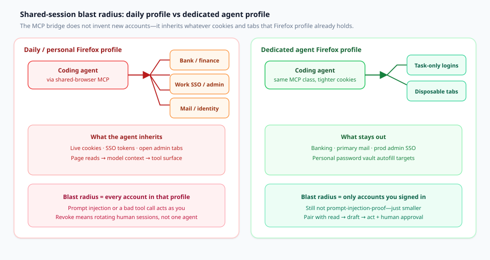
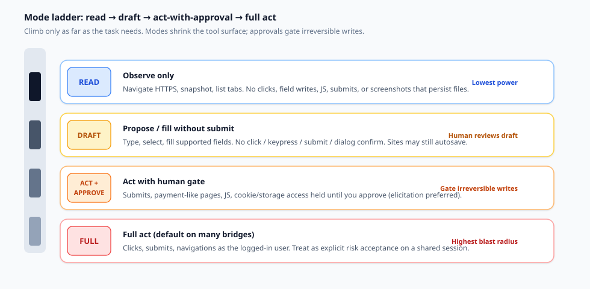

能够在你已经在用的 Firefox 里点击的编程智能体，方便的原因只有一个：**你的登录态已经在那里**。这种方便同时也是一项安全决策。智能体并不铸造新身份；它借用你的身份——cookie、SSO、打开的管理标签页，以及页面能够看到的密码管理器自动填充。

本文是一份决策文档，写给要把 Claude Code、Codex 或 OpenCode 接到浏览器 MCP 的工程师。这条轴是**共享的人类会话，相对独立的自动化浏览器**。Kitsune 是共享会话模式在 Firefox 家族中的一个具体实现——不是一篇软发布文章。比较集合是 Kitsune、firefox-bridge / Agent Bridge 一类工具、Playwright MCP，以及 Claude in Chrome。

## 你实际在决定的事

在注册另一个浏览器 MCP 之前，把这个决定写成一句话：

> 鉴于这项任务对实时登录态的需要，我是把智能体接到**一个我自己也在用的真实 Firefox 配置文件**（接受 cookie 与打开的标签页成为智能体的工具面），还是驱动一个**独立的自动化浏览器**，其会话我可以清掉，同时不触碰我日常的银行、邮件和工作 SSO？

如果答案收成只剩「把 MCP 指向我的日常配置文件，这样我就不用再登录」，你就是在一次选择里同时要了最大的便利和最大的爆炸半径。模式与审批可以缩小智能体*所做的事*；一旦它以你的身份读到恶意页面，它们并不能缩小智能体*能够触及的范围*。

## 两条轴——不是引擎新旧

共享会话桥与被启动的自动化浏览器，解决的是不同的信任问题。

**共享的人类会话（扩展 + 本地桥）。** 智能体接到你已经打开的 Firefox、Zen 或 LibreWolf。Cookie 与扩展留在原处。Kitsune 在这条路径上写明了 Claude Code、Codex、Pi 与 OpenCode——不需要安装 Playwright/WebDriver（[Kitsune README](https://github.com/junyeong-nero/kitsune)）。firefox-bridge 对真实已登录的 Firefox 标签页做出同一类声明（[firefox-bridge](https://github.com/raychao-oao/firefox-bridge)）；Firefox Agent Bridge 是另一种面向实时配置文件的 WebExtension + native-host 设计（[firefox-agent-bridge](https://github.com/1jehuang/firefox-agent-bridge)）。

**独立的自动化浏览器（Playwright MCP 的默认方式）。** Playwright MCP 会启动一个由它控制的浏览器。配置文件可以是持久的、`--isolated`（在内存中）、从存储状态播种，或通过 Playwright 的扩展可选地接到现有的 Chrome 标签页（[Playwright MCP README — 用户配置文件](https://github.com/microsoft/playwright-mcp)）。Kitsune 指出，Playwright MCP 并不是为了与人共享浏览器而设计的（[Kitsune README](https://github.com/junyeong-nero/kitsune)）。

**Claude in Chrome** 是 Chrome 上的共享会话：侧栏/扩展在你的标签页中工作，并带有 Anthropic 的分类器与权限模式（[安全使用 Claude in Chrome](https://support.claude.com/en/articles/12902428-use-claude-in-chrome-safely)）。

这条轴是**智能体继承谁的 cookie**——不是哪个浏览器二进制文件更新。

## 共享会话的爆炸半径

当智能体共享你的 Firefox 时，该配置文件中的每一个已认证表面都在场内：银行、工作 SSO、邮件、云控制台，以及站点仍然信任的任何 cookie。页面文本进入模型上下文；点击与键入以**你的身份**运行。Kitsune 的安全章节说得很直白：页面可以包含指令，而智能体以你登录的每一个账户行事（[Kitsune 指南 — 安全](https://github.com/junyeong-nero/kitsune/blob/main/docs/guide.md)）。

*图 1. 左：日常配置文件把 cookie、SSO 以及打开的敏感标签页扇入智能体的工具面——爆炸半径等于该配置文件中的每一个账户。右：专用智能体配置文件只保存任务所需的登录；银行、主邮件和生产环境管理 SSO 留在外面。模式仍然阻止不了提示注入；它们只是缩小能够触及的范围。*

Anthropic 给出同一做法的 Chrome 版本：使用不含敏感账户的独立配置文件；避开银行、医疗保健、政府以及敏感的工作站点；可见标签页的截图会进入对话（[安全使用 Claude in Chrome](https://support.claude.com/en/articles/12902428-use-claude-in-chrome-safely)）。Kitsune 的 Firefox 指引与此一致：使用专用配置文件；把银行、邮件和工作 SSO 留在外面；将会话、截图和工具日志视为敏感（[Kitsune README](https://github.com/junyeong-nero/kitsune)；[指南 — 安全](https://github.com/junyeong-nero/kitsune/blob/main/docs/guide.md)）。

**图 1 的读法：** 共享会话 MCP 作为一种模式很少是错的——它错在*那一个配置文件*。把任务所需的登录放进智能体配置文件；让日常的保险库保持不动。

## 模式阶梯：read → draft → act

一旦接受共享会话，下一层控制是**在人工关卡之前，智能体可以走多远**。Kitsune 的 `KITSUNE_MODE=read|draft|act`（默认 `act`）既限制所发布的工具，也限制桥所接受的请求（[Kitsune 指南 — 任务模式](https://github.com/junyeong-nero/kitsune/blob/main/docs/guide.md)）：

| 模式 | 智能体能做什么（Kitsune） |
| --- | --- |
| **read** | 读取类工具 + HTTPS/`about:blank` 的导航/滚动；标签页仅限列出（`new_tab` 用于后台标签页）。不能点击、写字段、执行 JS、提交，也不能做文件截图。 |
| **draft** | 读取面 + 键入/选择/填充（以及用 `browse` 勾选）。不能点击、按键、提交、确认对话框或执行 JS。对敏感或类支付目标强制先询问再行动。站点仍可能自动保存。 |
| **act** | 完整行为，再加上你另外设置的先询问再行动策略。 |

先询问再行动是一项单独的、需选择加入（或可锁定）的策略，覆盖提交、类支付页面、智能体 JS、cookie/存储、剪贴板以及下载。在 Claude Code 和 Codex 上，elicitation 在客户端发起询问，因此批准从不会经过智能体；没有 elicitation 时，确认令牌可以挡住意外，但**并不能**证明有人类批准过（[Kitsune 指南 — 先询问再行动](https://github.com/junyeong-nero/kitsune/blob/main/docs/guide.md)）。

*图 2. 只爬到任务需要的高度。Read 观察。Draft 填充但不提交。带审批的 Act 把不可逆写入挡在关卡之后。完整的 Act 是在共享会话上明确接受风险——不是你想放在日常配置文件上的那种安静默认。*

把这架阶梯对应到工作：

1. **调研** → `read`（或在受信任的站点上使用 Claude in Chrome，并手动批准）。
2. **先填好，留给人来收尾** → `draft`，然后由你提交。
3. **预订、发送、购买、删除** → 只有在先询问再行动已被锁定，且配置文件里没有你承受不起失去的账户时，才使用 `act`。
4. **绝不要**把聊天里的「请不要提交」当作 elicitation 或已锁定策略的替代。

Kitsune 默认把用户的标签页以及其他客户端的标签页设为**只读**（`user_tab_read_only`，除非 `KITSUNE_USER_TABS=writable` 或做了明确交接）。这能减少对你正在查看的标签页的干扰；它并不是 cookie 隔离（[Kitsune 指南 — 保护你的标签页](https://github.com/junyeong-nero/kitsune/blob/main/docs/guide.md)）。

## 把 Kitsune 当作一个实现案例

来自仓库与 PyPI 的事实——不是一份背书评分。

**它是什么。** 两个配套包 `kitsune-browser-mcp` 与 `kitsune-browser`（版本相同）。MCP 包会安装浏览器包，并暴露 `kitsune` / 桥的状态（[PyPI：kitsune-browser-mcp](https://pypi.org/project/kitsune-browser-mcp/)；[GitHub](https://github.com/junyeong-nero/kitsune)）。本文取材时，PyPI 显示的是 **v0.7.1**。

**它如何接入。** 智能体 → stdio MCP → 本地桥（`127.0.0.1` 上的 HTTP + bearer）→ 经 WebSocket 连到 Firefox 家族扩展（仅限 `moz-extension://`）→ content scripts（[Kitsune 指南 — 工作原理](https://github.com/junyeong-nero/kitsune/blob/main/docs/guide.md)）。错误的 `Host` 头会被拒绝；没有 CORS 头，因此普通页面不能调用这个 API。这仍然**不能**阻止提示注入、本地令牌被盗、敏感页面被读取，或以你的身份行动。

**工具面。** 默认使用 Playwright MCP 的 25 个核心工具（名称与 schema 相同），同时驱动的是你的浏览器。额外分组通过 `KITSUNE_CAPS` 加入；`storage` 和 `history` 不在 `all` 之中，因为它们会触及 cookie、剪贴板、历史记录和书签（[Kitsune README — 选择工具](https://github.com/junyeong-nero/kitsune)）。

**安装草图（上线前重新核对文档）。** Claude Code：`claude mcp add --scope user kitsune -- uvx --from kitsune-browser-mcp kitsune`。Codex：`codex mcp add kitsune -- uvx --from kitsune-browser-mcp kitsune`。OpenCode：在 `opencode.json` 中写本地 `mcp.kitsune` 命令。安装与之匹配的扩展；让浏览器保持打开（[Kitsune README — MCP 设置](https://github.com/junyeong-nero/kitsune)）。

**体验相对安全。** 后台的智能体标签页，以及你打字时暂停写入，属于用户体验。Kitsune 的共享浏览器基准（前台标签页对比 Playwright MCP）是定位，不是安全证明（[Kitsune README — 基准](https://github.com/junyeong-nero/kitsune)）。

## 比较：会话模型、隔离、审批、cookie 所有权

用这张表为一个工作负载挑选契合的一项。不要把它当成排名。

| 维度 | **Kitsune** | **firefox-bridge / Agent Bridge 类** | **Playwright MCP** | **Claude in Chrome** |
| --- | --- | --- | --- | --- |
| **会话模型** | 扩展 + 本地桥，接在你已经打开的 Firefox / Zen / LibreWolf 上 | 真实 Firefox 标签页上的 WebExtension + 原生消息宿主（firefox-bridge）；类似的实时配置文件桥设计（例如 Firefox Agent Bridge） | 默认启动由 Playwright 管理的浏览器；可选扩展路径接到现有的 Chrome 标签页 | 用户 Chrome 中的 Chrome 扩展 / 侧栏 |
| **谁拥有 cookie** | 你的 Firefox 家族配置文件 | 你的 Firefox 配置文件 | Playwright 用户数据目录、隔离的内存配置文件、存储状态种子，或已接入的浏览器——取决于标志 | 你的 Chrome 配置文件（或由组织管理的配置文件） |
| **配置文件隔离** | 由操作者选择：强烈建议专用配置文件；并非自动 | 由操作者选择；爆炸半径的算法与任何共享会话相同 | 内置的持久化 / `--isolated` / `--user-data-dir` / `--storage-state` 控制 | Anthropic 建议使用不含敏感账户的独立配置文件 |
| **审批 / 模式关卡** | `KITSUNE_MODE` 的 read/draft/act；可选加入或可锁定的先询问再行动；用户标签页默认只读；Claude Code / Codex 上的 elicitation | 工具策略与站点策略因项目而异（例如 firefox-bridge 上的黑名单确认）——到该仓库的 README 中核对 | 客户端级权限；Playwright MCP 声明它**不是**安全边界 | 分类器、动作筛查、手动与自动批准、站点阻止/允许列表（Team/Enterprise） |
| **点名的编程智能体** | 文档记载了 Claude Code、Codex、Pi、OpenCode | firefox-bridge 上点名了 Claude Code、Codex | 广泛的 MCP 客户端清单，其中包括 Claude Code 与 Codex | 按 Anthropic 所述，为 Claude Code / Cowork / Chrome 侧栏 |
| **解决不了** | 提示注入；本地令牌被盗；启发式脱敏的缺口 | 同一类共享会话风险 | 强大自动化浏览器中的不可信页面仍然需要宿主隔离与客户端策略 | 提示注入风险「不为零」；截图会捕获可见的敏感界面 |

各行来源：[Kitsune README / 指南](https://github.com/junyeong-nero/kitsune)，[PyPI 上的 kitsune-browser-mcp](https://pypi.org/project/kitsune-browser-mcp/)，[firefox-bridge](https://github.com/raychao-oao/firefox-bridge)，[firefox-agent-bridge](https://github.com/1jehuang/firefox-agent-bridge)，[Playwright MCP README](https://github.com/microsoft/playwright-mcp)，[安全使用 Claude in Chrome](https://support.claude.com/en/articles/12902428-use-claude-in-chrome-safely)。

**选择捷径**

- 需要**在后台标签页里做已登录的 Firefox 调研，同时你继续打字** → 共享会话这一类（Kitsune，或某个 firefox-bridge / Agent Bridge 工具）；从 `read` 或 `draft` 开始。
- 需要**状态可以清掉的可重复自动化** → 使用隔离或一次性配置文件的 Playwright MCP；不要把它可选的扩展接入理解成「安全的共享日常 Chrome」。
- 需要 **Chrome + Anthropic 的权限体验与组织允许列表** → Claude in Chrome，并且仍然放在非敏感配置文件上。
- 需要 **Firefox 中调试器 / 性能分析器的深度** → Mozilla 的 Firefox DevTools MCP 是另一款产品（远程调试接入），不是共享会话的便利层（[Kitsune 定位表](https://github.com/junyeong-nero/kitsune)；[firefox-devtools-mcp](https://github.com/mozilla/firefox-devtools-mcp)）。

## 给 Claude Code、Codex 与 OpenCode 的实用规则

无论你选的是 Kitsune、另一座 Firefox 桥、Playwright MCP，还是 Claude in Chrome，都照此执行。

1. **专用配置文件优先。** 只登录任务需要的账户。Kitsune 与 Anthropic 都这样说；把例外视为已经写明的风险接受。
2. **用能完成这项工作的最低模式。** 在 MCP 的环境变量里设置 `KITSUNE_MODE=read` 或 `draft`——不要只写在聊天里。模式会改变桥所接受的请求。
3. **为 `act` 锁定先询问再行动。** 优先 `KITSUNE_ASK_BEFORE_ACT=1`。优先使用带 elicitation 的客户端（Claude Code、Codex），这样批准就不是一枚可重放的令牌。
4. **让 `storage` / `history` 保持关闭**，除非你对 cookie、剪贴板、历史记录或书签有书面理由。
5. **让用户标签页保持只读。** 只用智能体拥有的后台标签页；在用于网银的笔记本上不要设置 `KITSUNE_USER_TABS=writable`。
6. **按信任程度分开注册 MCP。** 调研（read 模式）与结账辅助不得静默共用同一份宽松配置。
7. **OpenCode / JSON 客户端：** 把模式和能力放进紧挨命令的服务器 `env`（[Kitsune README — OpenCode](https://github.com/junyeong-nero/kitsune)）。
8. **不需要人类 cookie 时使用 Playwright MCP。** 优先隔离或一次性配置文件。Playwright MCP 不是安全边界——使用客户端权限（[Playwright MCP README — 安全](https://github.com/microsoft/playwright-mcp)）。
9. **Claude in Chrome：** 先从受信任的站点开始；不熟悉的主机用手动批准；受监管或敏感的页面上不要打开侧栏；使用组织允许列表（[安全](https://support.claude.com/en/articles/12902428-use-claude-in-chrome-safely)；[管理控制](https://support.claude.com/en/articles/13065128-claude-in-chrome-admin-controls)）。
10. **把对话记录视为敏感。** 桥的审计脱敏不会擦掉 MCP 聊天或模型上下文。

## 这解决不了的事

连接这座桥之前，先把这些说出来。

**提示注入。** Kitsune：它的任何控制都不能阻止提示注入（[README](https://github.com/junyeong-nero/kitsune)；[指南](https://github.com/junyeong-nero/kitsune/blob/main/docs/guide.md)）。Anthropic：分类器有帮助；残余风险不为零（[安全使用 Claude in Chrome](https://support.claude.com/en/articles/12902428-use-claude-in-chrome-safely)）。去掉提交类工具可以减轻损害；这并不能让页面文本变得可信。

**敌对的页面内容。** 对密码/OTP/卡号的脱敏是启发式的。`browser_evaluate` 可以读到页面所能读到的内容；视觉上被遮罩的字段，对智能体来说并没有被安全地隐藏（[Kitsune 指南 — 安全](https://github.com/junyeong-nero/kitsune/blob/main/docs/guide.md)）。

**Cookie 转储 / 会话窃取。** 启用存储工具——或在能够把令牌外带出去的页面上运行智能体 JS——就会终结这场共享会话。信任你的编程智能体，并不等于信任它打开的每一个 URL。

**没有 elicitation 的确认令牌。** 返回给模型的令牌可以被模型重放——这是意外防护，不是人类批准的证明（[Kitsune 指南](https://github.com/junyeong-nero/kitsune/blob/main/docs/guide.md)）。

**以你的身份运行的本地进程。** localhost 上的 bearer 令牌，对任何以你的用户身份运行的程序都在范围内。

**日常配置文件 + 敏感账户。** Kitsune 与 Claude in Chrome 都说不要。若仍然这样做，就等于接受一条被注入的指令去作用于银行、邮件和管理 SSO。

## 连接任何共享浏览器 MCP 之前的检查清单

在 `claude mcp add`、`codex mcp add` 或一段 OpenCode `mcp` 配置之前，把这份清单当作放行 / 不放行。

1. **写明配置文件。** 它是专用的智能体配置文件，还是你的日常配置文件？如果是日常的，就停。
2. **清点该配置文件中的登录。** 列出 SSO、邮件、云控制台、支付站点。去掉任务不需要的任何一项。
3. **选定模式。** `read`、`draft` 或 `act`——写下来，设在环境变量里，而不只是在聊天里提出。
4. **选定审批姿态。** 锁定的先询问再行动 / 手动批准 / elicitation 客户端。确认在*你的*客户端里，拒绝是什么样子。
5. **限制工具。** 除非必需，禁用 storage、history、evaluate/JS 以及下载这几组。
6. **确认标签页归属规则。** 优先使用智能体拥有的后台标签页；用户标签页保持只读。
7. **定好清除办法。** 一次糟糕的会话之后，如何清除 cookie，或删除该配置文件？
8. **定好监控。** 谁来留意意外的导航、新的域名，或突然出现的「帮我导出我的数据」这类行为？
9. **把例外写下来。** 任何共用日常配置文件的用法，都需要一个负责人、一个时间盒，以及一项补偿控制（通常是：每次提交都有人在 + 不启用存储工具）。
10. **重读第一方安全页面**，针对你实际安装的那一座桥——README 变得比博客文章更快。

## 结尾：只有当这些 cookie 值得承担风险时，才共享会话

共享的 Firefox MCP 之所以强，是因为它诚实：智能体就是你，带着你的 cookie。Kitsune 借助后台标签页、read/draft/act，以及可选的先询问再行动，让 Claude Code、Codex 和 OpenCode 能够这样用。firefox-bridge / Agent Bridge 站在同一条轴上。Playwright MCP 拥有一个自动化浏览器。Claude in Chrome 加上了 Anthropic 的分类器与组织控制——并且仍然说把敏感账户留在外面。

**遏制测试：** 如果一个被提示注入的页面能够花钱、读邮件，或更改生产 IAM，那就是你选错了配置文件——或者在模式阶梯上爬得太高。

会话模型第一。模式第二。MCP 第三。

## 来源（一手）

- Kitsune — [GitHub README](https://github.com/junyeong-nero/kitsune)；[指南（模式、安全、先询问再行动）](https://github.com/junyeong-nero/kitsune/blob/main/docs/guide.md)；[PyPI kitsune-browser-mcp](https://pypi.org/project/kitsune-browser-mcp/)
- Playwright MCP — [microsoft/playwright-mcp README（配置文件、隔离、安全）](https://github.com/microsoft/playwright-mcp)
- Claude in Chrome — [安全使用 Claude in Chrome](https://support.claude.com/en/articles/12902428-use-claude-in-chrome-safely)；[管理控制](https://support.claude.com/en/articles/13065128-claude-in-chrome-admin-controls)
- 与之竞争的 Firefox 桥 — [raychao-oao/firefox-bridge](https://github.com/raychao-oao/firefox-bridge)；[1jehuang/firefox-agent-bridge](https://github.com/1jehuang/firefox-agent-bridge)；相关定位经由 [mozilla/firefox-devtools-mcp](https://github.com/mozilla/firefox-devtools-mcp)
