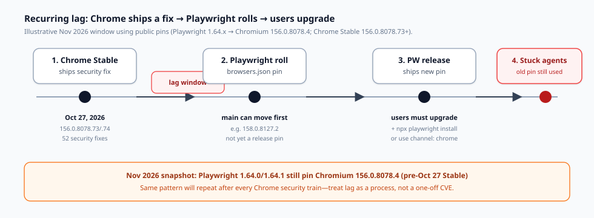
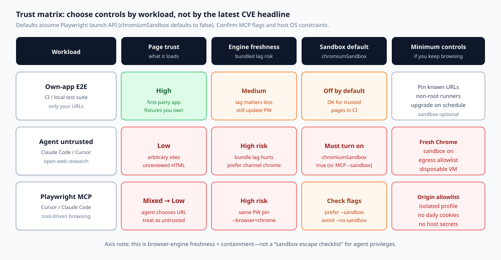

Chrome updates on a security train. Playwright updates on a release train. Coding agents sit on whatever binary Playwright last pinned—and often launch it with Chromium’s sandbox **off**.

That combination is not a November 2026 curiosity. It is a **recurring trust gap**: every time Google ships a Stable fix, agent browsers that still use an older Playwright pin remain behind until someone upgrades Playwright *and* reinstalls browsers—or until you stop using the bundled build for untrusted pages.

This guide is a decision document, not a CVE brief. It maps three workloads—**own-app E2E**, **agent untrusted browsing**, and **Playwright MCP**—to concrete controls: `chromiumSandbox`, `channel: 'chrome'`, non-root execution, and egress allowlists. It names Claude Code, Cursor, and Playwright MCP because those are where the lag meets day-to-day agent work. It deliberately stays on a different axis from “sandbox escape checklists” for agent privileges: here the issue is **engine freshness and browser containment**, not whether an agent can `rm -rf` your repo.

## What you are actually deciding

Write the decision as one sentence before you change configs:

> Given this workload’s page trust and blast radius, will I accept Playwright’s bundled Chromium pin (knowing it lags Chrome Stable), and which of `chromiumSandbox`, branded Chrome, host isolation, and network allowlists must be on before the agent browses?

If your answer collapses to “someone posted a CVE number, panic,” you will over-harden trusted CI and under-harden open-web agents. The matrix below exists to stop that.

## The lag is structural, not personal

Playwright does not auto-track Chrome Stable day by day. Each Playwright release pins browser builds in `packages/playwright-core/browsers.json`. The [Playwright browsers guide](https://playwright.dev/docs/browsers) is explicit: every Playwright version needs specific browser binaries; updating Playwright usually means running `npx playwright install` again.

That creates a predictable sequence:

1. **Chrome Stable** ships a security update.
2. **Playwright** later rolls a newer Chromium (often on `main` first).
3. A **Playwright release** ships the new pin.
4. **You** upgrade the package *and* install browsers—or you keep running the old pin forever.



*Figure 1. The recurring lag window. Agents do not inherit Chrome’s Stable channel unless you point Playwright at installed Chrome or wait for a Playwright release that pins a post-fix build.*

### A concrete November 2026 snapshot (facts, not the thesis)

Use this window as evidence of the pattern—not as the article’s spine.

- Playwright **v1.64.0** published **2026-10-07** ([GitHub release](https://github.com/microsoft/playwright/releases/tag/v1.64.0)).
- Playwright **v1.64.1** `browsers.json` still pins Chromium **`156.0.8078.4`** ([raw browsers.json @ v1.64.1](https://raw.githubusercontent.com/microsoft/playwright/v1.64.1/packages/playwright-core/browsers.json)).
- Chrome Stable on **2026-10-27** moved to **`156.0.8078.73/.74`** (Windows/Mac) and **`156.0.8078.73`** (Linux), with **52 security fixes**, including critical **CVE-2026-118306** (FileSystem memory corruption; Chromium severity Critical) per the [Chrome Releases post](https://chromereleases.googleblog.com/2026/10/stable-channel-update-for-desktop_0562499947.html) and the [CVE description](https://www.suse.com/security/cve/CVE-2026-118306.html).
- Playwright **`main`** can already show a newer pin (for example Chromium **`158.0.8127.2`**) while stable npm packages still ship the older one. Rolling on `main` is not the same as your agent’s installed package.

Google’s advisory language for CVE-2026-118306 is the usual high-level severity statement. This article will not reconstruct exploitation steps. Treat the CVE as a **freshness anchor**: a Critical fix landed in Stable while the then-current Playwright release pin was still on an earlier `156.0.8078.x` build.

When the next Chrome security train lands, expect the same diagram with new version numbers.

## The second half of the gap: sandbox off by default

Freshness is only half the story. Playwright’s launch API documents `chromiumSandbox` as:

> Enable Chromium sandboxing. Defaults to `false`.

Source: [BrowserType.launch options](https://playwright.dev/docs/api/class-browsertype).

That default exists for pragmatic reasons (containers, root, missing setuid helpers, CI images). It is still a security default that coding-agent setups inherit unless someone opts in. Untrusted HTML in a browser without Chromium’s sandbox is a different risk class than the same HTML in a current, sandboxed Chrome.

Playwright MCP exposes the same tension as CLI flags: `--sandbox` to enable, `--no-sandbox` to disable ([Playwright MCP README options](https://github.com/microsoft/playwright-mcp)). Docker examples often show `--no-sandbox` because containers make the Chromium sandbox awkward. That convenience must not silently become your laptop agent’s permanent posture.

**Decision rule:** for any workload that can load pages you did not author, treat `chromiumSandbox: false` / `--no-sandbox` as an explicit risk acceptance—not as “Playwright recommended.”

## Three workloads, three answers



*Figure 2. Trust matrix. Match controls to page trust and blast radius. Do not apply CI E2E defaults to open-web agent browsing.*

### 1) Own-app E2E (CI and local regression)

**Page trust:** high. You load your app, fixtures, and maybe a stub API.

**Bundled Chromium lag:** annoying, rarely urgent. You still want Playwright updated on a schedule so you catch upcoming Chrome breakage early—the [browsers docs](https://playwright.dev/docs/browsers) recommend staying current for that reason. Security urgency is lower because attackers do not choose your test HTML.

**Sandbox:** leaving the default off is a common CI tradeoff. Prefer non-root runners anyway. If your CI image can run with `chromiumSandbox: true`, turn it on; if the zygote fails with “No usable sandbox!”, fix the image (user namespaces / AppArmor / non-root) rather than cargo-culting `--no-sandbox` onto every developer laptop.

**Minimum controls**

1. Pin allowed base URLs (your staging / localhost).
2. Keep Playwright + `npx playwright install` on a cadence (weekly or every release).
3. Run as non-root.
4. Do not store production cookies in the test profile.

### 2) Agent untrusted browsing (Claude Code, Cursor agents, research)

**Page trust:** low. The agent follows links, opens docs, “just checks one more site.”

**Bundled Chromium lag:** **high**. This is where the Chrome→Playwright delay bites. Prefer a browser that receives Stable security updates without waiting for Playwright’s next pin.

**Sandbox:** **on**. Set `chromiumSandbox: true` when you launch via Playwright APIs. If the host cannot sandbox, move the browser into a disposable VM/container that has no host credentials—not the other way around.

**Minimum controls**

1. `channel: 'chrome'` (or `msedge`) so Playwright drives an installed, auto-updating branded browser ([channel docs](https://playwright.dev/docs/api/class-browsertype); [Google Chrome & Edge section](https://playwright.dev/docs/browsers)).
2. `chromiumSandbox: true`.
3. **Egress allowlist** at the network layer (proxy, firewall, or MCP origin rules)—default-deny except docs domains you actually need.
4. Disposable profile: no daily-driver cookies, no password manager, no SSO session to production.
5. Prefer a throwaway VM/container over “browser on the same user that holds AWS keys.”

Claude Code and Cursor often reach the web through shell + Playwright, through a computer-use path, or through MCP. Whatever the path, classify the session as **untrusted browsing** the moment the model can choose a URL.

### 3) Playwright MCP (Cursor, Claude Code, VS Code, and friends)

Official docs state Playwright MCP works with **VS Code, Cursor, Windsurf, Claude Code, Claude Desktop**, and other MCP clients ([Playwright MCP getting started](https://playwright.dev/docs/getting-started-mcp)). Installation is typically `npx @playwright/mcp@latest`.

Treat MCP as **untrusted browsing with a tool API**, unless you have locked origins to first-party apps.

**Browser selection:** pass `--browser=chrome` (or `msedge`) when you need Stable freshness instead of the downloaded Chromium pin. Supported values include `chrome`, `firefox`, `webkit`, `msedge`.

**Sandbox flags:** prefer `--sandbox`. Avoid baking `--no-sandbox` into laptop configs just because a Docker snippet used it.

**Network:** `--allowed-origins` can list trusted origins. MCP docs warn it **does not** serve as a full security boundary and **does not** affect redirects—so pair it with host egress controls, not faith in a single flag.

**Profile:** default persistent profiles keep cookies between sessions under a cache path. For research agents, prefer `--isolated` (or a dedicated `--user-data-dir`) so yesterday’s login is not tomorrow’s credential leak. Do not point automation at your personal Chrome profile; Playwright’s own docs warn against automating the default user profile.

**Dangerous tool:** `browser_run_code_unsafe` is RCE-equivalent in the Playwright server process. Enable only for trusted clients. That is agent-privilege risk, orthogonal to Chromium lag—but it raises the cost of a compromised browsing session.

## Controls that survive the next CVE train

Copy these as a standing checklist. Re-run after every Chrome Stable security blast and every Playwright upgrade.

### A. Engine freshness

- Record `npx playwright --version` and the Chromium version from `browsers.json` / `npx playwright install --list`.
- After Chrome Stable security posts, ask: “Are we on bundled Chromium or `channel: 'chrome'`?”
- If bundled: either wait for a Playwright release that pins a post-fix build, then `npm install` + `npx playwright install`, **or** switch untrusted workloads to branded Chrome now.
- Do not assume `main`’s browsers.json is what your agents run.

### B. Chromium sandbox

- Library/API: `chromium.launch({ chromiumSandbox: true, ... })` / equivalent in config `use`.
- MCP: `--sandbox`; do not set `--no-sandbox` unless the environment cannot start otherwise—and then isolate that environment.
- If sandbox fails to start, remediate the host (non-root, user namespaces) instead of permanently disabling containment for agents.

### C. Non-root host

- Do not run agent browsers as root “to make CI green.”
- Root + `--no-sandbox` is a common container pattern. Keep it in CI images that only hit trusted URLs, not on developer machines browsing the open web for the agent.

### D. Egress allowlist

- Prefer default-deny egress for agent browser processes.
- Allow only the domains required for the task; expand deliberately.
- For MCP, combine origin allowlists with OS/network policy. Remember redirects can leave an origin list behind.

### E. Credential hygiene

- Separate profiles for agents vs humans.
- No production cloud consoles, banking, or password-manager unlock in the agent browser.
- Rotate any cookie jar that may have touched untrusted HTML while sandbox/freshness controls were weak.

## Axis check: why this is not a “sandbox escape” article

Security Twitter often mixes two different problems:

1. **Browser engine lag + Chromium sandbox defaults** (this article).
2. **Agent sandbox escape / privilege checks**—whether the coding agent can break out of its tool jail, write outside a workspace, or abuse host APIs.

They share the word “sandbox.” They do not share the fix list. Escape checklists talk about FS permissions, approval prompts, and tool policy. This checklist talks about **which Chromium you launch**, whether **Chromium’s** sandbox is on, and how far that browser can talk on the network.

If you only run escape drills, you can still browse Critical-patched Chrome bugs on an old pin with `--no-sandbox`. If you only bump Chromium, you can still give the agent a browser that shares your SSO cookies. Do both tracks; do not collapse them.

## Config patterns (defense only)

These snippets are configuration checks, not attack recipes. Adapt to your stack.

**Playwright Test — untrusted / agent helper project**

```ts
import { defineConfig, devices } from '@playwright/test';

export default defineConfig({
  projects: [
    {
      name: 'agent-untrusted-chrome',
      use: {
        ...devices['Desktop Chrome'],
        channel: 'chrome',
        chromiumSandbox: true,
        launchOptions: {
          // Keep args minimal; do not add --no-sandbox here.
        },
      },
    },
  ],
});
```

**Library launch — same posture**

```js
const browser = await chromium.launch({
  channel: 'chrome',
  chromiumSandbox: true,
  headless: true,
});
```

**Playwright MCP — Cursor / Claude Code args sketch**

```json
{
  "mcpServers": {
    "playwright": {
      "command": "npx",
      "args": [
        "@playwright/mcp@latest",
        "--browser=chrome",
        "--sandbox",
        "--isolated",
        "--allowed-origins=https://docs.example.com;https://developer.example.com"
      ]
    }
  }
}
```

Notes that matter in review:

1. `--allowed-origins` is a trust hint, not a complete boundary; still enforce egress at the host or proxy.
2. If Chrome is missing on a machine, install it deliberately—or fail closed—rather than silently falling back to an old bundled pin for untrusted work.
3. For own-app E2E in CI, a separate project can keep bundled Chromium for hermetic browsers; do not reuse that project’s launch options for open-web agent sessions.

## Decision examples

**Example A — monorepo CI.** Playwright hits `http://localhost:3000` and a mock API. Label: own-app E2E. Keep hermetic Chromium if you want reproducible CI. Schedule weekly Playwright bumps. Non-root. Sandbox on if the image supports it. No open egress.

**Example B — Cursor agent “read this RFC and competing blog posts.”** Label: untrusted. Require `channel: 'chrome'` or MCP `--browser=chrome`, sandbox on, isolated profile, allowlist only the RFC host plus one docs CDN, run under a dedicated OS user without cloud CLIs in `PATH` credentials.

**Example C — Claude Code debugging a customer staging site the team owns.** Still not “internet random,” but not fully first-party either. Prefer branded Chrome + sandbox on + allowlist the staging hostname. Do not reuse the engineer’s personal profile that holds production admin cookies.

**Example D — someone pasted a Docker MCP line with `--no-sandbox` into laptop Cursor config.** Reject in review. Containers that need `--no-sandbox` should be disposable and network-locked; laptops should not inherit that flag by copy-paste.

## Practical rollout for teams using Claude Code and Cursor

**Step 1 — Inventory.** List every path that launches a browser for an agent: Playwright test configs, ad-hoc scripts, Playwright MCP server args, computer-use runners, internal “browse this” tools.

**Step 2 — Label each path** as own-app E2E or untrusted. If unsure, label untrusted.

**Step 3 — Apply the matrix.** Untrusted paths get branded Chrome (or equivalent current channel), sandbox on, allowlisted egress, isolated profile, non-root. E2E paths get scheduled Playwright upgrades and URL pins; sandbox on when the runner supports it.

**Step 4 — Make freshness observable.** Add a weekly job that prints Playwright version + Chromium pin + Chrome Stable version. When Stable is ahead of your pin by a security release, open a ticket automatically for untrusted workloads.

**Step 5 — Write the exception.** Any `--no-sandbox` or bundled-Chromium-on-open-web exception needs an owner, an expiry date, and a compensating control (usually a locked-down VM).

## What “good” looks like six months from now

You will still see Chrome security posts. Playwright will still pin browsers per release. That will not go away.

What should go away:

- Agents on developer laptops browsing arbitrary sites with Playwright’s default unsandboxed bundled Chromium.
- MCP configs copied from Docker that disable the sandbox “because the sample did.”
- Security responses that stop at citing one CVE number without classifying the workload.

What should remain:

- A living trust matrix.
- Freshness monitoring tied to Chrome Stable.
- Explicit opt-in for weaker containment.

## Sources (primary)

- Playwright `browsers.json` pin for v1.64.1: Chromium `156.0.8078.4` — [raw file](https://raw.githubusercontent.com/microsoft/playwright/v1.64.1/packages/playwright-core/browsers.json)
- Playwright v1.64.0 release date — [GitHub Releases](https://github.com/microsoft/playwright/releases/tag/v1.64.0)
- Playwright `chromiumSandbox` default `false` — [BrowserType docs](https://playwright.dev/docs/api/class-browsertype)
- Playwright browser update / `channel` / branded Chrome guidance — [Browsers docs](https://playwright.dev/docs/browsers)
- Chrome Stable 156.0.8078.73/.74, 52 security fixes including CVE-2026-118306 — [Chrome Releases, 2026-10-27](https://chromereleases.googleblog.com/2026/10/stable-channel-update-for-desktop_0562499947.html)
- CVE-2026-118306 high-level description — [SUSE CVE page](https://www.suse.com/security/cve/CVE-2026-118306.html)
- Playwright MCP clients (Cursor, Claude Code, …), browser flags, profiles — [Playwright MCP docs](https://playwright.dev/docs/getting-started-mcp) and [MCP README options](https://github.com/microsoft/playwright-mcp)

The next Chrome security train will make new version numbers. Your decision matrix should not need a rewrite—only a freshness check.
