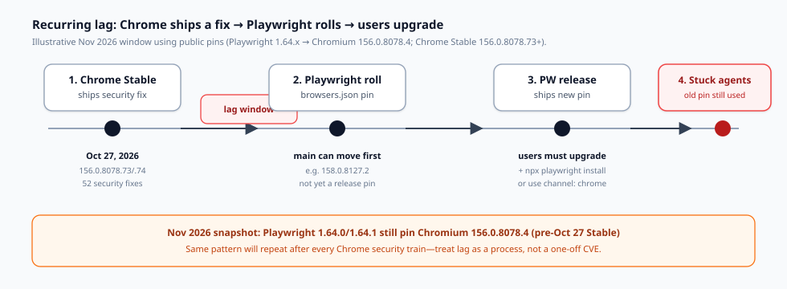
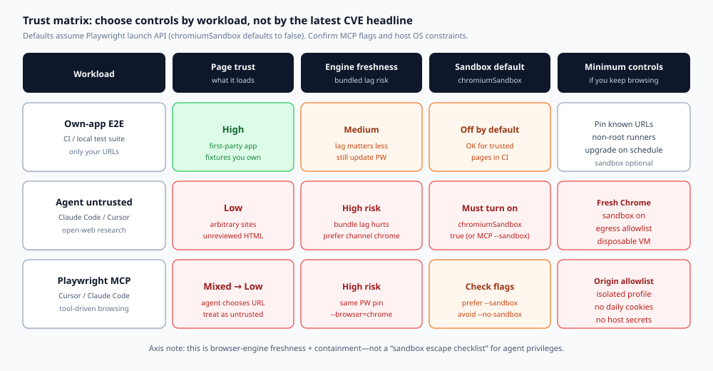

Chrome 按安全列车更新。Playwright 按发布列车更新。编程代理停留在 Playwright 上次固定的那个二进制上——而且常常在 Chromium 沙箱**关闭**的情况下启动它。

这种组合并不是 2026 年 11 月的猎奇。它是一个**反复出现的信任缺口**：每当 Google 发布 Stable 修复，仍使用较旧 Playwright 固定版本的代理浏览器都会落后，直到有人升级 Playwright *并且* 重新安装浏览器——或者直到你不再把捆绑构建用于不受信任的页面。

本指南是一份决策文档，不是 CVE 简报。它把三种工作负载——**自有应用 E2E**、**代理不受信任浏览**、**Playwright MCP**——映射到具体控制：`chromiumSandbox`、`channel: 'chrome'`、非 root 执行，以及出站允许列表。它点名 Claude Code、Cursor 与 Playwright MCP，因为滞后与日常代理工作相遇的地方正是这些产品。它有意停留在与代理权限“沙箱逃逸检查清单”不同的轴上：这里的问题是**引擎新鲜度与浏览器遏制**，而不是代理能否 `rm -rf` 你的仓库。

## 你实际在决定什么

在更改配置之前，把决定写成一句话：

> 给定这一工作负载的页面信任度与爆炸半径，我是否接受 Playwright 捆绑的 Chromium 固定版本（明知它落后于 Chrome Stable），以及在代理浏览之前，`chromiumSandbox`、品牌 Chrome、主机隔离与网络允许列表中的哪些必须开启？

如果你的答案塌缩成“有人发了一个 CVE 编号，于是恐慌”，你就会过度加固受信任的 CI，并让开放网络上的代理加固不足。下面的矩阵就是为了阻止这种情况。

## 滞后是结构性的，不是个人问题

Playwright 不会逐日自动跟踪 Chrome Stable。每个 Playwright 发布都在 `packages/playwright-core/browsers.json` 中固定浏览器构建。[Playwright 浏览器指南](https://playwright.dev/docs/browsers)写得很明确：每个 Playwright 版本都需要特定的浏览器二进制；更新 Playwright 通常意味着再次运行 `npx playwright install`。

这会形成一条可预测的序列：

1. **Chrome Stable** 发布一项安全更新。
2. **Playwright** 稍后滚动到更新的 Chromium（往往先出现在 `main` 上）。
3. 一次 **Playwright 发布** 带上新的固定版本。
4. **你**升级软件包 *并且* 安装浏览器——否则你会永远继续运行旧的固定版本。



*图 1. 反复出现的滞后窗口。除非你把 Playwright 指向已安装的 Chrome，或等待一次固定了修复后构建的 Playwright 发布，否则代理不会继承 Chrome 的 Stable 通道。*

### 一个具体的 2026 年 11 月快照（事实，而非论点）

把这个窗口用作该模式的证据——而不是文章的主干。

- Playwright **v1.64.0** 发布于 **2026-10-07**（[GitHub 发布](https://github.com/microsoft/playwright/releases/tag/v1.64.0)）。
- Playwright **v1.64.1** 的 `browsers.json` 仍然固定 Chromium **`156.0.8078.4`**（[v1.64.1 的原始 browsers.json](https://raw.githubusercontent.com/microsoft/playwright/v1.64.1/packages/playwright-core/browsers.json)）。
- Chrome Stable 在 **2026-10-27** 推进到 **`156.0.8078.73/.74`**（Windows/Mac）以及 **`156.0.8078.73`**（Linux），含 **52 项安全修复**，其中包括严重的 **CVE-2026-118306**（FileSystem 内存损坏；Chromium 严重级别为 Critical），依据 [Chrome Releases 帖子](https://chromereleases.googleblog.com/2026/10/stable-channel-update-for-desktop_0562499947.html) 与 [CVE 描述](https://www.suse.com/security/cve/CVE-2026-118306.html)。
- Playwright 的 **`main`** 可能已经显示更新的固定版本（例如 Chromium **`158.0.8127.2`**），而稳定版 npm 包仍在交付更旧的那个。在 `main` 上滚动，并不等同于你的代理已安装的包。

Google 针对 CVE-2026-118306 的公告措辞是惯常的高层严重性陈述。本文不会重构利用步骤。把该 CVE 当作**新鲜度锚点**：一项 Critical 修复已经进入 Stable，而当时的 Playwright 发布固定版本仍停留在更早的 `156.0.8078.x` 构建上。

当下一次 Chrome 安全列车到来时，预期同一张图会换成新的版本号。

## 缺口的另一半：沙箱默认关闭

新鲜度只是故事的一半。Playwright 的启动 API 将 `chromiumSandbox` 记载为：

> 启用 Chromium 沙箱。默认值为 `false`。

来源：[BrowserType.launch 选项](https://playwright.dev/docs/api/class-browsertype)。

该默认值的存在出于务实原因（容器、root、缺少 setuid 辅助程序、CI 镜像）。它仍然是编程代理环境会继承的安全默认值，除非有人主动选择开启。在没有 Chromium 沙箱的浏览器中加载不受信任的 HTML，与在当前且已启用沙箱的 Chrome 中加载同一份 HTML，属于不同的风险类别。

Playwright MCP 以 CLI 标志暴露出同样的张力：`--sandbox` 用于启用，`--no-sandbox` 用于禁用（[Playwright MCP README 选项](https://github.com/microsoft/playwright-mcp)）。Docker 示例常常展示 `--no-sandbox`，因为容器会让 Chromium 沙箱变得棘手。这种便利绝不能在无声中变成笔记本上代理的永久姿态。

**决策规则：** 对于任何可能加载并非你所编写页面的工作负载，把 `chromiumSandbox: false` / `--no-sandbox` 视为明确的风险接受——而不是“Playwright 所推荐的”。

## 三种工作负载，三种答案



*图 2. 信任矩阵。让控制措施与页面信任度及爆炸半径相匹配。不要把 CI E2E 的默认设置套用到开放网络上的代理浏览。*

### 1）自有应用 E2E（CI 与本地回归）

**页面信任度：** 高。你加载自己的应用、测试夹具，也许还有一个桩 API。

**捆绑 Chromium 滞后：** 烦人，很少紧急。你仍然希望按计划更新 Playwright，以便尽早抓住即将到来的 Chrome 破坏性变更——[浏览器文档](https://playwright.dev/docs/browsers)正是出于这个原因建议保持最新。安全紧迫性较低，因为攻击者并不能挑选你的测试 HTML。

**沙箱：** 保持默认关闭是常见的 CI 权衡。无论如何都优先使用非 root 运行器。如果你的 CI 镜像能以 `chromiumSandbox: true` 运行，就打开它；如果 zygote 因“No usable sandbox!”失败，就修复镜像（用户命名空间 / AppArmor / 非 root），而不是把 `--no-sandbox` 盲从复制到每一台开发者笔记本上。

**最低控制**

1. 固定允许的基础 URL（你的 staging / localhost）。
2. 按固定节奏维护 Playwright + `npx playwright install`（每周或每次发布）。
3. 以非 root 身份运行。
4. 不要把生产 Cookie 存放在测试配置文件中。

### 2）代理不受信任浏览（Claude Code、Cursor 代理、调研）

**页面信任度：** 低。代理会跟随链接、打开文档、“再查一个站点就好”。

**捆绑 Chromium 滞后：** **高**。这正是 Chrome→Playwright 延迟造成伤害的地方。优先选择无需等待 Playwright 下一次固定版本就能收到 Stable 安全更新的浏览器。

**沙箱：** **开启**。通过 Playwright API 启动时设置 `chromiumSandbox: true`。如果主机无法启用沙箱，就把浏览器移入一台不含主机凭据的一次性 VM/容器——而不是反过来。

**最低控制**

1. `channel: 'chrome'`（或 `msedge`），以便 Playwright 驱动已安装、会自动更新的品牌浏览器（[channel 文档](https://playwright.dev/docs/api/class-browsertype)；[Google Chrome 与 Edge 一节](https://playwright.dev/docs/browsers)）。
2. `chromiumSandbox: true`。
3. 在网络层做**出站允许列表**（代理、防火墙或 MCP 源站规则）——除你确实需要的文档域名外一律默认拒绝。
4. 一次性配置文件：没有日常浏览器的 Cookie，没有密码管理器，没有通往生产环境的 SSO 会话。
5. 优先使用一次性 VM/容器，而不是“浏览器运行在持有 AWS 密钥的同一用户之下”。

Claude Code 与 Cursor 常常经由 shell + Playwright、经由 computer-use 路径，或经由 MCP 访问网页。无论路径如何，一旦模型能够选择 URL，就把该会话归类为**不受信任浏览**。

### 3）Playwright MCP（Cursor、Claude Code、VS Code 及其同类）

官方文档指出，Playwright MCP 可用于 **VS Code、Cursor、Windsurf、Claude Code、Claude Desktop** 以及其他 MCP 客户端（[Playwright MCP 入门](https://playwright.dev/docs/getting-started-mcp)）。安装通常是 `npx @playwright/mcp@latest`。

把 MCP 视为**带工具 API 的不受信任浏览**，除非你已把源站锁定到第一方应用。

**浏览器选择：** 当你需要 Stable 的新鲜度、而不是已下载的 Chromium 固定版本时，传入 `--browser=chrome`（或 `msedge`）。支持的值包括 `chrome`、`firefox`、`webkit`、`msedge`。

**沙箱标志：** 优先使用 `--sandbox`。不要仅仅因为某段 Docker 片段用过 `--no-sandbox`，就把它固化进笔记本配置。

**网络：** `--allowed-origins` 可以列出受信任的源站。MCP 文档警告，它**并不**充当完整的安全边界，也**不会**影响重定向——因此把它与主机出站控制搭配使用，而不要只信赖单一标志。

**配置文件：** 默认的持久配置文件会在缓存路径下于会话之间保留 Cookie。对调研代理，优先使用 `--isolated`（或专用的 `--user-data-dir`），以免昨天的登录变成明天的凭据泄露。不要把自动化指向你的个人 Chrome 配置文件；Playwright 自己的文档警告不要自动化默认用户配置文件。

**危险工具：** `browser_run_code_unsafe` 在 Playwright 服务器进程中等价于 RCE。仅对受信任的客户端启用。这是代理权限风险，与 Chromium 滞后正交——但它提高了浏览会话一旦被攻破的代价。

## 能经受下一次 CVE 列车的控制措施

把这些抄成一份常设检查清单。每次 Chrome Stable 安全爆发以及每次 Playwright 升级之后都重新执行。

### A. 引擎新鲜度

- 记录 `npx playwright --version`，以及来自 `browsers.json` / `npx playwright install --list` 的 Chromium 版本。
- 在 Chrome Stable 安全帖之后，问：“我们用的是捆绑 Chromium，还是 `channel: 'chrome'`？”
- 如果是捆绑版本：要么等待一次固定了修复后构建的 Playwright 发布，然后执行 `npm install` + `npx playwright install`，**或者**现在就把不受信任的工作负载切换到品牌 Chrome。
- 不要假定 `main` 的 browsers.json 就是你的代理正在运行的内容。

### B. Chromium 沙箱

- 库/API：`chromium.launch({ chromiumSandbox: true, ... })` / 配置 `use` 中的等价写法。
- MCP：`--sandbox`；除非环境不如此就无法启动，否则不要设置 `--no-sandbox`——然后隔离该环境。
- 如果沙箱无法启动，就整治主机（非 root、用户命名空间），而不是永久关闭代理的遏制。

### C. 非 root 主机

- 不要为了“让 CI 变绿”而以 root 运行代理浏览器。
- Root + `--no-sandbox` 是常见的容器模式。把它留在只访问受信任 URL 的 CI 镜像中，不要留在为代理浏览开放网络的开发者机器上。

### D. 出站允许列表

- 对代理浏览器进程优先采用默认拒绝的出站。
- 只允许任务所需的域名；扩大时要有意为之。
- 对 MCP，把源站允许列表与操作系统/网络策略结合起来。记住，重定向可以让流量离开源站列表。

### E. 凭据卫生

- 代理与人类使用各自独立的配置文件。
- 代理浏览器中不要出现生产云控制台、银行业务，或密码管理器解锁。
- 轮换任何在沙箱/新鲜度控制薄弱期间可能接触过不受信任 HTML 的 Cookie 罐。

## 轴检查：为什么这不是一篇“沙箱逃逸”文章

安全 Twitter 常常把两个不同的问题混在一起：

1. **浏览器引擎滞后 + Chromium 沙箱默认值**（本文）。
2. **代理沙箱逃逸 / 权限检查**——编程代理能否逃出其工具牢笼、写到工作区之外，或滥用主机 API。

它们共用“沙箱”这个词。它们并不共用同一份修复清单。逃逸检查清单谈的是 FS 权限、批准提示与工具策略。这份检查清单谈的是**你启动的是哪一个 Chromium**、**Chromium 的**沙箱是否开启，以及该浏览器在网络上能通信到多远。

如果你只做逃逸演练，你仍然可能在带 `--no-sandbox` 的旧固定版本上接触那些已有 Critical 补丁的 Chrome 漏洞。如果你只提升 Chromium 版本，你仍然可能给代理一个共享你 SSO Cookie 的浏览器。两条轨道都要做；不要把它们塌缩成一条。

## 配置模式（仅防御）

这些片段是配置检查，不是攻击配方。请按你的技术栈改编。

**Playwright Test — 不受信任 / 代理辅助项目**

```ts
import { defineConfig, devices } from '@playwright/test';

export default defineConfig({
  projects: [
    {
      name: 'agent-untrusted-chrome',
      use: {
        ...devices['Desktop Chrome'],
        channel: 'chrome',
        chromiumSandbox: true,
        launchOptions: {
          // Keep args minimal; do not add --no-sandbox here.
        },
      },
    },
  ],
});
```

**库启动 — 同一姿态**

```js
const browser = await chromium.launch({
  channel: 'chrome',
  chromiumSandbox: true,
  headless: true,
});
```

**Playwright MCP — Cursor / Claude Code 参数草图**

```json
{
  "mcpServers": {
    "playwright": {
      "command": "npx",
      "args": [
        "@playwright/mcp@latest",
        "--browser=chrome",
        "--sandbox",
        "--isolated",
        "--allowed-origins=https://docs.example.com;https://developer.example.com"
      ]
    }
  }
}
```

评审中要紧的说明：

1. `--allowed-origins` 是信任提示，不是完整边界；仍要在主机或代理处强制执行出站控制。
2. 如果某台机器上缺少 Chrome，就有意安装它——或者失败关闭——而不是在不受信任的工作中静默回退到旧的捆绑固定版本。
3. 对于 CI 中的自有应用 E2E，单独的项目可以为封闭浏览器保留捆绑 Chromium；不要把该项目的启动选项复用到开放网络的代理会话。

## 决策示例

**示例 A — monorepo CI。** Playwright 访问 `http://localhost:3000` 和一个模拟 API。标签：自有应用 E2E。若你希望 CI 可复现，就保留封闭的 Chromium。安排每周的 Playwright 升级。非 root。镜像支持时开启沙箱。没有开放出站。

**示例 B — Cursor 代理“读这篇 RFC 以及竞品博客文章”。** 标签：不受信任。要求 `channel: 'chrome'` 或 MCP `--browser=chrome`，沙箱开启，隔离的配置文件，允许列表仅限 RFC 主机再加一个文档 CDN，在专用操作系统用户下运行，且该用户的 `PATH` 凭据中没有云 CLI。

**示例 C — Claude Code 调试团队所拥有的客户 staging 站点。** 这仍然不是“互联网上的随机站点”，但也并非完全的第一方。优先品牌 Chrome + 沙箱开启 + 允许列表仅限 staging 主机名。不要复用持有生产管理 Cookie 的工程师个人配置文件。

**示例 D — 有人把带 `--no-sandbox` 的一行 Docker MCP 配置粘贴进笔记本上的 Cursor 配置。** 在评审中拒绝。需要 `--no-sandbox` 的容器应当是一次性的并锁定网络；笔记本不应靠复制粘贴继承该标志。

## 面向使用 Claude Code 与 Cursor 的团队的实际推广

**第 1 步 — 盘点。** 列出为代理启动浏览器的每一条路径：Playwright 测试配置、临时脚本、Playwright MCP 服务器参数、computer-use 运行器、内部的“浏览这个”工具。

**第 2 步 — 为每条路径贴标签**，标为自有应用 E2E 或不受信任。如果不确定，就标为不受信任。

**第 3 步 — 应用矩阵。** 不受信任路径获得品牌 Chrome（或等价的当前通道）、开启沙箱、允许列表出站、隔离配置文件、非 root。E2E 路径获得按计划的 Playwright 升级与 URL 固定；运行器支持时开启沙箱。

**第 4 步 — 让新鲜度可观察。** 增加一个每周任务，打印 Playwright 版本 + Chromium 固定版本 + Chrome Stable 版本。当 Stable 因一次安全发布而领先于你的固定版本时，自动为不受信任工作负载开一张工单。

**第 5 步 — 写下例外。** 任何 `--no-sandbox` 或在开放网络上使用捆绑 Chromium 的例外，都需要一名负责人、一个到期日，以及一项补偿控制（通常是一台锁定的 VM）。

## 六个月后“好”是什么样子

你仍会看到 Chrome 安全帖。Playwright 仍会按每次发布固定浏览器。这一点不会消失。

应当消失的：

- 开发者笔记本上的代理，使用 Playwright 默认未开启沙箱的捆绑 Chromium 浏览任意站点。
- 从 Docker 复制来的、以“因为示例这么做”为由关闭沙箱的 MCP 配置。
- 停在引用一个 CVE 编号、却不对工作负载分类的安全响应。

应当留下的：

- 一份活的信任矩阵。
- 与 Chrome Stable 绑定的新鲜度监控。
- 对更弱遏制的显式选择加入。

## 来源（一手）

- Playwright v1.64.1 的 `browsers.json` 固定版本：Chromium `156.0.8078.4` — [原始文件](https://raw.githubusercontent.com/microsoft/playwright/v1.64.1/packages/playwright-core/browsers.json)
- Playwright v1.64.0 发布日期 — [GitHub Releases](https://github.com/microsoft/playwright/releases/tag/v1.64.0)
- Playwright `chromiumSandbox` 默认值 `false` — [BrowserType 文档](https://playwright.dev/docs/api/class-browsertype)
- Playwright 浏览器更新 / `channel` / 品牌 Chrome 指引 — [浏览器文档](https://playwright.dev/docs/browsers)
- Chrome Stable 156.0.8078.73/.74，52 项安全修复，包括 CVE-2026-118306 — [Chrome Releases，2026-10-27](https://chromereleases.googleblog.com/2026/10/stable-channel-update-for-desktop_0562499947.html)
- CVE-2026-118306 的高层描述 — [SUSE CVE 页面](https://www.suse.com/security/cve/CVE-2026-118306.html)
- Playwright MCP 客户端（Cursor、Claude Code、…）、浏览器标志、配置文件 — [Playwright MCP 文档](https://playwright.dev/docs/getting-started-mcp) 与 [MCP README 选项](https://github.com/microsoft/playwright-mcp)

下一次 Chrome 安全列车会带来新的版本号。你的决策矩阵应当不需要重写——只需要一次新鲜度检查。
